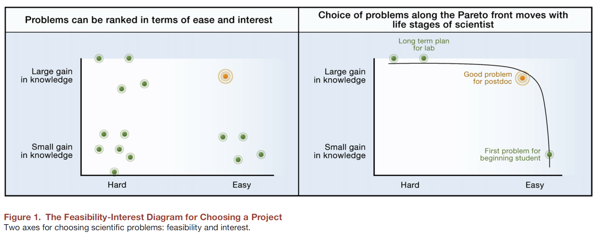
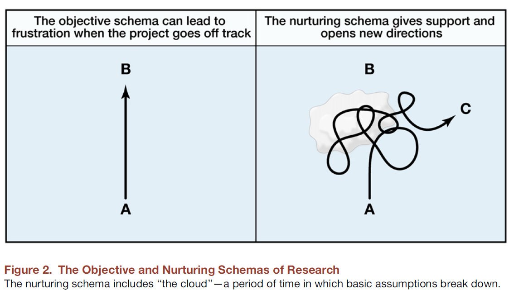

## O percurso deste capítulo

No capítulo anterior, discutimos o método científico como um protocolo para produzir conhecimento.

Agora, partimos desse protocolo para organizar o percurso da investigação:

```{mermaid}
flowchart LR
    A[Problema] --> B[Pergunta]
    B --> C[Dados]
    C --> D[Evidência]
    D --> E[Conclusão]
```

O método orienta a investigação, mas não define automaticamente **o que perguntar**, **quais dados procurar** ou **o que podemos concluir**. Essas decisões precisam permanecer conectadas durante toda a pesquisa. Uma pergunta bem formulada orienta a construção dos dados; os dados delimitam as evidências que podem ser produzidas; e essas evidências definem o alcance legítimo da conclusão.

## Como escolher uma boa pergunta

### Escolher a pergunta também é fazer pesquisa

> “Escolher bons problemas é essencial para ser um bom cientista.”  
> — Uri Alon (2009)

Escolher a pergunta organiza as decisões tomadas ao longo da investigação e delimita a contribuição pretendida. A escolha também expressa quais problemas o pesquisador considera relevantes e como pretende examiná-los.

### O papel do grupo de pesquisa

O grupo de pesquisa oferece condições para discutir problemas, apresentar ideias, reconhecer dificuldades e reformular caminhos. Também auxilia na escolha de questões compatíveis com a formação e com as condições de execução do pesquisador. Esse apoio não substitui a responsabilidade do pesquisador pela pergunta escolhida.

### O que é um bom problema?

Um bom problema científico deve ser:

- **Viável**: possível de realizar com os recursos e o tempo disponíveis.
- **Interessante**: capaz de gerar conhecimento real.
- **Motivador**: capaz de sustentar o interesse do pesquisador durante a investigação.
- **Formador**: permite crescimento e aprendizado.

### Os dois eixos: viabilidade e interesse

{width=50%}

Na figura, o **eixo X representa a viabilidade**, considerada a partir do tempo necessário para a conclusão e das habilidades disponíveis no grupo. O **eixo Y representa o interesse**, definido pela distância em relação ao conhecimento existente e pela contribuição esperada.

O objetivo é formular problemas que combinem viabilidade e interesse. Uma pergunta que não possa ser investigada com o tempo, os dados e as habilidades disponíveis não constitui um projeto executável. De modo semelhante, uma pergunta de execução simples, mas sem contribuição identificável, pode não justificar a investigação.

### A pergunta depende do estágio da pesquisa

Estudantes de graduação no começo da carreira tendem a se beneficiar de problemas mais delimitados, com retornos suficientemente rápidos para que possam aprender o processo de pesquisa. Estudantes de pós-graduação podem avançar no eixo do interesse, mas ainda precisam considerar prazos e condições de execução. Pesquisadores experientes, por sua vez, podem se aventurar em problemas difíceis e inovadores, com horizontes mais longos e possibilidade de divisão em subprojetos. Por isso, a mesma pergunta pode ser apropriada para um pesquisador e inviável para outro.

### A importância da exploração inicial

Aceitar o primeiro problema identificado pode comprometer o desenvolvimento da pesquisa. O tempo dedicado à escolha pode evitar o investimento prolongado em uma direção que posteriormente se revele inviável. Ler, discutir, conhecer os dados e planejar **também é pesquisa**. Ter uma pergunta definida não significa conhecer antecipadamente as respostas.

Uri Alon propõe que estudantes não se comprometam imediatamente com um projeto: antes disso, precisam explorar possibilidades.

### A voz interna

Quem decide como ordenar o interesse dos diferentes problemas?

O interesse possui uma dimensão **subjetiva** e **pessoal**. A relação do pesquisador com o problema contribui para a continuidade do trabalho. A orientação pode auxiliar na identificação das questões que mobilizam sua curiosidade e na avaliação de sua viabilidade científica.

> “Se eu fosse a única pessoa no mundo, qual desses problemas eu gostaria de resolver?”

### Pesquisa como expressão

O projeto selecionado expressa o modo como o pesquisador percebe o mundo e define o que considera relevante para investigação. Diferentes trajetórias conduzem a distintas questões, estratégias e contribuições. A pesquisa também constitui uma forma de expressão intelectual, desde que as escolhas sejam submetidas aos procedimentos de verificação exigidos pelo método científico.

## A jornada da pesquisa

### Do ideal ao real

{width=70%}

O primeiro esquema representa uma linha reta entre a pergunta **A** e a resposta esperada **B**.

O segundo representa o caminho real: não linear, marcado por incertezas, resultados inesperados e descobertas.

### O caminho real

No caminho idealizado, os desvios não são tolerados e a resposta B continua sendo perseguida mesmo quando o custo se torna muito alto. O compromisso rígido com a resposta esperada pode, assim, gerar frustração.

No caminho real, experimentos e estratégias podem não funcionar, e algumas suposições se mostram inadequadas. Uma fase de confusão pode permitir a entrada do desconhecido e conduzir a uma resposta **C**, mais interessante e viável que **B**.

### Quando a pergunta precisa mudar

É normal reformular a pergunta quando conhecemos melhor a literatura, o campo e os dados.

Entretanto, a mudança precisa ser consciente e registrada.

Reformular não significa abandonar a pesquisa. A mudança pode delimitar melhor o fenômeno, adequar o alcance da pergunta, reconhecer uma limitação da fonte, identificar uma questão mais interessante ou seguir uma descoberta que não estava prevista.

## Da pergunta aos dados

### Uma pergunta precisa ser investigável

Uma pergunta não é adequada apenas porque parece interessante. Precisamos compreender quais informações seriam necessárias para respondê-la, o que cada registro deverá representar e quais grupos, períodos e lugares serão observados. Também é necessário distinguir as informações já disponíveis daquelas que precisarão ser construídas e reconhecer as limitações impostas pela fonte à análise.

## Exemplo jurídico: violência psicológica

### Do problema à pergunta

A Lei nº 14.188/2021 introduziu no Código Penal o crime de violência psicológica contra a mulher, previsto no artigo 147-B.

Uma inquietação inicial pode ser formulada de maneira ampla:

> A criminalização ampliou a proteção das mulheres contra a violência psicológica?

Para produzir evidências, precisamos transformar essa inquietação em perguntas empiricamente investigáveis.

### Uma pergunta investigável

> Como o artigo 147-B tem sido mobilizado nas denúncias e nas decisões de primeira instância do Tribunal de Justiça de São Paulo?

Essa formulação delimita o dispositivo jurídico observado, os documentos examinados, a etapa do processo judicial, o tribunal de interesse e o tipo de prática institucional que será descrita.

Ela não resolve, por si só, todos os problemas da investigação. Mas orienta a procura pelos dados.

### Da pergunta às informações necessárias

Para responder à pergunta, precisamos identificar, entre outras informações:

- os dispositivos legais mencionados na denúncia;
- os dispositivos aplicados na sentença;
- o resultado do julgamento;
- a ocorrência isolada ou conjunta dos tipos penais;
- a data da decisão;
- o assunto utilizado na busca;
- características processuais relevantes para interpretar o caso.

Primeiro descrevemos a informação necessária. Depois procuramos onde e como ela pode ser obtida.

### O que cada linha representa?

A **unidade de observação** é o elemento representado por cada linha da base.

Em pesquisas jurídicas, uma linha pode representar:

- um processo;
- uma decisão;
- uma sentença;
- uma denúncia;
- um recurso;
- uma parte processual;
- uma ocorrência registrada dentro do processo.

Antes de contar linhas, calcular proporções ou remover duplicidades, precisamos perguntar: **o que cada linha representa?** Essa definição condiciona toda a análise posterior, pois determina o significado das contagens, das comparações e das medidas construídas a partir da base.

### Documentos diferentes, unidades diferentes

Uma pesquisa pode coletar processos e analisar mais de um documento de cada processo.

No estudo sobre o artigo 147-B, foram identificados 2.215 processos a partir dos parâmetros de busca. Depois da exclusão de duplicidades, permaneceram 2.211 processos. Foram coletadas 2.207 sentenças e analisadas 2.112 denúncias correspondentes.

Esses números não são equivalentes. Processo, sentença e denúncia cumprem papéis distintos na investigação.

### População, corpus e amostra

A **população** é o conjunto de unidades sobre o qual desejamos produzir informação.

O **corpus** reúne os documentos efetivamente localizados e selecionados para a análise.

Uma **amostra** é uma parcela da população observada segundo determinado procedimento.

Em pesquisas com decisões judiciais, o material recuperado por mecanismos de consulta não deve ser apresentado automaticamente como a totalidade das decisões existentes.

### Recortes temporal e institucional

A pergunta precisa ser compatível com a cobertura dos dados.

No exemplo do artigo 147-B, o recorte compreende processos julgados em primeira instância no Tribunal de Justiça de São Paulo, entre 28 de julho de 2021 e 8 de outubro de 2024. As decisões foram recuperadas por palavras-chave e assuntos jurídicos definidos na consulta.

Tribunal, instância, período, documento e parâmetros de busca fazem parte da definição da pesquisa.

### Dos documentos às variáveis

Uma pergunta jurídica raramente corresponde diretamente a uma coluna pronta.

| Tipo | Exemplo jurídico |
|---|---|
| **Informação disponível** | número do processo ou data da decisão |
| **Informação extraída** | artigo indicado na denúncia ou aplicado na sentença |
| **Variável recodificada** | agrupamento dos dispositivos por tipo de violência |
| **Indicador construído** | aplicação ou não do artigo 147-B |
| **Medida calculada** | proporção de sentenças em que o artigo foi aplicado |

### Da evidência ao argumento

Depois de transformar os documentos em variáveis, podemos examinar como os diferentes tipos penais aparecem nas decisões. No artigo que orienta este exemplo, um dos resultados centrais é a baixa frequência com que o artigo 147-B aparece isoladamente como fundamento da condenação. O quadro a seguir reproduz o resultado apresentado pelos autores.

**Quadro — Condenação isolada por artigo com e sem a presença de agravantes.** Reprodução do Quadro 4, com adaptação de formato.

| Artigo | Frequência (%) |
|---|---:|
| Art. 147 do Código Penal | 314 (19,5%) |
| Art. 147-A do Código Penal | 211 (13,1%) |
| Art. 129, §§ 9º e 13, do Código Penal | 174 (10,9%) |
| Art. 24-A da Lei Maria da Penha | 172 (10,7%) |
| Art. 147-B do Código Penal | 32 (1,2%) |
| Art. 21 do Decreto-Lei nº 3.688/1941 | 17 (1%) |
| Art. 150 do Código Penal | 7 (0,43%) |
| Art. 213 do Código Penal | 1 (0,06%) |
| Art. 121, § 2º-A, do Código Penal | 0 (0%) |
| **Total** | **928 (57,7%)** |

**Fonte:** reprodução, com adaptação de formato, do Quadro 4 de Goto, Severi e Nicolella, *Criminalizar é proteger? Um estudo sobre a aplicação do Art. 147-B nos casos de violência psicológica contra mulheres no TJSP*.

Entre os 1.609 processos julgados integralmente procedentes considerados nessa etapa do estudo, o artigo 147-B apareceu isoladamente em 32 sentenças, correspondentes a 1,2% do total analisado. Ameaça, perseguição, lesão corporal e descumprimento de medida protetiva apresentaram frequências superiores. O resultado sustenta a afirmação delimitada de que a aplicação isolada do artigo 147-B foi baixa no corpus e no período examinados.

O quadro, entretanto, não permite concluir sozinho que a criminalização foi ineficaz ou que não ampliou a proteção das mulheres. Essa conclusão exigiria outras evidências e um desenho capaz de avaliar os efeitos da mudança legislativa. A diferença entre essas duas afirmações mostra por que a conclusão precisa respeitar a pergunta, os dados e a estratégia de análise.

### Os dados realmente permitem responder?

Antes da análise, precisamos avaliar:

| Dimensão | Pergunta de verificação |
|---|---|
| Cobertura | A fonte observa o tribunal, o período e os documentos de interesse? |
| Unidade | Cada registro representa a unidade necessária para a pergunta? |
| Conceito | A variável representa o fenômeno jurídico que pretendemos estudar? |
| Consistência | Os documentos e critérios mantêm significado comparável? |
| Acesso | Os dados e a documentação podem ser obtidos e reutilizados? |
| Rastreabilidade | Conseguimos reconstruir as etapas da coleta e da classificação? |

### Não adapte silenciosamente a pergunta à base

Se a fonte não contém a informação necessária, existem pelo menos três possibilidades:

1. procurar outra fonte;
2. reformular justificadamente a pergunta;
3. reconhecer que a investigação não é viável nas condições atuais.

Não devemos substituir a pergunta original por outra apenas porque a nova pergunta é mais fácil de responder com a primeira base encontrada.

A mudança precisa ser consciente, justificada e documentada.

## Dos dados à evidência

### Perguntas diferentes exigem evidências diferentes

- **Descrição:** o que está acontecendo?
- **Associação:** o que varia conjuntamente?
- **Explicação:** por que o padrão pode ocorrer?
- **Causalidade:** o que aconteceria se determinado fator mudasse?

Essa sequência representa uma progressão na exigência da evidência, não uma escala de importância.

Uma análise descritiva compatível com os dados pode oferecer conclusões mais sustentadas do que uma tentativa de demonstrar causalidade sem desenho adequado.

### Perguntas diferentes sobre o mesmo fenômeno

Sobre o artigo 147-B, podemos perguntar:

- **Descrição:** com que frequência o artigo aparece nas denúncias e nas sentenças?
- **Comparação:** a utilização do artigo difere entre a denúncia e a sentença?
- **Explicação:** quais dificuldades jurídicas e probatórias podem ajudar a compreender sua baixa aplicação?
- **Causalidade:** a criação do tipo penal produziu mudanças na proteção das mulheres?

Essas perguntas exigem dados, desenhos e linguagens de conclusão diferentes.

### Uma associação não responde automaticamente ao porquê

Observar um padrão não demonstra, por si só, o mecanismo que o produziu.

Os dados podem ser consistentes com uma explicação, mas também podem admitir explicações concorrentes.

Pergunte:

- que mecanismo poderia produzir o padrão observado?
- que outras explicações também seriam plausíveis?
- que novas observações fortaleceriam ou enfraqueceriam cada explicação?

## Exemplo jurídico: violência de gênero digital

### A pergunta

> Como os elementos probatórios registrados nos acórdãos se relacionam com o reconhecimento de sua suficiência e com os desfechos das demandas cíveis de violência de gênero digital?

A pergunta conecta os tipos de prova apresentados, a avaliação judicial de sua suficiência e os resultados das demandas reparatórias.

### Os dados e o desenho

A investigação utiliza 642 acórdãos de apelação, provenientes de seis Tribunais de Justiça brasileiros e proferidos entre 2010 e 2025. O desenho combina uma análise quantitativa do conjunto dos acórdãos com uma análise qualitativa aprofundada de oito decisões envolvendo plataformas digitais.

A unidade de observação da análise quantitativa é o **acórdão de apelação**.

### O que a evidência permite afirmar?

Os dados permitem descrever os tipos de prova mencionados nos acórdãos, examinar associações entre provas, suficiência probatória e resultados e comparar padrões entre os contextos e tribunais representados na base. A análise qualitativa permite examinar as justificativas utilizadas em decisões selecionadas e discutir a atuação das plataformas na preservação e no fornecimento de dados.

Essas evidências não permitem generalizar automaticamente os resultados para todo o sistema de justiça brasileiro.

### As limitações fazem parte da evidência

- São Paulo e Paraná concentram a maior parte das decisões da base.
- O corpus está restrito a acórdãos de apelação.
- Decisões de primeira instância e outros recursos não integram a análise quantitativa.
- Os acórdãos nem sempre reproduzem todos os elementos das peças e das provas existentes nos autos.
- A informação registrada depende do conteúdo que os julgadores decidiram incluir nos relatórios e votos.

As limitações definem o alcance da conclusão; não são um apêndice dispensável da pesquisa. Explicitá-las permite distinguir aquilo que foi efetivamente observado das interpretações que ultrapassariam a cobertura dos documentos e o desenho adotado.

## Da evidência à conclusão

### A conclusão precisa responder à pergunta

Uma análise pode estar tecnicamente correta e, ainda assim, produzir uma conclusão inadequada.

Isso ocorre quando afirmamos mais do que os dados e o desenho da investigação permitem sustentar.

A conclusão deve preservar a conexão entre todas as etapas da investigação:

```{mermaid}
flowchart LR
    A[Pergunta] --> B[Dados]
    B --> C[Estratégia de análise]
    C --> D[Evidência]
    D --> E[Conclusão]
```

### Dizer apenas o que a evidência sustenta

| Evidência produzida | Formulações adequadas |
|---|---|
| Descrição | “observamos”; “a proporção foi”; “o grupo apresentou” |
| Associação | “está associado”; “varia conjuntamente”; “há diferença” |
| Evidência sobre um mecanismo | “o padrão é consistente com”; “os resultados apoiam a hipótese” |
| Desenho causal defensável | “estimamos o efeito, sob as hipóteses apresentadas” |

Palavras como “causa”, “determina”, “produz” ou “comprova” exigem justificativas adicionais.

### Preservar o contexto da análise

O período, o recorte institucional, a fonte e a construção das variáveis fazem parte da conclusão.

Em vez de afirmar:

> O Judiciário não aplica o artigo 147-B.

Uma formulação compatível com uma investigação delimitada poderia ser:

> Nas denúncias e sentenças de primeira instância do TJSP recuperadas pelos critérios adotados, entre 2021 e 2024, observamos baixa aplicação do artigo 147-B.

### A pergunta amadurece durante a pesquisa

O percurso não termina exatamente como foi inicialmente imaginado. A leitura modifica a pergunta, os dados revelam limitações e possibilidades e a análise pode produzir resultados inesperados. A conclusão, por sua vez, pode abrir uma nova pergunta.

Reformular não encerra a pesquisa. É necessário registrar o que mudou, por que mudou e como essa mudança afeta o alcance da investigação.

## Síntese

### Os oito insumos na produção científica

A análise de Scott Cunningham sobre William Shockley destaca oito capacidades:

1. identificar um bom problema;
2. trabalhar de forma eficaz nesse problema;
3. reconhecer um resultado que valha a pena;
4. decidir quando parar e redigir os resultados;
5. escrever de forma adequada;
6. aproveitar construtivamente as críticas;
7. submeter o trabalho a um periódico;
8. persistir nas revisões, especialmente quando solicitadas por pareceristas.

## Atividade

### Formule uma pergunta de jurimetria

Escolha um problema jurídico que desperte seu interesse e registre:

- **Problema:** qual fenômeno ou dificuldade chama sua atenção?
- **Pergunta:** o que exatamente você pretende investigar?
- **Unidade de observação:** o que cada linha da futura base representará?
- **Corpus ou fonte:** onde estarão os documentos ou registros necessários?
- **Recortes:** qual tribunal, período, instância, grupo ou território?
- **Evidência pretendida:** descrição, associação, explicação ou causalidade?
- **Conclusão possível:** o que os dados e o desenho permitirão afirmar?
- **Limites:** o que a investigação não permitirá concluir?

### Verificação final

- A pergunta é interessante e viável?
- Sabemos quais informações são necessárias?
- A unidade de observação está definida?
- A fonte cobre o grupo, o período e o contexto da pergunta?
- A pergunta e a conclusão pretendida estão no mesmo nível?
- Consideramos explicações alternativas?
- A linguagem preserva o alcance e os limites da análise?
- Conseguimos explicar por que essa investigação merece ser realizada?

## Slides do capítulo

[Ver os slides — Da Pergunta à Conclusão](../slides/fundamentos/pergunta-dados-evidencia/index.html){.btn .btn-primary target="_blank"}
