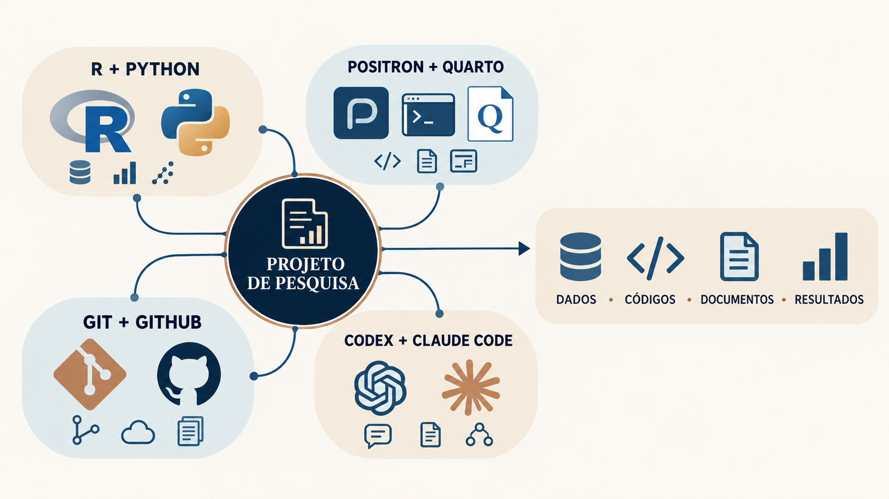

## Introdução

A pesquisa jurimétrica não é formada apenas por uma base de dados ou por um script. Ela articula uma pergunta jurídica, documentos, dados, procedimentos de coleta e tratamento, códigos, resultados e interpretações. Para que essas etapas possam ser examinadas e reproduzidas, precisamos construir um sistema de trabalho no qual cada elemento tenha uma função identificável.

Esse sistema combina ferramentas distintas. R e Python executam procedimentos de coleta, organização e análise. O Positron oferece uma interface para escrever códigos, acessar o terminal, acompanhar objetos e organizar os arquivos. O Quarto reúne texto, código e resultados em um mesmo documento. O Git registra as alterações realizadas no projeto, enquanto o GitHub permite hospedar o repositório e apoiar a colaboração. Codex e Claude Code podem consultar os arquivos e auxiliar em tarefas delimitadas pelos pesquisadores.

As ferramentas não substituem a formulação da pergunta, a escolha das fontes ou a interpretação dos resultados. Elas oferecem meios para registrar e executar o percurso da pesquisa. A definição dos objetivos, as decisões metodológicas e a validação dos produtos permanecem sob responsabilidade dos pesquisadores.

Este capítulo apresenta a arquitetura geral desse ambiente e o percurso que será desenvolvido na Parte II. Nos capítulos seguintes, cada componente será explicado antes de sua instalação e configuração. Depois, utilizaremos um exemplo com dados jurídicos para mostrar o funcionamento conjunto do sistema. A introdução ao R permanecerá ao final como aprofundamento opcional.

Os procedimentos serão apresentados inicialmente para o Windows. Os conceitos também se aplicam a outros sistemas operacionais, mas os caminhos, as telas e alguns comandos podem ser diferentes. Interfaces e instaladores também podem mudar entre versões; por isso, além de reproduzir os passos, verificaremos o resultado esperado de cada instalação.

::: {.callout-note title="Objetivos da Parte II"}

Ao final deste percurso, você deverá ser capaz de:

- explicar a função de R, Python, Positron, Quarto, Git, GitHub, Codex e Claude Code no ambiente de pesquisa;
- distinguir uma linguagem de programação de uma IDE;
- instalar e verificar R e Python;
- instalar o Positron, conectá-lo às linguagens e localizar editor, console, terminal, arquivos, objetos e gráficos;
- instalar o Quarto e renderizar um documento simples;
- distinguir Git de GitHub e verificar a instalação do Git;
- compreender como agentes de inteligência artificial acessam e auxiliam um projeto sob supervisão humana;
- verificar o funcionamento conjunto das ferramentas em um exemplo breve.

:::

## O ecossistema de trabalho

O centro do ambiente é o projeto. É nele que a pergunta de pesquisa se relaciona com as fontes, os dados, os códigos, os documentos e os resultados. As ferramentas são incorporadas ao projeto de acordo com a função que desempenham.

| Componente | Função no ambiente |
|---|---|
| R | organizar, transformar, analisar e representar dados |
| Python | apoiar coleta, extração de informações, automação e análise |
| Positron | reunir edição, execução, terminal, arquivos, objetos e gráficos |
| Quarto | integrar texto, código e resultados em documentos reproduzíveis |
| Git | registrar o histórico de alterações dos arquivos |
| GitHub | hospedar o repositório e apoiar compartilhamento e colaboração |
| Codex e Claude Code | auxiliar em tarefas realizadas sobre os arquivos do projeto |

Essa divisão não cria etapas independentes. Um documento Quarto pode executar código em R ou Python; o Positron permite editar esse documento e acompanhar sua execução; o Git registra as alterações realizadas; e os agentes podem auxiliar na leitura, na documentação ou na revisão dos arquivos. A integração ocorre porque todos trabalham sobre o mesmo projeto.

{#fig-ecossistema-integrado fig-align="center" width="100%"}

O projeto conecta os componentes do ambiente. R e Python executam procedimentos; o Positron oferece o espaço de trabalho; o Quarto combina a exposição escrita com códigos e resultados; Git e GitHub apoiam o registro das versões e a colaboração; Codex e Claude Code auxiliam em tarefas delimitadas. Dados, códigos, documentos e resultados permanecem relacionados porque integram a mesma estrutura de pesquisa.

## O livro como exemplo de integração

O próprio Livro de Jurimetria oferece um exemplo desse ecossistema. O texto que está sendo lido foi escrito em arquivos-fonte e convertido em uma página por meio do Quarto. Os capítulos, as imagens, os dados, os códigos e as referências são organizados em uma estrutura comum. Os procedimentos de análise apresentados no livro podem ser executados em R e, quando a tarefa exigir, em Python. O Positron permite acessar esses componentes no mesmo ambiente de trabalho.

As alterações dos arquivos podem ser acompanhadas com Git e compartilhadas por meio de um repositório no GitHub. Agentes de inteligência artificial podem auxiliar na organização, na revisão e na verificação técnica, desde que atuem de acordo com as regras do projeto e sob decisão dos autores. A página visualizada pelo leitor é, portanto, um dos resultados produzidos por esse sistema de trabalho; ela não é um arquivo isolado, mas a saída de um projeto que relaciona fontes, ferramentas e decisões editoriais.

```{mermaid}
%%| fig-align: center
%%| fig-alt: "Produção do Livro de Jurimetria como exemplo de integração entre arquivos, ferramentas e página publicada"

flowchart LR
    A["Projeto do livro"] --> B["Capítulos, imagens,<br/>dados e referências"]
    B --> C["R e Python<br/>procedimentos"]
    B --> D["Quarto<br/>composição do documento"]
    C --> D
    E["Positron<br/>ambiente de trabalho"] --> B
    F["Git e GitHub<br/>histórico e colaboração"] --> A
    G["Agentes<br/>apoio supervisionado"] -.-> A
    D --> H["Livro em HTML"]

    classDef etapa fill:#E8EEF5,stroke:#415A77,stroke-width:2px,color:#233F56;
    classDef projeto fill:#F4E9D7,stroke:#B49A68,stroke-width:2px,color:#233F56;
    classDef resultado fill:#E3EFE8,stroke:#4F7C64,stroke-width:2px,color:#233F56;
    class A projeto;
    class B,C,D,E,F,G etapa;
    class H resultado;
```

## Percurso dos próximos capítulos

Os componentes apresentados aqui serão tratados em capítulos próprios. A divisão permite explicar a função de cada ferramenta, orientar sua instalação e verificar seu funcionamento antes de utilizá-la na construção do projeto de pesquisa.

```{mermaid}
%%| fig-align: center
%%| fig-alt: "Percurso dos capítulos seguintes da Parte II"

flowchart LR
    A["R e Python<br/>linguagens"] --> B["Positron e Quarto<br/>trabalho e publicação"]
    B --> C["Git e GitHub<br/>versionamento e colaboração"]
    C --> D["Codex e Claude Code<br/>agentes no projeto"]
    D --> E["Exemplo integrado<br/>funcionamento do ecossistema"]
    E --> F["Introdução ao R<br/>aprofundamento opcional"]

    classDef etapa fill:#E8EEF5,stroke:#415A77,stroke-width:2px,color:#233F56;
    classDef resultado fill:#E3EFE8,stroke:#4F7C64,stroke-width:2px,color:#233F56;
    class A,B,C,D,F etapa;
    class E resultado;
```

O primeiro capítulo apresentará R e Python e mostrará como instalar e verificar as duas linguagens. O segundo tratará do Positron como ambiente de trabalho e do Quarto como sistema para combinar texto, código e resultados. O terceiro distinguirá Git e GitHub, incluindo a criação da conta necessária à colaboração remota. O quarto apresentará Codex e Claude Code como extensões utilizadas no Positron e como agentes que atuam sobre os arquivos do projeto. Em seguida, o exemplo integrado reunirá esses componentes na criação de um projeto jurídico de pequena escala. A introdução ao R encerrará a parte como material de aprofundamento, com ênfase no `tidyverse` e no `dplyr`.

Esse percurso prepara o ambiente que será utilizado nas etapas posteriores do livro. A finalidade não é acumular programas, mas estabelecer uma estrutura na qual os procedimentos possam ser identificados, executados e examinados.
