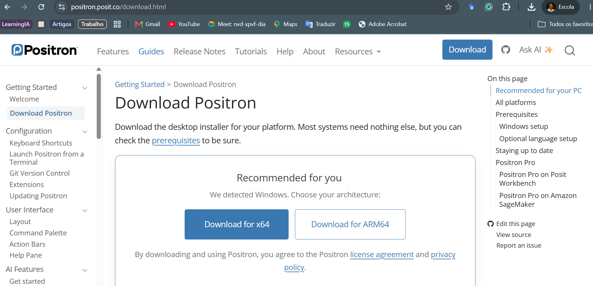
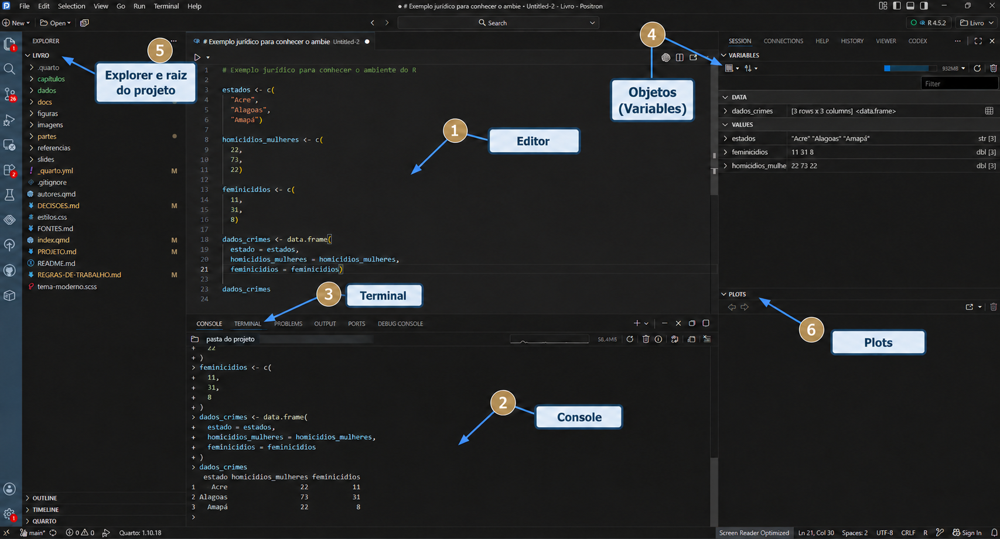
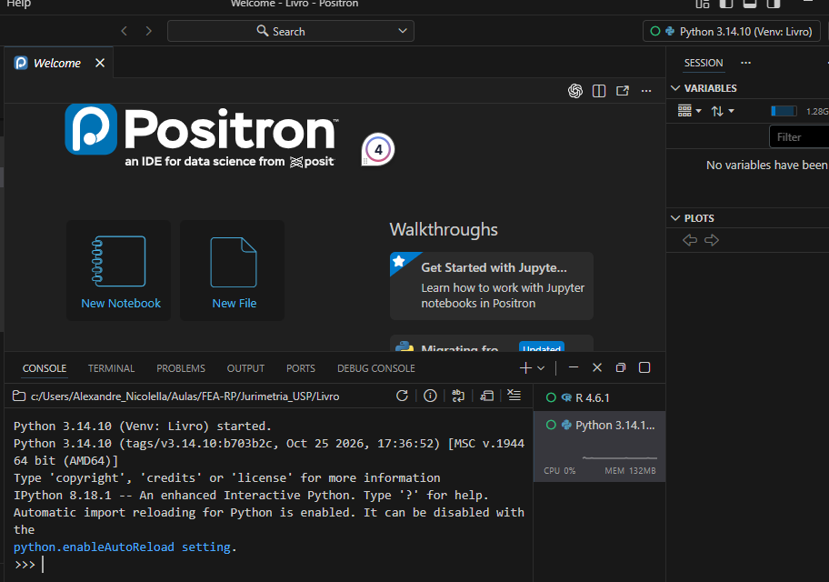
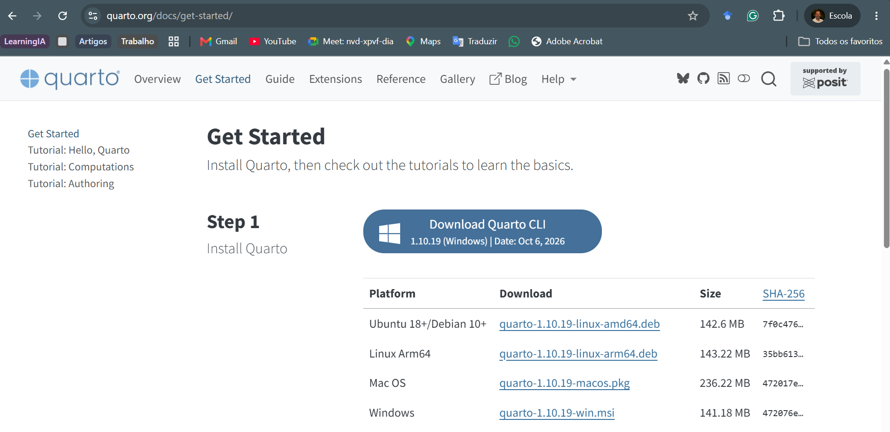
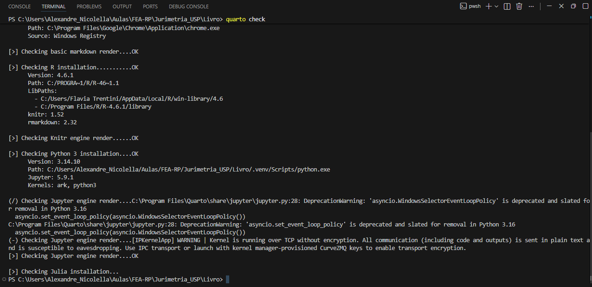
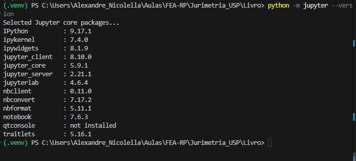

## Introdução

R e Python são linguagens utilizadas para representar procedimentos de pesquisa. Para escrever, executar e organizar esses procedimentos, utilizaremos o **Positron** como ambiente integrado de desenvolvimento. Para reunir texto, código e resultados em um mesmo documento, utilizaremos o **Quarto**.

Essas ferramentas cumprem funções diferentes. O Positron organiza o trabalho no computador; o Quarto transforma arquivos-fonte em relatórios, páginas, apresentações e livros. A página que você está lendo foi produzida por esse tipo de integração.

::: {.callout-note title="Objetivos do capítulo"}

Ao final deste capítulo, você deverá ser capaz de:

- distinguir linguagem, IDE e sistema de publicação;
- instalar e abrir o Positron no Windows;
- reconhecer editor, console, terminal, Explorer, objetos e gráficos;
- selecionar uma instalação de R ou Python;
- instalar o `uv` e utilizá-lo para administrar Python e as dependências do projeto;
- instalar e verificar o Quarto;
- compreender quando o Jupyter é necessário para executar Python em documentos Quarto;
- criar e renderizar um documento `.qmd` mínimo;
- distinguir o arquivo-fonte do arquivo HTML gerado.

:::

## Linguagem, IDE e sistema de publicação

O **R** e o **Python** interpretam e executam instruções. O **Positron** reúne os instrumentos utilizados para escrever essas instruções, acompanhar sua execução e navegar pelos arquivos do projeto. O **Quarto** lê um documento-fonte e produz a versão destinada à leitura.

```{mermaid}
%%| fig-align: center
%%| fig-alt: "Relação entre linguagem, Positron, Quarto e documento produzido"

flowchart LR
    A["R ou Python<br/>executam o código"] --> B["Positron<br/>organiza o trabalho"]
    B --> C["Arquivo .qmd<br/>texto e código"]
    C --> D["Quarto<br/>renderiza"]
    D --> E["HTML, PDF ou Word"]

    classDef principal fill:#E8EEF5,stroke:#415A77,stroke-width:2px,color:#233F56;
    classDef resultado fill:#F4E9D7,stroke:#B49A68,stroke-width:2px,color:#233F56;
    class A,B,C,D principal;
    class E resultado;
```

Uma IDE não substitui as linguagens. É possível instalar o Positron sem ter R ou Python; nesse caso, a interface será aberta, mas ainda não haverá uma linguagem disponível para executar os respectivos códigos.

## Instalação do Positron no Windows

O instalador deve ser obtido na [página oficial do Positron](https://positron.posit.co/download.html). Para computadores Windows usuais com processador Intel ou AMD, selecione a versão **Windows x64**. A instalação por usuário atende, em regra, ao uso individual e não exige que todos os usuários do computador recebam a mesma instalação.

O procedimento é:

1. baixar o instalador adequado à arquitetura do computador;
2. executar o arquivo recebido;
3. manter a opção de incluir o comando `positron` no `PATH`, quando apresentada;
4. concluir a instalação e abrir o programa.

No Windows, a documentação do Positron também recomenda manter atualizado o Microsoft Visual C++ Redistributable. O Positron exige uma versão compatível do R para iniciar uma sessão dessa linguagem; versões antigas podem ser encontradas no computador, mas desconsideradas pela IDE.

{#fig-positron-download fig-align="center" width="100%" fig-alt="Página oficial do Positron com os botões de download para Windows x64 e ARM64."}

Na maior parte dos computadores Windows com processadores Intel ou AMD, utiliza-se a opção **x64** mostrada na [Figura @fig-positron-download]. A opção ARM64 deve ser escolhida apenas quando o computador possuir essa arquitetura.

Para verificar se o comando foi disponibilizado no terminal, execute:

```powershell
positron --version
```

Também é possível abrir a pasta atual no Positron pelo terminal:

```powershell
positron .
```

O ponto representa a pasta em que o terminal está localizado.

## Abrindo a pasta de trabalho

No Positron, a unidade de trabalho inicial é uma pasta. Use **File > Open Folder** e selecione a pasta principal do projeto. A pasta aberta aparece no topo do Explorer e funciona como referência para a navegação entre arquivos.

Abrir a pasta principal é diferente de abrir apenas um arquivo isolado. Quando a raiz está aberta, os caminhos relativos, o terminal e as ferramentas de controle de versão partem do mesmo contexto.

::: {.callout-tip title="Comece pela raiz"}

Antes de escrever ou executar código, confirme no Explorer qual pasta ocupa o primeiro nível. Ela deve corresponder à pasta principal do trabalho que está sendo realizado.

:::

## Componentes do Positron

{#fig-positron-componentes .lightbox fig-align="center" width="100%" fig-alt="Captura da interface do Positron com marcações para Editor, Console, Terminal, Variables, Explorer e Plots."}

A [Figura @fig-positron-componentes] identifica os componentes utilizados com maior frequência.

### Explorer e raiz do projeto

O **Explorer** mostra as pastas e os arquivos. Seu primeiro nível indica a pasta aberta como raiz. Criar, mover ou renomear arquivos nesse painel altera os arquivos existentes no computador.

### Editor

O **editor** contém os arquivos salvos, como scripts `.R` e `.py`, documentos `.qmd` e arquivos Markdown. Ele preserva a sequência do trabalho e permite revisar o conteúdo antes da execução.

### Console

O **console** mantém uma sessão ativa de R ou Python. Ele recebe comandos dessas linguagens e apresenta resultados, mensagens, avisos e erros.

### Terminal

O **terminal** recebe comandos do sistema operacional e de programas instalados, como Quarto e Git. Ele não deve ser confundido com o console da linguagem.

| Local | Comando esperado | Exemplo |
|---|---|---|
| Console de R | código R | `mean(c(1, 2, 3))` |
| Console de Python | código Python | `sum([1, 2, 3])` |
| Terminal | comando do sistema | `python --version` |

### Objetos e gráficos

O painel **Variables** permite inspecionar objetos existentes na sessão. O painel **Plots** recebe gráficos produzidos pelo código. Esses painéis ajudam a acompanhar o trabalho, mas não substituem o registro das operações nos scripts.

## Selecionando R ou Python

No canto superior direito do Positron, o seletor de interpretador informa qual linguagem e qual instalação serão utilizadas. Se houver mais de uma versão do R ou mais de um ambiente Python, a escolha deve ser feita explicitamente.

Para conferir a versão do R no console dessa linguagem:

```r
R.version.string
```

Para conferir o executável Python da sessão:

```python
import sys
print(sys.executable)
print(sys.version)
```

Quando uma instalação de R não aparece, primeiro verifique se ela está em uma pasta padrão do Windows, como `C:\Program Files\R`. A indicação manual de um executável é uma medida de diagnóstico, não uma etapa obrigatória da instalação comum.

## Gerenciamento do Python com `uv`

O **interpretador** executa o código Python. Os pacotes acrescentam funcionalidades utilizadas pelo projeto. Para impedir que as dependências de um trabalho interfiram em outro, utilizaremos o `uv` como gerenciador de versões, pacotes e ambientes Python.

O `uv` é instalado uma vez no Windows e pode ser usado em todos os projetos. Em cada pasta, ele registra a versão de Python e as dependências necessárias. Internamente, o `uv` cria uma pasta `.venv`, mas o aluno não precisa utilizar `python -m venv`, instalar pacotes com `pip` nem ativar manualmente o ambiente. Os comandos serão executados por meio de `uv run`.

::: {.callout-note title="`uv` e `.venv` não são a mesma coisa"}
Neste livro, `uv` é a ferramenta responsável por criar e administrar o ambiente Python do projeto. `.venv` é apenas o nome da pasta local em que esse ambiente é armazenado. A presença dessa pasta não significa que o procedimento antigo com `python -m venv` esteja sendo utilizado. O ambiente será criado ou reconstruído pelo `uv`, e os comandos Python serão executados com `uv run`.

O Jupyter também será registrado e instalado pelo `uv`. Essa dependência permanecerá disponível para os capítulos e projetos que venham a executar blocos Python durante a renderização de documentos Quarto.
:::

### Instalação do `uv` no Windows

No terminal integrado do Positron, execute:

```powershell
winget install --id=astral-sh.uv -e
```

Depois da instalação, feche completamente o Positron, abra-o novamente e verifique:

```powershell
uv --version
```

Se o comando funcionar em um terminal externo, mas não no Positron, a IDE ainda está utilizando a versão anterior da variável `PATH`. Reiniciar o Positron atualiza esse contexto.

### Preparação de um projeto

Abra a pasta principal com **File > Open Folder** e confirme a localização no terminal integrado:

```powershell
Get-Location
```

O caminho deve corresponder à raiz do projeto, e não a uma pasta do sistema como `C:\Windows\System32`. Em uma pasta ainda não configurada, execute:

```powershell
uv init --bare
uv python pin 3.14
uv sync
```

`uv init --bare` cria uma configuração mínima sem impor uma estrutura de pacote Python. `uv python pin 3.14` registra a versão escolhida. `uv sync` cria ou atualiza o ambiente administrado pelo projeto.

### Arquivos criados pelo `uv`

| Elemento | Função |
|---|---|
| `pyproject.toml` | declara o projeto e suas dependências |
| `.python-version` | registra a versão de Python escolhida |
| `uv.lock` | fixa as versões resolvidas das dependências |
| `.venv/` | contém o ambiente local reconstruível |

Os três primeiros arquivos documentam o ambiente e devem acompanhar o projeto. A pasta `.venv/` permanece apenas no computador e deve constar do `.gitignore`.

### Execução sem ativação manual

Verifique a versão e o executável utilizados:

```powershell
uv run python --version
uv run python -c "import sys; print(sys.executable)"
```

O primeiro comando deve informar Python 3.14. O segundo deve apresentar o interpretador associado à pasta `.venv` do projeto. Não é necessário executar `Activate.ps1`; `uv run` seleciona automaticamente o ambiente correto.

### Iniciando a sessão Python no Positron

Depois que o `uv` criar o ambiente, use a Paleta de Comandos (`Ctrl + Shift + P`) e execute **Interpreter: Discover All Interpreters**. Em seguida, execute **Interpreter: Start New Console Session** e selecione o Python localizado em `.venv\Scripts\python.exe`.

O Positron pode perguntar se deve selecionar o novo ambiente para a pasta aberta. Selecione **Yes**. A sessão iniciada deve identificar Python 3.14 e a `.venv` do projeto. A [Figura @fig-python-sessao-venv] mostra o resultado esperado e registra que sessões de Python e R podem permanecer disponíveis no mesmo ambiente de trabalho.

{#fig-python-selecionar-venv fig-align="center" width="70%"}

{#fig-python-sessao-venv fig-align="center" width="100%"}

### `uv` e controle de versões

O `.gitignore` deve conter:

```gitignore
.venv/
```

Essa regra exclui somente o ambiente reconstruível. `pyproject.toml`, `.python-version` e `uv.lock` devem permanecer disponíveis para que outra pessoa execute `uv sync` e reconstrua o mesmo ambiente.

## O que é o Quarto?

O Quarto é um sistema de publicação que combina prosa, referências, equações, tabelas, figuras e código executável. Seu arquivo-fonte possui a extensão `.qmd`. A renderização lê esse arquivo, executa os blocos autorizados e produz o formato definido no cabeçalho.

O livro em que este capítulo está inserido é um projeto Quarto. Seus capítulos são escritos em arquivos `.qmd`; a versão de leitura é formada pelos arquivos HTML produzidos durante a renderização.

## Instalação e verificação do Quarto

No Windows, baixe o instalador `.msi` na [página oficial de instalação do Quarto](https://quarto.org/docs/get-started/) e conclua o assistente. A [Figura @fig-quarto-download] mostra onde localizar o instalador para Windows. Feche e reabra o terminal após a instalação.

{#fig-quarto-download fig-align="center" width="100%" fig-alt="Página oficial do Quarto com o instalador MSI para Windows."}

Primeiro, confirme que o comando está disponível:

```powershell
quarto --version
```

Depois, execute a verificação geral:

```powershell
quarto check
```

O primeiro comando informa apenas a versão instalada. O segundo examina a instalação do Quarto e as integrações encontradas no computador, como R, `knitr`, Python e Jupyter. Nem todas essas integrações são obrigatórias: o resultado esperado depende das linguagens que o projeto utiliza. A [Figura @fig-quarto-check] mostra uma verificação em um projeto que utiliza R e Python.

{#fig-quarto-check fig-align="center" width="100%" fig-alt="Terminal integrado do Positron executando quarto check e reconhecendo R, knitr, Python e Jupyter."}

### Jupyter para documentos Quarto com Python

A sessão Python do Positron não exige uma instalação separada do Jupyter. Para versões compatíveis do Python, o Positron fornece o kernel necessário para iniciar o console. Por isso, a sessão Python 3.14 pode funcionar antes da instalação do Jupyter no ambiente virtual.

A situação é diferente quando um documento Quarto contém blocos executáveis de Python. Nesse caso, o Quarto utiliza o mecanismo do Jupyter para executar o código durante a renderização. Se o projeto utilizar somente blocos de R, essa instalação não é necessária.

Para preparar o projeto para documentos Quarto com Python, abra o terminal integrado na raiz e registre o Jupyter como dependência de desenvolvimento:

```powershell
uv add --dev jupyter
```

O `uv` atualiza `pyproject.toml` e `uv.lock`, instala os componentes na `.venv` e preserva a possibilidade de reconstrução. Verifique:

```powershell
uv run python -m jupyter --version
```

{#fig-jupyter-venv-versao fig-align="center" width="100%" fig-alt="Terminal integrado do Positron com a pasta .venv ativa e a lista de componentes e versões do Jupyter."}

A [Figura @fig-jupyter-venv-versao] registra os componentes utilizados pelo Quarto. Alguns componentes opcionais podem aparecer como não instalados sem impedir a execução de documentos Quarto ou o uso do console do Positron.

Por fim, execute a verificação do Quarto dentro do ambiente administrado pelo `uv`:

```powershell
uv run quarto check jupyter
```

O resultado deve registrar a instalação do Python, apresentar o interpretador do projeto e identificar o Jupyter.

::: {.callout-warning title="Confirme o interpretador antes de instalar"}
Se `uv run python -c "import sys; print(sys.executable)"` indicar um caminho externo ao projeto, interrompa o procedimento e confirme a pasta aberta e os arquivos de configuração antes de instalar novamente qualquer dependência.
:::

::: {.callout-note title="Ordem das ferramentas"}
Primeiro instalamos Python e confirmamos seu funcionamento. Depois apresentamos o Positron e o `uv`, que administra o ambiente do projeto. O Jupyter somente é acrescentado quando passamos a executar Python dentro de documentos Quarto.
:::

## Primeiro documento Quarto

Crie um arquivo chamado `exemplo.qmd` e insira:

````markdown
---
title: "Exemplo jurídico"
format: html
---

## Uma tabela simples

O documento combina texto, código e resultado.

```{r}
estados <- c("Acre", "Alagoas", "Amapá")
feminicidios <- c(11, 31, 8)

data.frame(estado = estados, feminicidios = feminicidios)
```
````

O bloco delimitado por `---` é o **YAML**. Ele deve começar na primeira linha do documento. O título e o formato são metadados; o restante contém a prosa e o bloco de código.

No terminal, localizado na mesma pasta do arquivo, execute:

```powershell
quarto render exemplo.qmd
```

Em um documento isolado, o resultado `exemplo.html` tende a ser criado ao lado da fonte. Em um projeto Quarto, o arquivo `_quarto.yml` pode definir outro destino, como `docs/`. Portanto, a localização da saída depende da configuração do projeto.

## Arquivo-fonte e arquivo gerado

O arquivo `.qmd` é a fonte que deve ser editada. O arquivo `.html` é o produto da renderização. Modificar diretamente o HTML não atualiza a fonte e a alteração pode desaparecer na próxima renderização.

| Arquivo | Natureza | Conduta |
|---|---|---|
| `exemplo.qmd` | fonte | escrever, revisar e preservar |
| `exemplo.html` | resultado | abrir para leitura e verificação |
| `exemplo_files/` | dependências geradas, quando houver | manter junto ao HTML se o formato depender dela |

Em projetos com recursos incorporados ao próprio HTML, a pasta auxiliar pode não ser criada. Sua presença ou ausência depende das opções de renderização.

## Erros frequentes de renderização

### YAML inválido

Uma instrução inserida antes do cabeçalho pode produzir erro. Por exemplo, `quarto render---` não é um início válido de documento. O arquivo deve começar exatamente com o delimitador `---`.

### Arquivo não encontrado

Um caminho relativo é interpretado a partir do contexto da renderização. Confirme a raiz do projeto, o nome do arquivo e a posição da pasta referenciada.

### Linguagem ou pacote ausente

Se um bloco de R ou Python depende de um pacote, esse pacote precisa estar instalado no ambiente que o Quarto está utilizando. A presença do pacote em outra versão do R ou em outro ambiente Python não o torna disponível automaticamente.

::: {.callout-warning title="Leia a primeira mensagem de erro"}

Erros posteriores podem ser consequência do primeiro problema registrado. Identifique o arquivo, a linha ou o bloco indicados antes de alterar configurações ou instalar programas adicionais.

:::

## Síntese

Neste capítulo, distinguimos linguagem, IDE e sistema de publicação. Instalamos conceitualmente o Positron e o Quarto, identificamos os componentes do ambiente, selecionamos interpretadores, criamos um ambiente virtual de Python e acompanhamos o percurso entre um arquivo `.qmd` e o HTML gerado.

Nos capítulos seguintes, integraremos esse ambiente ao controle de versões e aos agentes de inteligência artificial.

::: {.callout-tip title="Antes de avançar"}

- [ ] A pasta principal está aberta no Explorer?
- [ ] Consigo distinguir editor, console e terminal?
- [ ] Sei qual versão do R ou do Python está ativa?
- [ ] O `uv` foi instalado e reconhecido no terminal do Positron?
- [ ] `.python-version` registra Python 3.14?
- [ ] `uv run python --version` utiliza a versão esperada?
- [ ] A regra `.venv/` está registrada no `.gitignore`?
- [ ] Os comandos `quarto --version` e `quarto check` reconhecem a instalação?
- [ ] Se o projeto usa blocos Python, o Jupyter está instalado na `.venv` e é reconhecido pelo Quarto?
- [ ] Sei qual arquivo é a fonte e qual foi gerado?

:::

## Referências de instalação e consulta

- [Download e requisitos do Positron](https://positron.posit.co/download.html)
- [Inicialização do Positron pelo terminal](https://positron.posit.co/add-to-path.html)
- [Descoberta de instalações de R no Positron](https://positron.posit.co/r-installations.html)
- [Descoberta de instalações e ambientes Python no Positron](https://positron.posit.co/python-installations.html)
- [Instalação do Quarto](https://quarto.org/docs/get-started/)
- [Uso de Python e Jupyter em documentos Quarto](https://quarto.org/docs/computations/python.html)
- [Verificação da instalação do Quarto](https://quarto.org/docs/cli/check.html)
- [Instalação do `uv`](https://docs.astral.sh/uv/getting-started/installation/)
- [Projetos administrados pelo `uv`](https://docs.astral.sh/uv/guides/projects/)

## Slides da aula

[Ver os slides — Positron e Quarto](../slides/ambiente-trabalho/positron-quarto/index.html){.btn .btn-primary target="_blank"}
