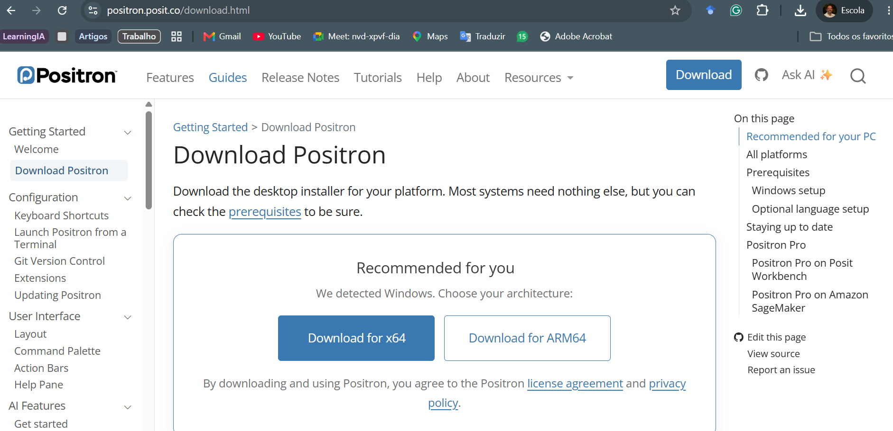
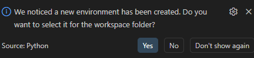
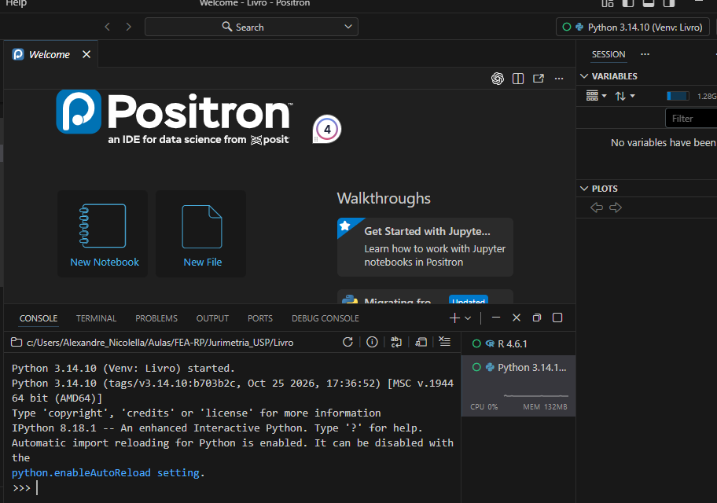
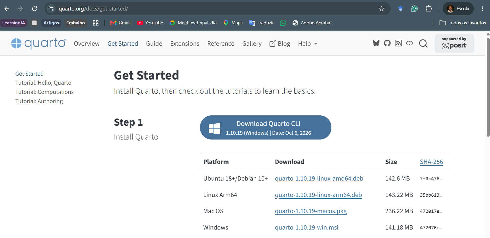
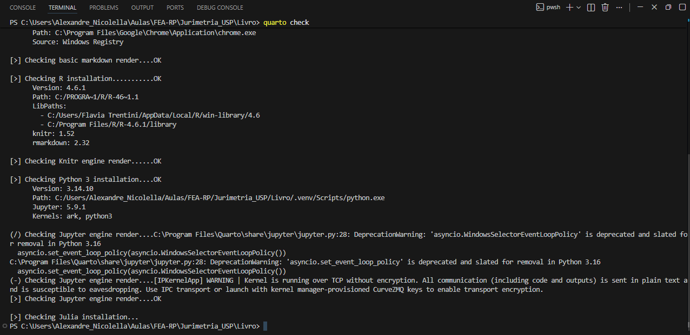
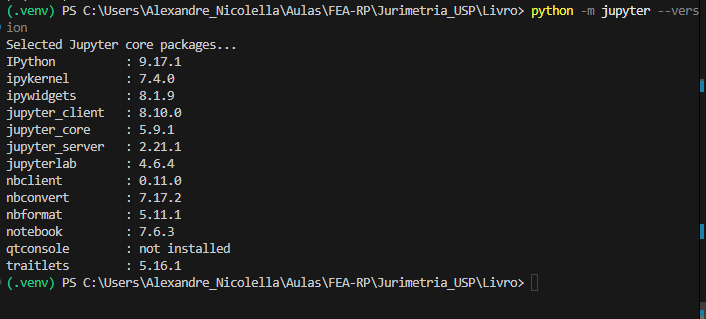

## Introdução

R e Python são linguagens utilizadas para representar procedimentos de pesquisa. Para escrever, executar e organizar esses procedimentos, utilizaremos o **Positron** como ambiente integrado de desenvolvimento. Para reunir texto, código e resultados em um mesmo documento, utilizaremos o **Quarto**.

Essas ferramentas cumprem funções diferentes. O Positron organiza o trabalho no computador; o Quarto transforma arquivos-fonte em relatórios, páginas, apresentações e livros. A página que você está lendo foi produzida por esse tipo de integração.

::: {.callout-note title="Objetivos do capítulo"}

Ao final deste capítulo, você deverá ser capaz de:

- distinguir linguagem, IDE e sistema de publicação;
- instalar e abrir o Positron no Windows;
- reconhecer editor, console, terminal, Explorer, objetos e gráficos;
- selecionar uma instalação de R ou Python;
- criar e selecionar um ambiente virtual de Python para o projeto;
- instalar e verificar o Quarto;
- compreender quando o Jupyter é necessário para executar Python em documentos Quarto;
- criar e renderizar um documento `.qmd` mínimo;
- distinguir o arquivo-fonte do arquivo HTML gerado.

:::

## Linguagem, IDE e sistema de publicação

O **R** e o **Python** interpretam e executam instruções. O **Positron** reúne os instrumentos utilizados para escrever essas instruções, acompanhar sua execução e navegar pelos arquivos do projeto. O **Quarto** lê um documento-fonte e produz a versão destinada à leitura.

```{mermaid}
%%| fig-align: center
%%| fig-alt: "Relação entre linguagem, Positron, Quarto e documento produzido"

flowchart LR
    A["R ou Python<br/>executam o código"] --> B["Positron<br/>organiza o trabalho"]
    B --> C["Arquivo .qmd<br/>texto e código"]
    C --> D["Quarto<br/>renderiza"]
    D --> E["HTML, PDF ou Word"]

    classDef principal fill:#E8EEF5,stroke:#415A77,stroke-width:2px,color:#233F56;
    classDef resultado fill:#F4E9D7,stroke:#B49A68,stroke-width:2px,color:#233F56;
    class A,B,C,D principal;
    class E resultado;
```

Uma IDE não substitui as linguagens. É possível instalar o Positron sem ter R ou Python; nesse caso, a interface será aberta, mas ainda não haverá uma linguagem disponível para executar os respectivos códigos.

## Instalação do Positron no Windows

O instalador deve ser obtido na [página oficial do Positron](https://positron.posit.co/download.html). Para computadores Windows usuais com processador Intel ou AMD, selecione a versão **Windows x64**. A instalação por usuário atende, em regra, ao uso individual e não exige que todos os usuários do computador recebam a mesma instalação.

O procedimento é:

1. baixar o instalador adequado à arquitetura do computador;
2. executar o arquivo recebido;
3. manter a opção de incluir o comando `positron` no `PATH`, quando apresentada;
4. concluir a instalação e abrir o programa.

No Windows, a documentação do Positron também recomenda manter atualizado o Microsoft Visual C++ Redistributable. O Positron exige uma versão compatível do R para iniciar uma sessão dessa linguagem; versões antigas podem ser encontradas no computador, mas desconsideradas pela IDE.

{#fig-positron-download fig-align="center" width="100%" fig-alt="Página oficial do Positron com os botões de download para Windows x64 e ARM64."}

Na maior parte dos computadores Windows com processadores Intel ou AMD, utiliza-se a opção **x64** mostrada na [Figura @fig-positron-download]. A opção ARM64 deve ser escolhida apenas quando o computador possuir essa arquitetura.

Para verificar se o comando foi disponibilizado no terminal, execute:

```powershell
positron --version
```

Também é possível abrir a pasta atual no Positron pelo terminal:

```powershell
positron .
```

O ponto representa a pasta em que o terminal está localizado.

## Abrindo a pasta de trabalho

No Positron, a unidade de trabalho inicial é uma pasta. Use **File > Open Folder** e selecione a pasta principal do projeto. A pasta aberta aparece no topo do Explorer e funciona como referência para a navegação entre arquivos.

Abrir a pasta principal é diferente de abrir apenas um arquivo isolado. Quando a raiz está aberta, os caminhos relativos, o terminal e as ferramentas de controle de versão partem do mesmo contexto.

::: {.callout-tip title="Comece pela raiz"}

Antes de escrever ou executar código, confirme no Explorer qual pasta ocupa o primeiro nível. Ela deve corresponder à pasta principal do trabalho que está sendo realizado.

:::

## Componentes do Positron

{#fig-positron-componentes .lightbox fig-align="center" width="100%" fig-alt="Captura da interface do Positron com marcações para Editor, Console, Terminal, Variables, Explorer e Plots."}

A [Figura @fig-positron-componentes] identifica os componentes utilizados com maior frequência.

### Explorer e raiz do projeto

O **Explorer** mostra as pastas e os arquivos. Seu primeiro nível indica a pasta aberta como raiz. Criar, mover ou renomear arquivos nesse painel altera os arquivos existentes no computador.

### Editor

O **editor** contém os arquivos salvos, como scripts `.R` e `.py`, documentos `.qmd` e arquivos Markdown. Ele preserva a sequência do trabalho e permite revisar o conteúdo antes da execução.

### Console

O **console** mantém uma sessão ativa de R ou Python. Ele recebe comandos dessas linguagens e apresenta resultados, mensagens, avisos e erros.

### Terminal

O **terminal** recebe comandos do sistema operacional e de programas instalados, como Quarto e Git. Ele não deve ser confundido com o console da linguagem.

| Local | Comando esperado | Exemplo |
|---|---|---|
| Console de R | código R | `mean(c(1, 2, 3))` |
| Console de Python | código Python | `sum([1, 2, 3])` |
| Terminal | comando do sistema | `python --version` |

### Objetos e gráficos

O painel **Variables** permite inspecionar objetos existentes na sessão. O painel **Plots** recebe gráficos produzidos pelo código. Esses painéis ajudam a acompanhar o trabalho, mas não substituem o registro das operações nos scripts.

## Selecionando R ou Python

No canto superior direito do Positron, o seletor de interpretador informa qual linguagem e qual instalação serão utilizadas. Se houver mais de uma versão do R ou mais de um ambiente Python, a escolha deve ser feita explicitamente.

Para conferir a versão do R no console dessa linguagem:

```r
R.version.string
```

Para conferir o executável Python da sessão:

```python
import sys
print(sys.executable)
print(sys.version)
```

Quando uma instalação de R não aparece, primeiro verifique se ela está em uma pasta padrão do Windows, como `C:\Program Files\R`. A indicação manual de um executável é uma medida de diagnóstico, não uma etapa obrigatória da instalação comum.

## Ambiente virtual do Python no projeto

O **interpretador** é o programa que executa o código Python. A instalação principal disponibiliza um interpretador no sistema. Um ambiente virtual cria um espaço isolado que utiliza uma versão de Python e um conjunto próprio de pacotes.

Em regra, cria-se um ambiente virtual para cada projeto, e não para cada arquivo ou programa. Essa separação evita que a atualização exigida por um trabalho modifique o funcionamento de outro. A pasta do ambiente costuma receber o nome `.venv` e permanece na raiz do projeto.

O ambiente virtual não contém os códigos, os dados ou os documentos da pesquisa e não restringe o Python à pasta do projeto. Quando o ambiente está selecionado ou ativado, os comandos utilizam o interpretador e os pacotes associados àquele trabalho. Fora dele, o interpretador instalado no sistema continua disponível.

O ambiente de Python também é independente da sessão de R. O Positron pode manter uma sessão de R aberta e, ao mesmo tempo, utilizar uma `.venv` para executar códigos em Python.

### Conferindo uma versão compatível

O Positron pode localizar uma versão do Python e ainda classificá-la como **Unsupported**. Isso significa que a instalação existe, mas não é compatível com a versão atual da IDE. No momento da preparação deste material, utilizamos Python 3.14. Para verificar as versões instaladas, abra o terminal integrado pelo menu **Terminal > New Terminal** e execute:

```powershell
py list
```

Se Python 3.14 não estiver disponível, instale-o pelo Python Install Manager:

```powershell
py install 3.14
```

### Criando o ambiente no terminal integrado

Em um projeto existente, abra sua pasta principal no Positron. Em um projeto novo, crie a pasta, abra-a com **File > Open Folder** e somente então prossiga. Use **Terminal > New Terminal**; não abra um terminal separado pelo menu Iniciar do Windows.

O terminal integrado pode apresentar `PS` no início da linha porque utiliza o PowerShell como shell no Windows. Antes de criar o ambiente, confirme a localização:

```powershell
Get-Location
```

O caminho deve corresponder à raiz do projeto, e não a uma pasta do sistema como `C:\Windows\System32`. Em seguida, crie o ambiente explicitamente com Python 3.14:

```powershell
py -V:3.14 -m venv .venv
```

O comando cria a pasta `.venv`. Ao identificá-la, o Positron pode perguntar: **“We noticed a new environment has been created. Do you want to select it for the workspace folder?”**. Selecione **Yes**. Essa escolha associa o ambiente à pasta aberta no Positron e não encerra uma sessão de R que já esteja funcionando.

{#fig-python-selecionar-venv fig-align="center" width="70%"}

Para ativar o ambiente também no terminal integrado, execute:

```powershell
.\.venv\Scripts\Activate.ps1
```

Depois da ativação, o início da linha costuma apresentar `(.venv)`. Verifique a versão e o executável utilizados:

```powershell
python --version
python -c "import sys; print(sys.executable)"
```

A primeira instrução deve informar Python 3.14. A segunda deve apresentar um caminho terminado em `.venv\Scripts\python.exe`.

### Iniciando a sessão Python no Positron

Depois de criar o ambiente, use a Paleta de Comandos (`Ctrl + Shift + P`) e execute **Interpreter: Discover All Interpreters**. Em seguida, execute **Interpreter: Start New Console Session** e selecione o ambiente Python associado à pasta do projeto.

A sessão iniciada deve identificar Python 3.14 e a `.venv` do projeto, sem a classificação **Unsupported**. A [Figura @fig-python-sessao-venv] mostra o resultado esperado e também registra que as sessões de Python e R permanecem disponíveis no mesmo ambiente de trabalho.

{#fig-python-sessao-venv fig-align="center" width="100%"}

### Ambiente virtual e controle de versões

A pasta `.venv` é reconstruível e não deve ser enviada ao repositório. O arquivo `.gitignore`, localizado na raiz do projeto, deve conter:

```gitignore
.venv/
```

Essa regra mantém o ambiente no computador e impede que seus arquivos sejam incorporados ao controle de versões. O arquivo `.gitignore`, ao contrário, faz parte do projeto e deve ser preservado no repositório.

Para encerrar a ativação do ambiente naquele terminal, execute:

```powershell
deactivate
```

## O que é o Quarto?

O Quarto é um sistema de publicação que combina prosa, referências, equações, tabelas, figuras e código executável. Seu arquivo-fonte possui a extensão `.qmd`. A renderização lê esse arquivo, executa os blocos autorizados e produz o formato definido no cabeçalho.

O livro em que este capítulo está inserido é um projeto Quarto. Seus capítulos são escritos em arquivos `.qmd`; a versão de leitura é formada pelos arquivos HTML produzidos durante a renderização.

## Instalação e verificação do Quarto

No Windows, baixe o instalador `.msi` na [página oficial de instalação do Quarto](https://quarto.org/docs/get-started/) e conclua o assistente. A [Figura @fig-quarto-download] mostra onde localizar o instalador para Windows. Feche e reabra o terminal após a instalação.

{#fig-quarto-download fig-align="center" width="100%" fig-alt="Página oficial do Quarto com o instalador MSI para Windows."}

Primeiro, confirme que o comando está disponível:

```powershell
quarto --version
```

Depois, execute a verificação geral:

```powershell
quarto check
```

O primeiro comando informa apenas a versão instalada. O segundo examina a instalação do Quarto e as integrações encontradas no computador, como R, `knitr`, Python e Jupyter. Nem todas essas integrações são obrigatórias: o resultado esperado depende das linguagens que o projeto utiliza. A [Figura @fig-quarto-check] mostra uma verificação em um projeto que utiliza R e Python.

{#fig-quarto-check fig-align="center" width="100%" fig-alt="Terminal integrado do Positron executando quarto check e reconhecendo R, knitr, Python e Jupyter."}

### Jupyter para documentos Quarto com Python

A sessão Python do Positron não exige uma instalação separada do Jupyter. Para versões compatíveis do Python, o Positron fornece o kernel necessário para iniciar o console. Por isso, a sessão Python 3.14 pode funcionar antes da instalação do Jupyter no ambiente virtual.

A situação é diferente quando um documento Quarto contém blocos executáveis de Python. Nesse caso, o Quarto utiliza o mecanismo do Jupyter para executar o código durante a renderização. Se o projeto utilizar somente blocos de R, essa instalação não é necessária.

Para preparar a `.venv` para documentos Quarto com Python, abra o terminal integrado na raiz do projeto. Para evitar que o instalador utilize por engano outra versão disponível no sistema, indique diretamente o executável do ambiente virtual:

```powershell
.\.venv\Scripts\python.exe -m pip install jupyter
```

Esse comando instala o Jupyter especificamente na `.venv` do projeto, mesmo que o terminal ainda não esteja ativado. Depois da instalação, verifique o Jupyter pelo mesmo executável:

```powershell
.\.venv\Scripts\python.exe -m jupyter --version
```

{#fig-jupyter-venv-versao fig-align="center" width="100%" fig-alt="Terminal integrado do Positron com a pasta .venv ativa e a lista de componentes e versões do Jupyter."}

A [Figura @fig-jupyter-venv-versao] confirma que o comando foi executado com a `.venv` ativa e que os componentes utilizados pelo Quarto estão disponíveis. Alguns componentes opcionais podem aparecer como não instalados sem impedir a execução de documentos Quarto ou o uso do console do Positron.

Por fim, confirme que a `.venv` está ativada no terminal e verifique se o Quarto reconhece essa integração:

```powershell
.\.venv\Scripts\Activate.ps1
quarto check jupyter
```

O resultado deve registrar que a instalação do Python foi localizada, apresentar o caminho do interpretador dentro de `.venv` e identificar o Jupyter. Se aparecer um aviso de ambiente não ativado, retorne à ativação da `.venv` antes de instalar novamente qualquer pacote.

::: {.callout-warning title="Confirme o interpretador antes de instalar"}
Se a instalação utilizar um caminho externo à pasta `.venv`, interrompa o procedimento e retorne à raiz do projeto. A indicação explícita `.\.venv\Scripts\python.exe -m pip install jupyter` evita que outra versão do Python disponível no sistema receba os pacotes do projeto.
:::

::: {.callout-note title="Ordem das ferramentas"}
Primeiro instalamos Python e confirmamos seu funcionamento. Depois apresentamos o Positron e criamos a `.venv`. O Jupyter somente é instalado quando passamos a executar Python dentro de documentos Quarto.
:::

## Primeiro documento Quarto

Crie um arquivo chamado `exemplo.qmd` e insira:

````markdown
---
title: "Exemplo jurídico"
format: html
---

## Uma tabela simples

O documento combina texto, código e resultado.

```{r}
estados <- c("Acre", "Alagoas", "Amapá")
feminicidios <- c(11, 31, 8)

data.frame(estado = estados, feminicidios = feminicidios)
```
````

O bloco delimitado por `---` é o **YAML**. Ele deve começar na primeira linha do documento. O título e o formato são metadados; o restante contém a prosa e o bloco de código.

No terminal, localizado na mesma pasta do arquivo, execute:

```powershell
quarto render exemplo.qmd
```

Em um documento isolado, o resultado `exemplo.html` tende a ser criado ao lado da fonte. Em um projeto Quarto, o arquivo `_quarto.yml` pode definir outro destino, como `docs/`. Portanto, a localização da saída depende da configuração do projeto.

## Arquivo-fonte e arquivo gerado

O arquivo `.qmd` é a fonte que deve ser editada. O arquivo `.html` é o produto da renderização. Modificar diretamente o HTML não atualiza a fonte e a alteração pode desaparecer na próxima renderização.

| Arquivo | Natureza | Conduta |
|---|---|---|
| `exemplo.qmd` | fonte | escrever, revisar e preservar |
| `exemplo.html` | resultado | abrir para leitura e verificação |
| `exemplo_files/` | dependências geradas, quando houver | manter junto ao HTML se o formato depender dela |

Em projetos com recursos incorporados ao próprio HTML, a pasta auxiliar pode não ser criada. Sua presença ou ausência depende das opções de renderização.

## Erros frequentes de renderização

### YAML inválido

Uma instrução inserida antes do cabeçalho pode produzir erro. Por exemplo, `quarto render---` não é um início válido de documento. O arquivo deve começar exatamente com o delimitador `---`.

### Arquivo não encontrado

Um caminho relativo é interpretado a partir do contexto da renderização. Confirme a raiz do projeto, o nome do arquivo e a posição da pasta referenciada.

### Linguagem ou pacote ausente

Se um bloco de R ou Python depende de um pacote, esse pacote precisa estar instalado no ambiente que o Quarto está utilizando. A presença do pacote em outra versão do R ou em outro ambiente Python não o torna disponível automaticamente.

::: {.callout-warning title="Leia a primeira mensagem de erro"}

Erros posteriores podem ser consequência do primeiro problema registrado. Identifique o arquivo, a linha ou o bloco indicados antes de alterar configurações ou instalar programas adicionais.

:::

## Síntese

Neste capítulo, distinguimos linguagem, IDE e sistema de publicação. Instalamos conceitualmente o Positron e o Quarto, identificamos os componentes do ambiente, selecionamos interpretadores, criamos um ambiente virtual de Python e acompanhamos o percurso entre um arquivo `.qmd` e o HTML gerado.

Nos capítulos seguintes, integraremos esse ambiente ao controle de versões e aos agentes de inteligência artificial.

::: {.callout-tip title="Antes de avançar"}

- [ ] A pasta principal está aberta no Explorer?
- [ ] Consigo distinguir editor, console e terminal?
- [ ] Sei qual versão do R ou do Python está ativa?
- [ ] A `.venv` foi criada na raiz do projeto com uma versão compatível do Python?
- [ ] A regra `.venv/` está registrada no `.gitignore`?
- [ ] Os comandos `quarto --version` e `quarto check` reconhecem a instalação?
- [ ] Se o projeto usa blocos Python, o Jupyter está instalado na `.venv` e é reconhecido pelo Quarto?
- [ ] Sei qual arquivo é a fonte e qual foi gerado?

:::

## Referências de instalação e consulta

- [Download e requisitos do Positron](https://positron.posit.co/download.html)
- [Inicialização do Positron pelo terminal](https://positron.posit.co/add-to-path.html)
- [Descoberta de instalações de R no Positron](https://positron.posit.co/r-installations.html)
- [Descoberta de instalações e ambientes Python no Positron](https://positron.posit.co/python-installations.html)
- [Instalação do Quarto](https://quarto.org/docs/get-started/)
- [Uso de Python e Jupyter em documentos Quarto](https://quarto.org/docs/computations/python.html)
- [Verificação da instalação do Quarto](https://quarto.org/docs/cli/check.html)

## Slides da aula

[Ver os slides — Positron e Quarto](../slides/ambiente-trabalho/positron-quarto/index.html){.btn .btn-primary target="_blank"}
