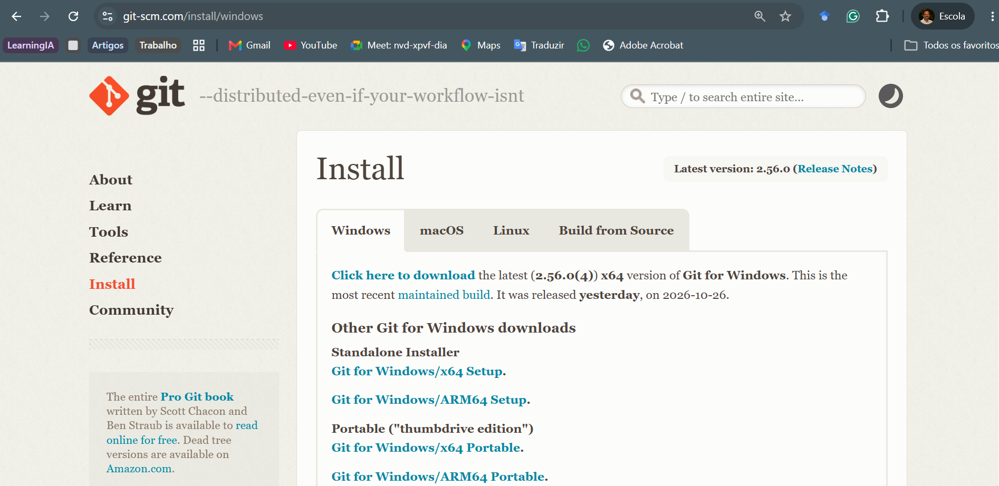

## Introdução

Uma pesquisa passa por sucessivas alterações. Textos são revistos, códigos são corrigidos e bases são reconstruídas. Salvar cópias com nomes como `final`, `final_2` e `final_agora_vai` não registra de forma adequada o que mudou nem permite relacionar cada versão a uma decisão.

O **Git** registra mudanças nos arquivos de um projeto. O **GitHub** hospeda repositórios Git e acrescenta instrumentos de colaboração. Eles se relacionam, mas não são a mesma ferramenta.

::: {.callout-note title="Objetivos do capítulo"}

Ao final deste capítulo, você deverá ser capaz de:

- distinguir Git de GitHub;
- instalar e verificar o Git no Windows;
- criar uma conta no GitHub e reconhecer suas configurações iniciais;
- compreender o que constitui um repositório local;
- reconhecer a diferença entre histórico local e repositório remoto;
- identificar arquivos que não devem ser versionados;
- utilizar `.gitignore` para prevenir inclusões indevidas;
- reconhecer os cuidados necessários com dados jurídicos e credenciais.

:::

## Git e GitHub não são a mesma coisa

O Git é um sistema de controle de versões executado no computador. Ele compara o estado dos arquivos, registra versões identificadas e permite consultar o histórico do projeto.

O GitHub é uma plataforma que hospeda repositórios Git na internet. Um repositório pode existir somente no computador, sem GitHub. Também é possível criar um repositório no GitHub e ainda não possuir uma cópia local.

| Ferramenta | Local principal | Função |
|---|---|---|
| Git | computador | registrar e comparar versões |
| GitHub | serviço remoto | hospedar repositórios e apoiar a colaboração |

```{mermaid}
%%| fig-align: center
%%| fig-alt: "Relação entre arquivos de trabalho, histórico local do Git e repositório remoto no GitHub"

flowchart LR
    A["Arquivos de trabalho"] --> B["Histórico local<br/>Git"]
    B <--> C["Repositório remoto<br/>GitHub"]
    C --> D["Colaboração e publicação"]

    classDef principal fill:#E8EEF5,stroke:#415A77,stroke-width:2px,color:#233F56;
    classDef remoto fill:#F4E9D7,stroke:#B49A68,stroke-width:2px,color:#233F56;
    class A,B principal;
    class C,D remoto;
```

Enviar uma versão ao GitHub não substitui o registro local. Da mesma forma, registrar uma versão no Git não a publica automaticamente.

## Instalação do Git no Windows

Baixe o instalador na [página oficial do Git para Windows](https://git-scm.com/install/windows). Para uma primeira instalação, as opções padrão atendem à maior parte dos usos descritos neste livro.

Após concluir o assistente, feche e reabra o terminal do Positron. Verifique a instalação:

```powershell
git --version
```

O terminal deve informar a versão encontrada. Se o comando não for reconhecido, reinicie o Positron e verifique se o instalador incluiu o Git no `PATH` do Windows.

{#fig-git-install fig-align="center" width="100%" fig-alt="Página oficial do Git com as opções de instalação para Windows x64 e ARM64."}

## Identificação do autor dos registros

O Git associa cada registro a um nome e a um endereço de correio eletrônico. A configuração global vale para os repositórios utilizados pela conta do Windows:

```powershell
git config --global user.name "Nome do autor"
git config --global user.email "endereco@exemplo.com"
```

Para consultar a configuração:

```powershell
git config --global --list
```

Essa identificação integra o histórico. Ela não substitui a autenticação no GitHub e não concede acesso a repositórios remotos. O nome pode ser o nome acadêmico ou profissional que o autor deseja registrar. O endereço pode ser um correio eletrônico comum ou o endereço privado fornecido pelo GitHub.

O Git funciona mesmo que esse endereço não seja o mesmo utilizado para entrar no GitHub. Contudo, para que o GitHub associe os registros à conta do autor, o endereço gravado no registro deve estar verificado nessa conta ou corresponder ao endereço privado disponibilizado pela plataforma. Essa associação identifica a autoria do registro; ela não realiza a autenticação nem sincroniza o projeto.

## O repositório local

Um repositório Git é uma pasta de projeto acompanhada por metadados de versão. Quando o controle de versões é iniciado, o Git cria uma pasta oculta denominada `.git`. Ela contém o histórico e as configurações locais do repositório.

O comando a seguir informa se a pasta atual pertence a um repositório e mostra o estado dos arquivos:

```powershell
git status
```

Quando executado fora de um repositório, o Git informa que não encontrou a pasta `.git`. Antes de qualquer operação, observe no terminal se o caminho exibido corresponde à raiz correta do projeto.

::: {.callout-warning title="Não crie repositórios dentro de repositórios"}

Iniciar Git em uma subpasta por engano pode produzir históricos sobrepostos. Confirme a raiz do projeto antes de iniciar o versionamento.

:::

## O que o Git observa

O Git distingue, de forma simplificada, três situações:

- arquivo ainda não acompanhado;
- arquivo acompanhado e modificado;
- versão registrada no histórico.

O percurso completo de seleção, registro e intercâmbio de versões será realizado em atividade própria. Neste capítulo, importa compreender que o Git não decide sozinho quais mudanças representam uma versão coerente. A pessoa responsável deve revisar os arquivos e formular um registro que corresponda a uma etapa compreensível do trabalho.

### Primeiro registro local

Em uma pasta nova, a sequência básica ocorre primeiro no computador. Na raiz do projeto, os responsáveis iniciam o repositório e conferem os arquivos:

```powershell
git init
git status
```

Depois de revisar o conteúdo e o `.gitignore`, selecionam os arquivos que formarão a versão e conferem novamente o estado:

```powershell
git add .
git status
```

Por fim, registram a versão local:

```powershell
git commit -m "Cria a estrutura inicial do projeto"
```

O *commit* atualiza o histórico local. Ele não cria um repositório no GitHub e não envia arquivos à internet. O uso de `git add .` pressupõe que a pessoa já examinou os arquivos da pasta e confirmou as regras do `.gitignore`; quando houver dúvida, os arquivos podem ser selecionados individualmente.

```{mermaid}
%%| fig-align: center
%%| fig-alt: "Sequência entre arquivos, seleção, commit local e sincronização posterior com o GitHub"

flowchart LR
    A["Arquivos na pasta"] --> B["git add<br/>seleciona"]
    B --> C["git commit<br/>registra localmente"]
    C --> D["Conexão com o GitHub<br/>etapa posterior"]
    D --> E["Sincronização<br/>envia ou recebe versões"]

    classDef local fill:#E8EEF5,stroke:#415A77,stroke-width:2px,color:#233F56;
    classDef remoto fill:#F4E9D7,stroke:#B49A68,stroke-width:2px,color:#233F56;
    class A,B,C local;
    class D,E remoto;
```

## O repositório remoto

Um repositório no GitHub pode funcionar como ponto de colaboração, cópia remota e origem de uma página pública. Sua visibilidade pode ser pública ou privada. Essa escolha precisa considerar direitos autorais, dados pessoais, sigilo, contratos e as regras institucionais aplicáveis.

Conectar um repositório local a um remoto não autoriza o envio de arquivos. Em uma etapa posterior, cria-se o repositório no GitHub, associa-se seu endereço ao repositório local e realiza-se a primeira sincronização. A criação do remoto, sua conexão e as operações de envio ou recebimento devem ser realizadas conscientemente pelos autores do projeto.

Assim, a ordem adotada neste livro é: organizar a pasta, iniciar o Git, revisar e registrar uma versão local; somente depois criar ou escolher um repositório no GitHub e sincronizar os históricos. O GitHub amplia o alcance do repositório, mas não é necessário para criar o primeiro *commit*.

## Criando uma conta no GitHub

Para utilizar repositórios remotos e colaborar no GitHub, cada participante deve possuir sua própria conta. A conta é individual; senhas e códigos de autenticação não devem ser compartilhados.

O procedimento inicial é:

1. acessar [github.com](https://github.com/);
2. selecionar **Sign up**;
3. informar um endereço de correio eletrônico acessível;
4. escolher uma senha exclusiva e um nome de usuário;
5. confirmar o endereço recebido por correio eletrônico;
6. entrar na conta e revisar as configurações de segurança.

O nome de usuário integra o endereço dos repositórios. Por isso, convém escolher uma identificação estável e adequada ao uso acadêmico ou profissional.

Ative a autenticação em dois fatores nas configurações de segurança da conta. Esse mecanismo acrescenta uma segunda verificação ao acesso e reduz o risco de uso indevido da conta.

<!-- IMAGEM A INSERIR: figuras/parte-02-ambiente-trabalho/github-criar-conta.png — página inicial do GitHub com a opção Sign up identificada. -->

### Conta, Git e autenticação

Três elementos não devem ser confundidos:

- `git config user.name` e `user.email` identificam os registros locais;
- a conta do GitHub identifica a pessoa na plataforma;
- a autenticação autoriza o computador a acessar os repositórios permitidos.

Ter o Git instalado não cria uma conta no GitHub. Criar a conta também não conecta automaticamente uma pasta local a um repositório remoto. Essa conexão será realizada quando o projeto for criado.

::: {.callout-important title="Publicar exige uma decisão própria"}

Uma versão local correta não deve ser enviada automaticamente. Antes da publicação, verifique conteúdo, autoria, licenças, dados protegidos e arquivos gerados.

:::

## O arquivo `.gitignore`

O `.gitignore` declara padrões de arquivos que o Git deve deixar fora do acompanhamento. Um projeto de pesquisa pode começar com:

```gitignore
# Sessão local do R
.Rhistory
.RData
.Ruserdata

# Ambientes locais
.venv/
.env

# Arquivos temporários
*.tmp
*.log

# Dados não publicáveis
dados/sensiveis/
dados/identificados/
```

Esse arquivo deve ser adaptado ao projeto. Ignorar toda a pasta de dados pode impedir o versionamento de bases públicas ou simuladas que deveriam acompanhar o código. Por outro lado, bases identificadas ou protegidas não devem entrar em um repositório público.

O `.gitignore` atua preventivamente. Se um arquivo já foi incorporado ao histórico, acrescentá-lo depois ao `.gitignore` não elimina as versões anteriores.

## O que não deve ser versionado

Em pesquisas jurídicas, a revisão deve considerar pelo menos quatro grupos.

### Credenciais e segredos

Senhas, chaves de API, tokens de acesso e arquivos `.env` não devem ser registrados no repositório. O código deve obter esses valores de variáveis de ambiente ou de mecanismos próprios de gerenciamento de credenciais.

### Dados pessoais ou sigilosos

Documentos processuais, bases identificadas e informações sujeitas a sigilo exigem avaliação própria. A disponibilidade pública do documento em uma fonte não elimina automaticamente os deveres de proteção, contextualização e uso adequado.

### Arquivos locais ou temporários

Caches, históricos de sessão, ambientes virtuais e arquivos temporários dependem do computador e costumam ser reconstruídos. Incluí-los aumenta o repositório sem documentar uma decisão de pesquisa.

### Produtos gerados

HTML, tabelas e figuras podem ser reconstruídos a partir das fontes, mas alguns projetos precisam versioná-los para publicação. A decisão depende da forma de distribuição. Neste livro, por exemplo, os arquivos de `docs/` integram a publicação da página, embora sejam gerados pelos arquivos-fonte.

## Uma verificação antes de registrar ou enviar

Antes de criar uma versão ou publicar mudanças, examine:

- quais arquivos foram modificados;
- se a alteração pertence à etapa atual;
- se existem dados pessoais, sigilosos ou credenciais;
- se algum arquivo grande foi incluído por engano;
- se os resultados podem ser reconstruídos;
- se a documentação corresponde ao código;
- se a versão foi aprovada pelos responsáveis.

A documentação do GitHub recomenda revisar individualmente os arquivos selecionados e evitar comandos indiscriminados quando houver risco de incorporar conteúdo sensível.

## Git como registro metodológico

O histórico do Git não registra apenas programação. Em uma pesquisa, ele pode documentar quando uma variável foi redefinida, quando um critério de inclusão foi alterado ou quando um texto foi revisto após nova verificação. Para cumprir essa função, cada versão precisa reunir mudanças relacionadas e receber uma descrição informativa.

O Git não explica por si só o fundamento de uma decisão. Critérios de coleta, limpeza e análise também devem aparecer nos documentos metodológicos do projeto.

## Síntese

Neste capítulo, distinguimos Git e GitHub, verificamos a instalação do Git e identificamos as funções do repositório local e do remoto. Também discutimos o papel do `.gitignore` e os riscos associados a credenciais, dados jurídicos protegidos e arquivos gerados.

O capítulo não executou o fluxo completo de envio e recebimento de versões. Essas operações serão feitas quando houver um projeto definido e uma decisão expressa sobre o repositório remoto.

::: {.callout-tip title="Antes de avançar"}

- [ ] O comando `git --version` funciona no terminal?
- [ ] Sei distinguir repositório local de remoto?
- [ ] A raiz do projeto está identificada?
- [ ] O `.gitignore` protege arquivos locais e dados não publicáveis?
- [ ] Nenhuma credencial aparece nos arquivos do projeto?
- [ ] A publicação permanece uma decisão expressa dos autores?

:::

## Referências de instalação e consulta

- [Instalação do Git no Windows](https://git-scm.com/install/windows)
- [Diferença entre Git e GitHub](https://docs.github.com/en/get-started/start-your-journey/what-is-github)
- [Configuração do endereço associado aos commits](https://docs.github.com/en/account-and-profile/how-tos/email-preferences/setting-your-commit-email-address)
- [Como ignorar arquivos](https://docs.github.com/en/get-started/getting-started-with-git/ignoring-files)
- [Prevenção da inclusão de dados sensíveis](https://docs.github.com/en/authentication/keeping-your-account-and-data-secure/removing-sensitive-data-from-a-repository)

## Slides da aula

[Ver os slides — Git e GitHub](../slides/ambiente-trabalho/git-github/index.html){.btn .btn-primary target="_blank"}
