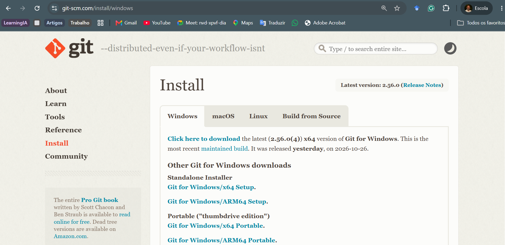

## Introdução

Uma pesquisa passa por sucessivas alterações. Textos são revistos, códigos são corrigidos e bases são reconstruídas. Salvar cópias com nomes como `final`, `final_2` e `final_agora_vai` não registra de forma adequada o que mudou nem permite relacionar cada versão a uma decisão.

O **Git** registra mudanças nos arquivos de um projeto. O **GitHub** hospeda repositórios Git e acrescenta instrumentos de colaboração. Eles se relacionam, mas não são a mesma ferramenta.

::: {.callout-note title="Objetivos do capítulo"}

Ao final deste capítulo, você deverá ser capaz de:

- distinguir Git de GitHub;
- instalar e verificar o Git no Windows;
- criar uma conta no GitHub e reconhecer suas configurações iniciais;
- configurar e testar a autenticação por SSH no Windows;
- distinguir a autenticação por SSH do uso de tokens de acesso;
- compreender o que constitui um repositório local;
- reconhecer a diferença entre histórico local e repositório remoto;
- identificar arquivos que não devem ser versionados;
- utilizar `.gitignore` para prevenir inclusões indevidas;
- reconhecer os cuidados necessários com dados jurídicos e credenciais.

:::

## Git e GitHub não são a mesma coisa

O Git é um sistema de controle de versões executado no computador. Ele compara o estado dos arquivos, registra versões identificadas e permite consultar o histórico do projeto.

O GitHub é uma plataforma que hospeda repositórios Git na internet. Um repositório pode existir somente no computador, sem GitHub. Também é possível criar um repositório no GitHub e ainda não possuir uma cópia local.

| Ferramenta | Local principal | Função |
|---|---|---|
| Git | computador | registrar e comparar versões |
| GitHub | serviço remoto | hospedar repositórios e apoiar a colaboração |

```{mermaid}
%%| fig-align: center
%%| fig-alt: "Relação entre arquivos de trabalho, histórico local do Git e repositório remoto no GitHub"

flowchart LR
    A["Arquivos de trabalho"] --> B["Histórico local<br/>Git"]
    B <--> C["Repositório remoto<br/>GitHub"]
    C --> D["Colaboração e publicação"]

    classDef principal fill:#E8EEF5,stroke:#415A77,stroke-width:2px,color:#233F56;
    classDef remoto fill:#F4E9D7,stroke:#B49A68,stroke-width:2px,color:#233F56;
    class A,B principal;
    class C,D remoto;
```

Enviar uma versão ao GitHub não substitui o registro local. Da mesma forma, registrar uma versão no Git não a publica automaticamente.

## Instalação do Git no Windows

Baixe o instalador na [página oficial do Git para Windows](https://git-scm.com/install/windows). Para uma primeira instalação, as opções padrão atendem à maior parte dos usos descritos neste livro.

Após concluir o assistente, feche e reabra o terminal do Positron. Verifique a instalação:

```powershell
git --version
```

O terminal deve informar a versão encontrada. Se o comando não for reconhecido, reinicie o Positron e verifique se o instalador incluiu o Git no `PATH` do Windows.

{#fig-git-install fig-align="center" width="100%" fig-alt="Página oficial do Git com as opções de instalação para Windows x64 e ARM64."}

## Identificação do autor dos registros

O Git associa cada registro a um nome e a um endereço de correio eletrônico. A configuração global vale para os repositórios utilizados pela conta do Windows:

```powershell
git config --global user.name "Nome do autor"
git config --global user.email "endereco@exemplo.com"
```

Para consultar a configuração:

```powershell
git config --global --list
```

Essa identificação integra o histórico. Ela não substitui a autenticação no GitHub e não concede acesso a repositórios remotos. O nome pode ser o nome acadêmico ou profissional que o autor deseja registrar. O endereço pode ser um correio eletrônico comum ou o endereço privado fornecido pelo GitHub.

O Git funciona mesmo que esse endereço não seja o mesmo utilizado para entrar no GitHub. Contudo, para que o GitHub associe os registros à conta do autor, o endereço gravado no registro deve estar verificado nessa conta ou corresponder ao endereço privado disponibilizado pela plataforma. Essa associação identifica a autoria do registro; ela não realiza a autenticação nem sincroniza o projeto.

## O repositório local

Um repositório Git é uma pasta de projeto acompanhada por metadados de versão. Quando o controle de versões é iniciado, o Git cria uma pasta oculta denominada `.git`. Ela contém o histórico e as configurações locais do repositório.

O comando a seguir informa se a pasta atual pertence a um repositório e mostra o estado dos arquivos:

```powershell
git status
```

Quando executado fora de um repositório, o Git informa que não encontrou a pasta `.git`. Antes de qualquer operação, observe no terminal se o caminho exibido corresponde à raiz correta do projeto.

::: {.callout-warning title="Não crie repositórios dentro de repositórios"}

Iniciar Git em uma subpasta por engano pode produzir históricos sobrepostos. Confirme a raiz do projeto antes de iniciar o versionamento.

:::

## O que o Git observa

O Git distingue, de forma simplificada, três situações:

- arquivo ainda não acompanhado;
- arquivo acompanhado e modificado;
- versão registrada no histórico.

O percurso completo de seleção, registro e intercâmbio de versões será realizado em atividade própria. Neste capítulo, importa compreender que o Git não decide sozinho quais mudanças representam uma versão coerente. A pessoa responsável deve revisar os arquivos e formular um registro que corresponda a uma etapa compreensível do trabalho.

### Primeiro registro local

Em uma pasta nova, a sequência básica ocorre primeiro no computador. Na raiz do projeto, os responsáveis iniciam o repositório e conferem os arquivos:

```powershell
git init
git status
```

Depois de revisar o conteúdo e o `.gitignore`, selecionam os arquivos que formarão a versão e conferem novamente o estado:

```powershell
git add .
git status
```

Por fim, registram a versão local:

```powershell
git commit -m "Cria a estrutura inicial do projeto"
```

O *commit* atualiza o histórico local. Ele não cria um repositório no GitHub e não envia arquivos à internet. O uso de `git add .` pressupõe que a pessoa já examinou os arquivos da pasta e confirmou as regras do `.gitignore`; quando houver dúvida, os arquivos podem ser selecionados individualmente.

```{mermaid}
%%| fig-align: center
%%| fig-alt: "Sequência entre arquivos, seleção, commit local e sincronização posterior com o GitHub"

flowchart LR
    A["Arquivos na pasta"] --> B["git add<br/>seleciona"]
    B --> C["git commit<br/>registra localmente"]
    C --> D["Conexão com o GitHub<br/>etapa posterior"]
    D --> E["Sincronização<br/>envia ou recebe versões"]

    classDef local fill:#E8EEF5,stroke:#415A77,stroke-width:2px,color:#233F56;
    classDef remoto fill:#F4E9D7,stroke:#B49A68,stroke-width:2px,color:#233F56;
    class A,B,C local;
    class D,E remoto;
```

## O repositório remoto

Um repositório no GitHub pode funcionar como ponto de colaboração, cópia remota e origem de uma página pública. Sua visibilidade pode ser pública ou privada. Essa escolha precisa considerar direitos autorais, dados pessoais, sigilo, contratos e as regras institucionais aplicáveis.

Conectar um repositório local a um remoto não autoriza o envio de arquivos. Em uma etapa posterior, cria-se o repositório no GitHub, associa-se seu endereço ao repositório local e realiza-se a primeira sincronização. A criação do remoto, sua conexão e as operações de envio ou recebimento devem ser realizadas conscientemente pelos autores do projeto.

Assim, a ordem adotada neste livro é: organizar a pasta, iniciar o Git, revisar e registrar uma versão local; somente depois criar ou escolher um repositório no GitHub e sincronizar os históricos. O GitHub amplia o alcance do repositório, mas não é necessário para criar o primeiro *commit*.

## Criando uma conta no GitHub

Para utilizar repositórios remotos e colaborar no GitHub, cada participante deve possuir sua própria conta. A conta é individual; senhas e códigos de autenticação não devem ser compartilhados.

O procedimento inicial é:

1. acessar [github.com](https://github.com/);
2. selecionar **Sign up**;
3. informar um endereço de correio eletrônico acessível;
4. escolher uma senha exclusiva e um nome de usuário;
5. confirmar o endereço recebido por correio eletrônico;
6. entrar na conta e revisar as configurações de segurança.

O nome de usuário integra o endereço dos repositórios. Por isso, convém escolher uma identificação estável e adequada ao uso acadêmico ou profissional.

Ative a autenticação em dois fatores nas configurações de segurança da conta. Esse mecanismo acrescenta uma segunda verificação ao acesso e reduz o risco de uso indevido da conta.

<!-- IMAGEM A INSERIR: figuras/parte-02-ambiente-trabalho/github-criar-conta.png — página inicial do GitHub com a opção Sign up identificada. -->

### Conta, Git e autenticação

Três elementos não devem ser confundidos:

- `git config user.name` e `user.email` identificam os registros locais;
- a conta do GitHub identifica a pessoa na plataforma;
- a autenticação autoriza o computador a acessar os repositórios permitidos.

Ter o Git instalado não cria uma conta no GitHub. Criar a conta também não conecta automaticamente uma pasta local a um repositório remoto. Essa conexão será realizada quando o projeto for criado.

::: {.callout-important title="Publicar exige uma decisão própria"}

Uma versão local correta não deve ser enviada automaticamente. Antes da publicação, verifique conteúdo, autoria, licenças, dados protegidos e arquivos gerados.

:::

## Autenticação entre o computador e o GitHub

Até este ponto, o Git está instalado, a autoria dos registros foi configurada e a conta do GitHub foi criada. Ainda falta autorizar a comunicação entre o computador e a plataforma. Nesta seção, essa autenticação será configurada por **SSH** (*Secure Shell Protocol*).

O SSH utiliza um par de chaves relacionadas:

- a **chave privada** permanece no computador e não deve ser compartilhada;
- a **chave pública** é cadastrada na conta do GitHub.

Quando o computador inicia uma conexão, o GitHub verifica se a chave privada apresentada corresponde à chave pública cadastrada. A chave privada não é enviada ao GitHub. Esse procedimento permite autenticar o computador sem inserir a senha da conta em cada operação.

::: {.callout-important title="A chave pública pode ser compartilhada; a chave privada, não"}

Os dois arquivos costumam ter nomes semelhantes. O arquivo da chave pública termina em `.pub`. O arquivo de mesmo nome sem essa extensão contém a chave privada. Não copie, envie ou inclua a chave privada em um repositório, conversa, gravação ou captura de tela.

:::

O procedimento a seguir acompanha a sequência realizada em aula e a [documentação oficial do GitHub](https://docs.github.com/en/authentication/connecting-to-github-with-ssh/generating-a-new-ssh-key-and-adding-it-to-the-ssh-agent). Os comandos foram adaptados ao PowerShell e ao terminal do Positron no Windows.

### Etapa 1 — verificar se já existem chaves

Abra o terminal do Positron e execute:

```powershell
Get-ChildItem "$HOME\.ssh"
```

O comando consulta a pasta oculta `.ssh` da conta atual do Windows. Se ela não existir, o terminal informará que o caminho não foi encontrado. Isso não representa um problema: a pasta será criada na etapa seguinte.

Se aparecerem arquivos como `id_ed25519` e `id_ed25519.pub`, já existe um par de chaves. Antes de criar outra chave, verifique se a chave pública já está cadastrada no GitHub. Não substitua uma chave existente sem conhecer os serviços que a utilizam.

### Etapa 2 — gerar o par de chaves

No mesmo terminal, execute o comando abaixo, substituindo o endereço pelo correio eletrônico associado à conta do GitHub:

```powershell
ssh-keygen -t ed25519 -C "endereco@exemplo.com"
```

O programa solicitará três informações.

1. **Local do arquivo:** pressione **Enter** para aceitar o caminho sugerido, desde que ele não substitua uma chave existente.
2. **Frase secreta:** informe uma frase secreta para proteger a chave privada.
3. **Confirmação:** digite novamente a mesma frase.

Durante a digitação da frase secreta, nenhum caractere aparece na tela. Esse comportamento é esperado. Ao final, o terminal informa os caminhos da chave privada e da chave pública e apresenta uma imagem textual denominada *randomart*.

::: {.callout-note title="Por que utilizar uma frase secreta?"}

A frase secreta acrescenta proteção caso outra pessoa obtenha uma cópia da chave privada. O `ssh-agent`, configurado na próxima etapa, pode manter essa autorização durante a sessão para evitar que a frase seja repetida a cada operação.

:::

### Etapa 3 — iniciar o serviço `ssh-agent`

No Windows, a configuração inicial do serviço pode exigir permissão administrativa. Feche o terminal comum, procure **PowerShell** no menu Iniciar e selecione **Executar como administrador**. Nessa janela, execute:

```powershell
Get-Service -Name ssh-agent |
  Set-Service -StartupType Manual

Start-Service ssh-agent
```

O primeiro comando permite que o serviço seja iniciado quando necessário. O segundo inicia o serviço. A ausência de uma mensagem após `Start-Service` geralmente indica que o comando foi concluído.

::: {.callout-warning title="Use a janela administrativa somente nesta etapa"}

Depois de iniciar o serviço, feche o PowerShell aberto como administrador. Os comandos seguintes devem ser executados no terminal comum do Positron. Essa separação reduz o risco de alterar arquivos ou executar programas com permissões administrativas sem necessidade.

:::

### Etapa 4 — adicionar a chave privada ao agente

De volta ao terminal comum do Positron, execute:

```powershell
ssh-add "$HOME\.ssh\id_ed25519"
```

Se a chave tiver outro nome, substitua `id_ed25519` pelo nome correspondente. O programa poderá solicitar a frase secreta criada anteriormente. Uma mensagem com a expressão `Identity added` confirma que a chave foi adicionada.

Para conferir as chaves mantidas pelo agente:

```powershell
ssh-add -l
```

### Etapa 5 — copiar somente a chave pública

Consulte novamente os arquivos da pasta `.ssh`:

```powershell
Get-ChildItem "$HOME\.ssh"
```

Confirme que o arquivo escolhido termina em `.pub`. Depois, copie seu conteúdo para a área de transferência:

```powershell
Get-Content "$HOME\.ssh\id_ed25519.pub" |
  Set-Clipboard
```

Esse comando não apresenta a chave na tela. Ele apenas copia o conteúdo do arquivo público. Se a chave tiver outro nome, ajuste o caminho.

### Etapa 6 — cadastrar a chave pública no GitHub

Com a chave pública na área de transferência:

1. entre na conta do GitHub;
2. selecione a fotografia do perfil e abra **Settings**;
3. na seção **Access**, abra **SSH and GPG keys**;
4. selecione **New SSH key** ou **Add SSH key**;
5. em **Title**, escreva um nome que permita reconhecer o computador, como `Notebook pessoal`;
6. em **Key type**, escolha **Authentication Key**;
7. cole a chave pública no campo **Key**;
8. selecione **Add SSH key** e confirme a identidade, se solicitado.

O título não precisa seguir uma convenção técnica. Sua função é permitir que o titular da conta reconheça e revogue a chave de um computador que tenha sido substituído, perdido ou deixado de usar.

### Etapa 7 — testar a conexão

No terminal comum, execute:

```powershell
ssh -T git@github.com
```

Na primeira conexão, o terminal poderá informar que ainda não reconhece o servidor e apresentar sua impressão digital. Compare-a com as [impressões digitais publicadas pelo GitHub](https://docs.github.com/en/authentication/keeping-your-account-and-data-secure/githubs-ssh-key-fingerprints). Se os valores coincidirem, responda `yes`.

Uma configuração correta produz uma mensagem semelhante a esta:

```text
Hi NOME-DE-USUARIO! You've successfully authenticated,
but GitHub does not provide shell access.
```

A mensagem confirma a autenticação. A referência à ausência de acesso ao *shell* não é um erro: o GitHub aceita a conexão para operações Git, mas não oferece uma sessão interativa no servidor. Segundo a documentação oficial, esse teste também pode terminar com código de saída `1`, mesmo quando a autenticação foi bem-sucedida.

### Se aparecer `Permission denied (publickey)`

Essa mensagem indica que o GitHub não conseguiu relacionar a conexão a uma chave pública autorizada. Verifique, nesta ordem:

1. se a chave privada foi adicionada ao agente com `ssh-add -l`;
2. se a chave cadastrada no GitHub é a pública, terminada em `.pub`;
3. se a chave foi cadastrada na conta correta;
4. se o comando utiliza exatamente `git@github.com`;
5. se o serviço `ssh-agent` está ativo.

No Windows, o OpenSSH do sistema e o programa incluído no Git para Windows podem coexistir. Se o teste funcionar, mas o Git continuar solicitando credenciais ou ignorando a chave, a documentação do GitHub recomenda indicar explicitamente o OpenSSH do Windows:

```powershell
git config --global core.sshCommand "C:/Windows/System32/OpenSSH/ssh.exe"
```

Esse comando deve ser usado apenas quando houver esse conflito. Ele não é necessário em uma instalação que já utiliza a chave corretamente.

## SSH e token de acesso cumprem funções diferentes

Na aula, depois da configuração do SSH, também foi criado um token. Os dois mecanismos não constituem duas metades da mesma conexão e não precisam ser usados simultaneamente em todas as atividades.

| Mecanismo | O que autentica ou autoriza | Uso principal neste livro |
|---|---|---|
| SSH | o computador diante do GitHub | operações Git com um endereço remoto SSH |
| token de acesso pessoal | um programa ou uma operação com permissões definidas | acesso por HTTPS ou à API do GitHub |

O token pertence à conta que o criou. Ele não pertence necessariamente a um projeto, mas suas permissões podem e devem ser limitadas a determinados repositórios e tarefas. Um token utilizado por um pacote do R para consultar a API do GitHub, por exemplo, tem função diferente da chave SSH utilizada pelo Git para sincronizar um repositório.

Quando o endereço remoto utiliza SSH, a chave SSH é suficiente para as operações Git usuais. Criar um token adicional apenas para `pull` e `push` não é necessário. Um token pode ser exigido quando um programa acessa a API do GitHub ou quando a conexão utiliza HTTPS.

### O procedimento realizado em aula

Na atividade realizada em aula, o percurso adotado foi:

1. abrir **Settings → Developer settings → Personal access tokens → Tokens (classic)**;
2. selecionar **Generate new token (classic)**;
3. atribuir um nome ao token e definir validade de 90 dias;
4. marcar todas as permissões apresentadas;
5. gerar e copiar o token, que não voltaria a ser exibido pelo GitHub;
6. guardar temporariamente o valor em um arquivo local não versionado;
7. solicitar ao agente executado no ambiente local que transferisse o valor para o arquivo `.Renviron`, sem reproduzir o token na conversa.

Nesse procedimento, o token não foi digitado no chat. Ele permaneceu em arquivos locais durante a transferência. Isso reduz a exposição na conversa, mas não significa que o agente não tenha acessado o segredo: para ler o arquivo de origem e escrever o arquivo de destino, o programa recebeu acesso ao conteúdo. Por essa razão, a operação somente deve ser realizada com um agente local autorizado, em arquivos excluídos do controle de versões e após a conferência dos caminhos envolvidos.

O procedimento descreve o que foi feito na aula. A seleção de todas as permissões produziu um token amplo, adequado ao conjunto de atividades então previsto, mas também aumentou o alcance da credencial. Em novos projetos, as permissões devem ser definidas de acordo com a finalidade do token.

### Criação responsável de um token

Os menus e os tipos de token podem mudar. Consulte sempre a [documentação oficial sobre tokens de acesso pessoal](https://docs.github.com/en/authentication/keeping-your-account-and-data-secure/managing-your-personal-access-tokens). Em termos gerais, o percurso começa em:

**Settings → Developer settings → Personal access tokens**

Quando o serviço utilizado aceitar esse formato, prefira um token com permissões específicas (*fine-grained personal access token*). Durante a criação:

1. identifique a finalidade do token;
2. estabeleça uma data de expiração;
3. limite o acesso aos repositórios necessários;
4. conceda somente as permissões exigidas pela atividade;
5. copie o token quando ele for apresentado;
6. revogue-o quando deixar de ser necessário.

Não selecione todas as permissões por conveniência. Um token permite realizar ações em nome de sua conta dentro dos limites concedidos. Quanto mais amplas forem as permissões, maior será o impacto de uma exposição.

### Tokens usados por programas do R

Alguns pacotes do R podem precisar de um token para consultar a API do GitHub. Nesses casos, a credencial pode ser disponibilizada por uma variável de ambiente. O arquivo usual do R recebe o nome `.Renviron`; `R_ENVIRON` é o nome de uma variável que pode apontar para outro arquivo de configuração e não deve ser confundido com o nome padrão do arquivo.

O token pode ser inserido pelo próprio usuário ou transferido por uma ferramenta local autorizada. Em qualquer dos casos, o procedimento não deve expor o valor no código, no histórico do terminal ou em uma conversa. O arquivo `.Renviron`, assim como `.env`, deve permanecer fora do controle de versões.

::: {.callout-important title="Não exponha o segredo na conversa"}

Não cole tokens, senhas ou chaves privadas em conversas com o Codex, Claude Code ou outro sistema. Quando uma ferramenta local for utilizada para transportar uma credencial entre arquivos, limite a autorização aos arquivos necessários, confirme que ambos estão fora do controle de versões e determine expressamente que o valor não seja exibido na conversa nem nos registros da execução.

Se um segredo for exibido em aula, gravação, captura de tela, conversa ou repositório, considere-o exposto e revogue-o antes de criar outro.

:::

## O arquivo `.gitignore`

O `.gitignore` declara padrões de arquivos que o Git deve deixar fora do acompanhamento. Um projeto de pesquisa pode começar com:

```gitignore
# Sessão local do R
.Rhistory
.RData
.Ruserdata

# Ambientes locais
.venv/
.env

# Arquivos temporários
*.tmp
*.log

# Dados não publicáveis
dados/sensiveis/
dados/identificados/
```

Esse arquivo deve ser adaptado ao projeto. Ignorar toda a pasta de dados pode impedir o versionamento de bases públicas ou simuladas que deveriam acompanhar o código. Por outro lado, bases identificadas ou protegidas não devem entrar em um repositório público.

Em projetos Python administrados pelo `uv`, apenas `.venv/` é excluída. Os arquivos `pyproject.toml`, `.python-version` e `uv.lock` documentam a versão do Python e as dependências e, por isso, devem permanecer no controle de versões. Depois de obter o repositório, outro participante poderá executar `uv sync` para reconstruir o ambiente local.

O `.gitignore` atua preventivamente. Se um arquivo já foi incorporado ao histórico, acrescentá-lo depois ao `.gitignore` não elimina as versões anteriores.

## O que não deve ser versionado

Em pesquisas jurídicas, a revisão deve considerar pelo menos quatro grupos.

### Credenciais e segredos

Senhas, chaves de API, tokens de acesso e arquivos `.env` não devem ser registrados no repositório. O código deve obter esses valores de variáveis de ambiente ou de mecanismos próprios de gerenciamento de credenciais.

### Dados pessoais ou sigilosos

Documentos processuais, bases identificadas e informações sujeitas a sigilo exigem avaliação própria. A disponibilidade pública do documento em uma fonte não elimina automaticamente os deveres de proteção, contextualização e uso adequado.

### Arquivos locais ou temporários

Caches, históricos de sessão, ambientes virtuais e arquivos temporários dependem do computador e costumam ser reconstruídos. Incluí-los aumenta o repositório sem documentar uma decisão de pesquisa.

### Produtos gerados

HTML, tabelas e figuras podem ser reconstruídos a partir das fontes, mas alguns projetos precisam versioná-los para publicação. A decisão depende da forma de distribuição. Neste livro, por exemplo, os arquivos de `docs/` integram a publicação da página, embora sejam gerados pelos arquivos-fonte.

## Uma verificação antes de registrar ou enviar

Antes de criar uma versão ou publicar mudanças, examine:

- quais arquivos foram modificados;
- se a alteração pertence à etapa atual;
- se existem dados pessoais, sigilosos ou credenciais;
- se algum arquivo grande foi incluído por engano;
- se os resultados podem ser reconstruídos;
- se a documentação corresponde ao código;
- se a versão foi aprovada pelos responsáveis.

A documentação do GitHub recomenda revisar individualmente os arquivos selecionados e evitar comandos indiscriminados quando houver risco de incorporar conteúdo sensível.

## Git como registro metodológico

O histórico do Git não registra apenas programação. Em uma pesquisa, ele pode documentar quando uma variável foi redefinida, quando um critério de inclusão foi alterado ou quando um texto foi revisto após nova verificação. Para cumprir essa função, cada versão precisa reunir mudanças relacionadas e receber uma descrição informativa.

O Git não explica por si só o fundamento de uma decisão. Critérios de coleta, limpeza e análise também devem aparecer nos documentos metodológicos do projeto.

## Síntese

Neste capítulo, distinguimos Git e GitHub, verificamos a instalação do Git e identificamos as funções do repositório local e do remoto. Configuramos a autenticação do computador por SSH e diferenciamos esse mecanismo dos tokens utilizados por programas, conexões HTTPS e acesso à API. Também discutimos o papel do `.gitignore` e os riscos associados a credenciais, dados jurídicos protegidos e arquivos gerados.

O capítulo não executou o fluxo completo de envio e recebimento de versões. Essas operações serão feitas quando houver um projeto definido e uma decisão expressa sobre o repositório remoto.

::: {.callout-tip title="Antes de avançar"}

- [ ] O comando `git --version` funciona no terminal?
- [ ] Sei distinguir repositório local de remoto?
- [ ] A chave privada permanece somente no computador?
- [ ] O teste `ssh -T git@github.com` identifica minha conta?
- [ ] Sei distinguir a finalidade da chave SSH e a de um token?
- [ ] A raiz do projeto está identificada?
- [ ] O `.gitignore` protege arquivos locais e dados não publicáveis?
- [ ] Nenhuma credencial aparece nos arquivos do projeto?
- [ ] A publicação permanece uma decisão expressa dos autores?

:::

## Referências de instalação e consulta

- [Instalação do Git no Windows](https://git-scm.com/install/windows)
- [Diferença entre Git e GitHub](https://docs.github.com/en/get-started/start-your-journey/what-is-github)
- [Configuração do endereço associado aos commits](https://docs.github.com/en/account-and-profile/how-tos/email-preferences/setting-your-commit-email-address)
- [Geração de uma chave SSH e configuração do agente](https://docs.github.com/en/authentication/connecting-to-github-with-ssh/generating-a-new-ssh-key-and-adding-it-to-the-ssh-agent)
- [Cadastro de uma chave SSH na conta do GitHub](https://docs.github.com/en/authentication/connecting-to-github-with-ssh/adding-a-new-ssh-key-to-your-github-account)
- [Teste da conexão SSH](https://docs.github.com/en/authentication/connecting-to-github-with-ssh/testing-your-ssh-connection)
- [Gerenciamento de tokens de acesso pessoal](https://docs.github.com/en/authentication/keeping-your-account-and-data-secure/managing-your-personal-access-tokens)
- [Como ignorar arquivos](https://docs.github.com/en/get-started/getting-started-with-git/ignoring-files)
- [Prevenção da inclusão de dados sensíveis](https://docs.github.com/en/authentication/keeping-your-account-and-data-secure/removing-sensitive-data-from-a-repository)

## Slides da aula

[Ver os slides — Git e GitHub](../slides/ambiente-trabalho/git-github/index.html){.btn .btn-primary target="_blank"}
