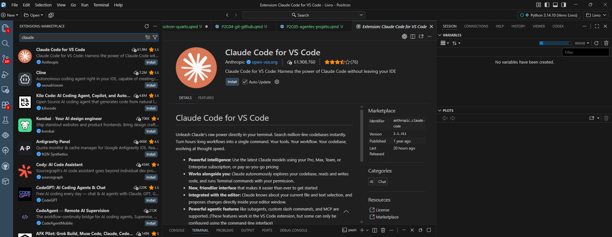

## Introdução

Um chatbot responde a uma mensagem a partir do contexto que recebeu. Um agente de desenvolvimento pode, além de responder, consultar arquivos, propor alterações, executar comandos e verificar resultados dentro de um ambiente autorizado. Essa diferença amplia sua utilidade, mas também amplia os efeitos de uma instrução imprecisa.

Neste livro, consideraremos o **Codex** e o **Claude Code** como instrumentos de apoio à organização, à redação técnica e à programação. Eles não substituem a autoria, a interpretação jurídica ou a validação dos resultados.

::: {.callout-note title="Objetivos do capítulo"}

Ao final deste capítulo, você deverá ser capaz de:

- distinguir uma conversa de uma atuação agêntica;
- instalar ou ativar Codex e Claude Code como extensões no Positron;
- abrir uma ferramenta no contexto correto do projeto;
- formular uma primeira tarefa de leitura sem autorizar alterações;
- compreender permissões de leitura, escrita e execução;
- reconhecer a função de arquivos de orientação do projeto;
- proteger credenciais, dados e decisões intelectuais.

:::

## De uma resposta para uma ação

Uma pergunta como “o que esta função faz?” pode ser respondida sem acesso ao projeto. Já a solicitação “localize o erro, corrija o arquivo e teste o resultado” pressupõe acesso aos arquivos e, em algum grau, autorização para modificá-los e executar comandos.

| Tipo de interação | Contexto principal | Efeito esperado |
|---|---|---|
| conversa | mensagem e anexos fornecidos | explicação ou proposta |
| agente com leitura | arquivos autorizados | diagnóstico fundamentado no projeto |
| agente com escrita | arquivos e regras | alteração local dos arquivos |
| agente com execução | terminal e ferramentas | comandos, testes e renderizações |

O termo “agente” não significa autonomia irrestrita. A atuação deve ser delimitada por escopo, permissões, regras do projeto e pontos de aprovação humana.

## Codex e Claude Code

Codex e Claude Code podem trabalhar com arquivos e comandos locais. As interfaces e formas de instalação não são idênticas, mas o princípio de uso no projeto é semelhante.

### Codex

O Codex pode ser utilizado em aplicativo próprio, no terminal e por meio de extensão para editores compatíveis com VS Code. Neste livro, adotaremos a extensão dentro do Positron para manter os arquivos, o terminal e a conversa no mesmo ambiente. O aplicativo e a interface de terminal são alternativas de uso, não pré-requisitos para a extensão. Por isso, o comando `codex --version` somente funciona quando a interface de terminal foi instalada; ele não serve para verificar a extensão.

A instalação adotada no curso começa no próprio Positron: abra **Extensions**, pesquise **Codex**, confirme que a extensão corresponde à ferramenta oficial, selecione **Install**, abra o ícone do Codex e faça a autenticação solicitada. Depois, abra uma pasta de projeto e inicie a conversa no painel lateral. A [documentação oficial da extensão do Codex](https://learn.chatgpt.com/docs/codex/ide) descreve esse percurso.

O Positron utiliza um catálogo baseado no Open VSX e também permite instalar extensões por arquivo `.vsix`. Como nem toda extensão do catálogo do VS Code é distribuída no Open VSX, a disponibilidade precisa ser conferida na versão instalada do Positron.

### Claude Code

O Claude Code possui interface de terminal e integração com editores compatíveis. Neste livro, procuraremos utilizá-lo no Positron como extensão. Assim como no Codex, a instalação de um aplicativo separado não é condição para pesquisar e instalar a extensão disponível no catálogo do Positron. A interface de terminal constitui uma alternativa para uso, instalação ou diagnóstico e deve seguir a [documentação oficial de configuração](https://code.claude.com/docs/en/setup), pois os requisitos e instaladores podem mudar.

Somente quando a interface de terminal do Claude Code tiver sido instalada, sua verificação é:

```powershell
claude --version
```

Para iniciar uma sessão, abra o terminal na raiz do projeto e execute:

```powershell
claude
```

Se a ferramenta for iniciada em outra pasta, ela poderá receber um contexto diferente daquele que se pretendia utilizar.

::: {.callout-warning title="Confirme a raiz antes de iniciar"}

O caminho mostrado no terminal deve corresponder ao projeto correto. Não use como raiz uma pasta ampla que contenha trabalhos não relacionados.

:::

## Instalação das extensões no Positron

Abra o Positron e selecione o ícone **Extensions** na barra lateral. Em seguida:

1. pesquise a extensão pelo nome da ferramenta;
2. confira o nome do publicador, a documentação e a origem do pacote;
3. selecione **Install** somente depois de confirmar a procedência;
4. reinicie ou recarregue o Positron se isso for solicitado;
5. abra o painel da extensão e realize a autenticação com a conta correspondente;
6. confirme quais permissões de arquivos e execução serão concedidas.

As extensões do Positron são separadas daquelas instaladas no VS Code. Portanto, ter uma extensão no VS Code não significa que ela esteja instalada no Positron. Da mesma forma, instalar a extensão não torna obrigatório instalar a interface de terminal da mesma ferramenta.

Se a extensão oficial não aparecer na busca, não instale outra apenas porque possui um nome semelhante. Consulte a documentação do fornecedor. Quando houver um arquivo `.vsix` oficial e compatível, o Positron permite usar o comando **Extensions: Install from VSIX**. Caso contrário, utilize a interface de terminal documentada pelo fornecedor.

{#fig-claude-extensao fig-align="center" width="100%" fig-alt="Painel Extensions do Positron com a extensão Claude Code for VS Code, publicada pela Anthropic, selecionada para instalação."}

A [Figura @fig-claude-extensao] mostra a extensão do Claude Code publicada pela Anthropic. A verificação do nome e do publicador evita a instalação de extensões de terceiros com nomes semelhantes.

## Começando por uma pasta nova

Depois da instalação, comece por uma pasta criada para o trabalho. Ela não precisa conter um projeto pronto: a própria construção do projeto ocorrerá dentro dela. No Windows, crie uma pasta com nome descritivo, abra o Positron, selecione **File > Open Folder** e escolha essa pasta. Confirme no Explorer que ela aparece como raiz.

Quando o painel do Codex ou do Claude Code é aberto, a ferramenta recebe como contexto a pasta que está aberta no Positron, conforme as permissões concedidas. Não é necessário realizar uma integração adicional com a pasta. Também não é adequado abrir como raiz um diretório amplo que reúna pesquisas não relacionadas.

O percurso básico é:

1. criar uma pasta exclusiva para o novo trabalho;
2. abrir essa pasta no Positron;
3. conferir a raiz no Explorer;
4. abrir o painel do Codex ou do Claude Code;
5. conferir o contexto e as permissões apresentados;
6. começar solicitando a leitura da pasta e uma proposta de estrutura;
7. autorizar a criação de arquivos ou a execução somente quando a etapa exigir.

<!-- IMAGEM A INSERIR: figuras/parte-02-ambiente-trabalho/agente-terminal-positron.png — terminal do Positron aberto na raiz do projeto, sem credenciais visíveis. -->

O terminal integrado continua sendo utilizado para comandos de instalação, diagnóstico e execução. Ele também constitui a alternativa quando uma integração oficial não estiver disponível no catálogo do Positron.

## Leitura, escrita e execução

Uma tarefa deve indicar o tipo de atuação autorizado.

### Leitura

Na leitura, o agente inspeciona arquivos e relata o que encontrou. Esse é o modo adequado para conhecer um projeto, comparar versões ou preparar uma proposta.

Exemplo:

> Leia os arquivos de orientação e o capítulo indicado. Não altere arquivos. Identifique a estrutura atual, as fontes usadas e os pontos que exigem decisão dos autores.

### Escrita

Na escrita, o agente modifica ou cria arquivos dentro do escopo aprovado. A instrução deve indicar os caminhos permitidos, o texto-base e aquilo que não pode ser alterado.

### Execução

Na execução, o agente utiliza o terminal para rodar códigos, verificações ou renderizações. A autorização para editar não implica automaticamente autorização para publicar, instalar programas, alterar Git ou enviar dados a serviços externos.

```{mermaid}
%%| fig-align: center
%%| fig-alt: "Fluxo de trabalho entre pedido humano, leitura, proposta, aprovação, alteração e verificação"

flowchart LR
    A["Pedido delimitado"] --> B["Leitura do projeto"]
    B --> C["Proposta"]
    C --> D{"Aprovação humana?"}
    D -- "não" --> E["Revisar a proposta"]
    E --> C
    D -- "sim" --> F["Alteração autorizada"]
    F --> G["Verificação"]
    G --> H["Relato do que mudou"]

    classDef principal fill:#E8EEF5,stroke:#415A77,stroke-width:2px,color:#233F56;
    classDef decisao fill:#F4E9D7,stroke:#B49A68,stroke-width:2px,color:#233F56;
    class A,B,C,E,F,G,H principal;
    class D decisao;
```

## Contexto do projeto

O agente precisa conhecer as regras aplicáveis à tarefa. Sem contexto, ele pode reorganizar arquivos, reduzir um texto ou substituir exemplos sem compreender as decisões editoriais já adotadas.

Alguns projetos mantêm arquivos próprios de orientação. O Codex reconhece o arquivo `AGENTS.md` como uma convenção opcional para instruções persistentes do repositório. O Claude Code utiliza `CLAUDE.md` para finalidade semelhante. Outros arquivos podem registrar objetivo, decisões, fontes, plano e procedimentos.

Esses documentos podem informar:

- objetivo e escopo do projeto;
- arquivos que devem ser lidos antes do trabalho;
- fontes autorizadas;
- padrões de escrita e código;
- operações proibidas ou dependentes de aprovação;
- formas de validação;
- responsabilidades de autoria e publicação.

Neste momento, importa reconhecer sua função. A criação da estrutura completa de regras, contexto e skills será realizada no capítulo dedicado à montagem do projeto de pesquisa.

## Skills e instruções reutilizáveis

Uma **skill** reúne instruções especializadas e, quando necessário, referências ou scripts para tarefas recorrentes. Ela pode padronizar uma rotina, mas não deve substituir as decisões específicas do projeto.

Antes de criar uma skill, é preciso verificar se a regra pertence:

- ao projeto atual, caso em que deve permanecer em seus arquivos de orientação;
- a uma tarefa repetida em diferentes projetos, caso em que uma skill pode ser adequada;
- a uma decisão pontual, caso em que a instrução deve ser fornecida na própria tarefa.

Essa distinção evita transformar uma decisão editorial viva em uma regra rígida aplicada fora de contexto.

## Um primeiro pedido seguro

Ao abrir uma pasta nova, comece com uma solicitação que esclareça o objetivo e preserve um ponto de aprovação:

> Esta pasta será utilizada para um novo projeto de pesquisa. Não crie nem altere arquivos e não execute comandos. Proponha uma estrutura inicial de pastas e documentos, explique a função de cada elemento e indique quais decisões precisam ser tomadas antes da criação. Aguarde aprovação.

Esse formato explicita o objetivo, o escopo, as restrições e o produto esperado. Depois de avaliar a resposta, o pesquisador pode autorizar uma etapa delimitada. Quando a pasta já contiver arquivos, o primeiro pedido deve determinar sua leitura antes de qualquer proposta de reorganização.

## Supervisão humana

Agentes podem produzir códigos sintaticamente corretos e metodologicamente inadequados. Também podem atribuir uma informação à fonte errada, interpretar de modo incompleto uma decisão jurídica ou eliminar detalhes que pareçam repetitivos, mas sejam necessários ao argumento.

Por isso, a supervisão deve incluir:

- leitura da proposta antes da alteração;
- comparação com o texto-base;
- revisão dos arquivos modificados;
- execução controlada dos códigos;
- exame dos resultados produzidos;
- decisão expressa sobre versionamento e publicação.

::: {.callout-important title="A autorização deve ser específica"}

Autorizar a redação de um capítulo não autoriza instalar programas, modificar outros capítulos, executar Git, publicar uma página ou enviar dados a um serviço externo.

:::

## Dados, credenciais e serviços externos

Não inclua senhas, tokens ou chaves de API em prompts, códigos ou arquivos versionados. Antes de permitir acesso a uma pasta, verifique se ela contém documentos sigilosos, dados pessoais ou materiais de terceiros que não devam ser processados pelo serviço utilizado.

Também é necessário distinguir execução local de processamento remoto. As condições de uso e as políticas de dados variam entre produtos, planos e formas de acesso. Consulte a documentação institucional vigente antes de utilizar bases jurídicas protegidas.

## Síntese

Neste capítulo, distinguimos conversa, leitura, escrita e execução. Situamos Codex e Claude Code no ambiente do projeto, apresentamos a função dos arquivos de orientação e definimos um fluxo com aprovação humana.

O uso de agentes será retomado quando estruturarmos um projeto de pesquisa completo. Nessa etapa, criaremos os arquivos necessários de acordo com o objetivo, as fontes e os limites do trabalho.

::: {.callout-tip title="Antes de avançar"}

- [ ] A ferramenta foi aberta na raiz correta?
- [ ] O pedido identifica arquivos, objetivo e restrições?
- [ ] A primeira etapa é de leitura quando o projeto ainda não foi examinado?
- [ ] Escrita e execução dependem de autorização específica?
- [ ] Credenciais e dados protegidos estão fora do contexto enviado?
- [ ] A validação intelectual permanece com os autores?

:::

## Referências de instalação e consulta

- [Documentação oficial do Codex](https://developers.openai.com/learn/codex)
- [Fluxos de trabalho com Codex e `AGENTS.md`](https://developers.openai.com/cookbook/examples/codex/iterating-development-workflows-with-codex)
- [Configuração oficial do Claude Code](https://code.claude.com/docs/en/setup)

## Slides da aula

[Ver os slides — Agentes de inteligência artificial](../slides/ambiente-trabalho/agentes-projeto/index.html){.btn .btn-primary target="_blank"}
