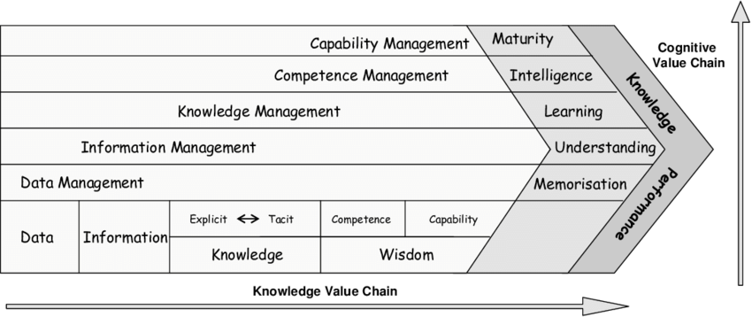
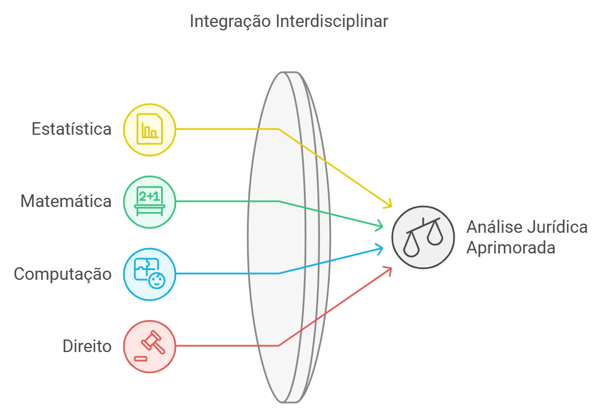
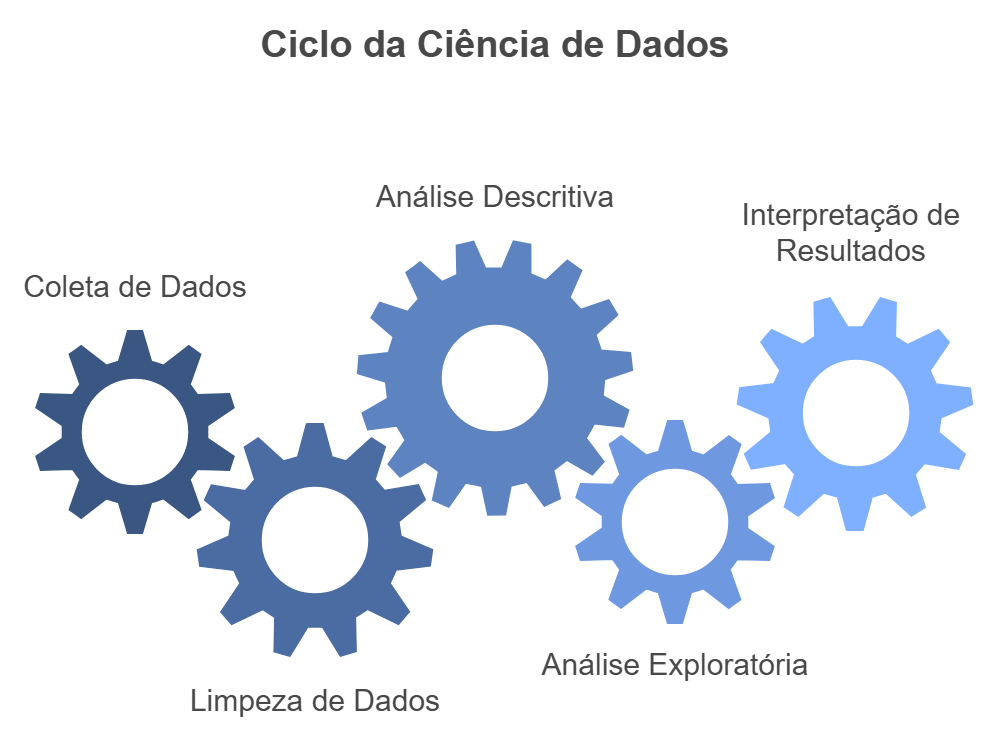

```{r}
#| include: false
#| eval: true
knitr::opts_knit$set(root.dir = normalizePath(".."))
options(scipen = 999)
```

## Introdução

A análise descritiva organiza as informações contidas em um banco de dados. Ela apresenta a composição da amostra, resume a posição e a dispersão das variáveis numéricas e identifica padrões de distribuição e associação. Essas operações constituem uma etapa necessária entre a construção do banco e a elaboração de modelos estatísticos.

Neste capítulo, utilizaremos o banco tratado no capítulo anterior. Ele reúne 642 acórdãos sobre violência de gênero digital e contém informações sobre tribunal, ano, perfil das partes, participação de plataformas, tipos de prova, suficiência probatória, resultado em primeira instância e indenização.

O banco primário é de propriedade do InternetLab e deriva de pesquisa desenvolvida pela instituição. A base utilizada no livro corresponde a um recorte didático, sem identificadores processuais e campos textuais, posteriormente estruturado e tratado conforme as decisões documentadas no capítulo anterior.

O percurso está organizado em cinco blocos:

1. medidas de posição;
2. medidas de variabilidade;
3. distribuições;
4. variáveis categóricas;
5. medidas de associação.

::: {.callout-note title="Objetivos do capítulo"}

Ao final do capítulo, você deverá ser capaz de selecionar estatísticas compatíveis com o tipo de variável, interpretar medidas numéricas e frequências, representar distribuições graficamente e examinar associações sem atribuir a elas uma interpretação causal automática.

:::

## Análise preliminar

### Cadeia de valor do conhecimento

A análise descritiva integra um percurso que começa com registros dispersos e termina com informação interpretável. A cadeia de valor do conhecimento representa a passagem dos dados à informação, da informação ao conhecimento e do conhecimento à decisão. A estatística descritiva participa desse percurso ao resumir os registros, tornar padrões visíveis e indicar questões que exigem investigação posterior.

{width="80%" fig-align="center"}

A ciência de dados combina conhecimentos de estatística, computação e do domínio substantivo da pesquisa. Na jurimetria, a interpretação depende também do desenho da pesquisa, das instituições jurídicas e do processo que deu origem aos dados.

{width="70%" fig-align="center"}

### O ciclo da ciência de dados

O ciclo da ciência de dados não termina com a construção do banco. Depois da coleta, da extração, da limpeza e da estruturação, é necessário descrever as observações, avaliar sua distribuição, identificar associações e interpretar os resultados à luz da pergunta de pesquisa.

{width="70%" fig-align="center"}

Neste livro, o percurso é organizado em etapas relacionadas:

1. **coleta e extração:** obtenção dos documentos e registro das informações relevantes;
2. **limpeza e estruturação:** padronização das categorias, tratamento das ausências e construção do banco analisável;
3. **análise descritiva:** síntese da posição, da variabilidade e das distribuições;
4. **análise exploratória:** exame de padrões e associações que podem orientar novas perguntas;
5. **interpretação:** retorno ao problema jurídico para avaliar o alcance e os limites dos resultados.

### O que será analisado

Trabalharemos com três grupos de medidas. As **medidas de posição** indicam onde os valores se concentram; as **medidas de variabilidade** descrevem sua dispersão; e as **medidas de associação** examinam como duas variáveis se comportam conjuntamente. Essas medidas serão combinadas com tabelas e gráficos adequados a variáveis numéricas e categóricas.

## Preparando o banco

```{r}
library(dplyr)
library(readr)
library(tidyr)
library(tibble)
library(ggplot2)
library(kableExtra)
library(ggcorrplot)

base <- read_csv(
  "dados/violencia_digital_didatica_tratada.csv",
  na = c("", "NA"),
  show_col_types = FALSE
)
```

Cada linha corresponde a um acórdão. Assim, uma contagem representa acórdãos, e não pessoas, fatos ou documentos existentes nos processos de origem.

```{r}
dim(base)
```

```{r}
glimpse(base)
```

Criamos funções auxiliares para calcular percentuais e identificar a moda de uma variável numérica.

```{r}
calcular_percentual <- function(n) {
  round(100 * n / sum(n), 1)
}

calcular_moda <- function(x) {
  x <- x[!is.na(x)]
  frequencias <- table(x)
  modas <- names(frequencias)[
    frequencias == max(frequencias)
  ]
  paste(modas, collapse = "; ")
}

formatar_moeda <- function(x) {
  ifelse(
    is.na(x),
    "NA",
    paste0(
      "R$ ",
      format(
        round(x, 2),
        big.mark = ".",
        decimal.mark = ",",
        nsmall = 2,
        scientific = FALSE,
        trim = TRUE
      )
    )
  )
}

indicadores_prova <- c(
  "prova_documental",
  "prova_print",
  "prova_depoimento_testemunhal",
  "prova_audio_video",
  "prova_imei_ip_url",
  "prova_boletim_ocorrencia",
  "prova_imagem",
  "prova_ata_notarial",
  "prova_outros"
)

base <- base |>
  mutate(
    numero_provas = if_else(
      prova_nao_cita == 1,
      NA_real_,
      rowSums(
        across(all_of(indicadores_prova)),
        na.rm = TRUE
      )
    )
  )

limite_superior_975 <- quantile(
  base$valor_indenizacao_jul2026[
    base$valor_indenizacao_jul2026 > 0
  ],
  probs = 0.975,
  na.rm = TRUE
)

base_indenizacoes_recorte <- base |>
  filter(
    valor_indenizacao_jul2026 > 0,
    valor_indenizacao_jul2026 <= limite_superior_975
  )
```

## Medidas de posição

Medidas de posição indicam onde os valores de uma distribuição se concentram. Utilizaremos as indenizações atualizadas para julho de 2026, o que permite comparar valores registrados em anos diferentes.

### Média

A média aritmética é a soma dos valores dividida pelo número de observações válidas:

$$
\bar{x}=\frac{1}{n}\sum_{i=1}^{n}x_i
$$

A média utiliza todas as observações e, por isso, é sensível a valores extremos.

```{r}
media_com_zero <- mean(
  base$valor_indenizacao_jul2026,
  na.rm = TRUE
)

media_com_zero
```

O argumento `na.rm = TRUE` retira apenas os valores ausentes do cálculo. Os valores iguais a zero permanecem na média.

### Mediana

A mediana divide os valores ordenados em duas partes. Metade das observações fica abaixo dela e metade, acima. Em distribuições assimétricas, ela costuma representar o centro com menor influência dos extremos.

```{r}
mediana_com_zero <- median(
  base$valor_indenizacao_jul2026,
  na.rm = TRUE
)

mediana_com_zero
```

### Moda

A moda corresponde ao valor mais frequente. Uma distribuição pode apresentar uma ou mais modas.

```{r}
moda_com_zero <- calcular_moda(
  base$valor_indenizacao_jul2026
)

moda_com_zero
```

### Quartis e percentis

Os quartis dividem a distribuição ordenada em quatro partes. O primeiro quartil corresponde ao percentil 25; o segundo, à mediana; e o terceiro, ao percentil 75.

```{r}
resumo_posicao <- base |>
  summarise(
    observacoes_validas = sum(
      !is.na(valor_indenizacao_jul2026)
    ),
    media = mean(
      valor_indenizacao_jul2026,
      na.rm = TRUE
    ),
    mediana = median(
      valor_indenizacao_jul2026,
      na.rm = TRUE
    ),
    moda = calcular_moda(
      valor_indenizacao_jul2026
    ),
    primeiro_quartil = quantile(
      valor_indenizacao_jul2026,
      0.25,
      na.rm = TRUE,
      names = FALSE
    ),
    terceiro_quartil = quantile(
      valor_indenizacao_jul2026,
      0.75,
      na.rm = TRUE,
      names = FALSE
    )
  )

resumo_posicao |>
  mutate(
    media = formatar_moeda(media),
    mediana = formatar_moeda(mediana),
    primeiro_quartil = formatar_moeda(primeiro_quartil),
    terceiro_quartil = formatar_moeda(terceiro_quartil)
  ) |>
  kbl(
    align = "c",
    caption = "Medidas de posição das indenizações, incluindo zero"
  ) |>
  kable_styling(full_width = FALSE)
```

Percentis permitem examinar outros pontos da distribuição. O comando abaixo calcula os percentis 1, 5, 25, 50, 75, 95 e 99:

```{r}
percentis_indenizacao <- quantile(
  base$valor_indenizacao_jul2026,
  probs = c(0.01, 0.05, 0.25, 0.50, 0.75, 0.95, 0.99),
  na.rm = TRUE
)

tibble(
  percentil = names(percentis_indenizacao),
  valor = formatar_moeda(
    as.numeric(percentis_indenizacao)
  )
) |>
  kbl(
    align = "c",
    caption = "Percentis dos valores de indenização"
  ) |>
  kable_styling(full_width = FALSE)
```

## Medidas de variabilidade

Medidas de variabilidade descrevem a dispersão. Duas distribuições podem apresentar a mesma média e concentrações distintas.

### Amplitude

A amplitude é a diferença entre o maior e o menor valor:

$$
A=x_{\max}-x_{\min}
$$

Como depende apenas dos extremos, ela é sensível a observações atípicas.

```{r}
amplitude_com_zero <- diff(
  range(
    base$valor_indenizacao_jul2026,
    na.rm = TRUE
  )
)

amplitude_com_zero
```

Esse resultado considera todos os valores monetários informados, inclusive os iguais a zero.

### Amplitude interquartil

A amplitude interquartil descreve a dispersão dos 50% centrais:

$$
AIQ=Q_3-Q_1
$$

```{r}
aiq_com_zero <- IQR(
  base$valor_indenizacao_jul2026,
  na.rm = TRUE
)

aiq_com_zero
```

Como utiliza os quartis, a amplitude interquartil é menos influenciada pelos extremos do que a amplitude total.

### Variância e desvio-padrão

A variância amostral mede os desvios quadráticos em torno da média:

$$
s^2=\frac{\sum_{i=1}^{n}(x_i-\bar{x})^2}{n-1}
$$

O desvio-padrão é a raiz da variância e retorna à unidade monetária:

$$
s=\sqrt{s^2}
$$

```{r}
variancia_com_zero <- var(
  base$valor_indenizacao_jul2026,
  na.rm = TRUE
)

variancia_com_zero
```

```{r}
desvio_padrao_com_zero <- sd(
  base$valor_indenizacao_jul2026,
  na.rm = TRUE
)

desvio_padrao_com_zero
```

A variância está expressa em unidades monetárias ao quadrado. O desvio-padrão retorna à unidade dos valores de indenização e, por isso, possui interpretação mais direta.

### Coeficiente de variação

O coeficiente de variação relaciona o desvio-padrão à média:

$$
CV=\frac{s}{\bar{x}}\times 100
$$

```{r}
cv_com_zero <- 100 *
  desvio_padrao_com_zero /
  media_com_zero

cv_com_zero
```

O coeficiente de variação expressa o desvio-padrão como percentual da média. Ele deve ser interpretado com cautela quando a média se aproxima de zero ou quando a distribuição contém muitos zeros.

## Decisões sobre zeros e valores extremos

As medidas anteriores utilizaram todos os valores monetários informados. Esse primeiro diagnóstico revelou duas questões que precisam ser decididas antes dos gráficos e das análises seguintes: o significado dos zeros e a influência dos maiores valores.

### O papel dos valores iguais a zero

No banco didático, não é possível assegurar apenas pela variável monetária se zero significa inexistência de indenização, inexistência de pedido ou informação não localizada. Por isso, apresentamos primeiro os resultados completos e, a partir daqui, comparamos três recortes:

1. todos os valores informados, incluindo zero;
2. somente indenizações positivas;
3. indenizações positivas até o percentil 97,5.

```{r}
comparacao_posicao <- bind_rows(
  base |>
    filter(!is.na(valor_indenizacao_jul2026)) |>
    summarise(
      grupo = "Incluindo zero",
      n = n(),
      media = mean(valor_indenizacao_jul2026),
      mediana = median(valor_indenizacao_jul2026),
      primeiro_quartil = quantile(
        valor_indenizacao_jul2026,
        0.25
      ),
      terceiro_quartil = quantile(
        valor_indenizacao_jul2026,
        0.75
      )
    ),
  base |>
    filter(valor_indenizacao_jul2026 > 0) |>
    summarise(
      grupo = "Somente positivas",
      n = n(),
      media = mean(valor_indenizacao_jul2026),
      mediana = median(valor_indenizacao_jul2026),
      primeiro_quartil = quantile(
        valor_indenizacao_jul2026,
        0.25
      ),
      terceiro_quartil = quantile(
        valor_indenizacao_jul2026,
        0.75
      )
    ),
  base_indenizacoes_recorte |>
    summarise(
      grupo = "Positivas até P97,5",
      n = n(),
      media = mean(valor_indenizacao_jul2026),
      mediana = median(valor_indenizacao_jul2026),
      primeiro_quartil = quantile(
        valor_indenizacao_jul2026,
        0.25
      ),
      terceiro_quartil = quantile(
        valor_indenizacao_jul2026,
        0.75
      )
    )
)

```

A comparação mostra quanto a média, a mediana e os quartis dependem da decisão sobre os zeros e a cauda superior. O recorte não modifica o banco original; ele cria uma base derivada para as análises seguintes.

### Variabilidade entre indenizações positivas

Agora excluímos os registros iguais a zero e calculamos as mesmas medidas somente entre as indenizações positivas. Esse recorte evita misturar a existência de indenização com sua magnitude. Em seguida, retiramos apenas os valores acima do percentil 97,5 para observar quanto da dispersão decorre da cauda superior.

#### Amplitude das indenizações positivas

```{r}
amplitude_positivos <- diff(
  range(
    base$valor_indenizacao_jul2026[
      base$valor_indenizacao_jul2026 > 0
    ],
    na.rm = TRUE
  )
)

amplitude_positivos
```

#### Amplitude interquartil das indenizações positivas

```{r}
aiq_positivos <- IQR(
  base$valor_indenizacao_jul2026[
    base$valor_indenizacao_jul2026 > 0
  ],
  na.rm = TRUE
)

aiq_positivos
```

#### Variância e desvio-padrão das indenizações positivas

```{r}
variancia_positivos <- var(
  base$valor_indenizacao_jul2026[
    base$valor_indenizacao_jul2026 > 0
  ],
  na.rm = TRUE
)

variancia_positivos
```

```{r}
desvio_padrao_positivos <- sd(
  base$valor_indenizacao_jul2026[
    base$valor_indenizacao_jul2026 > 0
  ],
  na.rm = TRUE
)

desvio_padrao_positivos
```

#### Coeficiente de variação das indenizações positivas

```{r}
media_positivos <- mean(
  base$valor_indenizacao_jul2026[
    base$valor_indenizacao_jul2026 > 0
  ],
  na.rm = TRUE
)

cv_positivos <- 100 *
  desvio_padrao_positivos /
  media_positivos

cv_positivos
```

#### Recorte superior das indenizações positivas

O banco de análise mantém os valores positivos até o percentil 97,5. Ele será utilizado nos gráficos seguintes para tornar visível a região em que se concentra a maior parte das indenizações. O banco original permanece inalterado.

```{r}
tibble(
  limite = "Percentil 97,5",
  valor = formatar_moeda(as.numeric(limite_superior_975))
) |>
  kbl(
    align = "c",
    caption = "Limite superior do recorte"
  ) |>
  kable_styling(full_width = FALSE)
```

### Comparação final das medidas de posição e variabilidade

Depois de calcular cada medida separadamente, reunimos posição e variabilidade nos três recortes. Essa tabela encerra a decisão metodológica. A partir da próxima seção, utilizaremos apenas as indenizações positivas até o percentil 97,5.

```{r}
calcular_variabilidade <- function(dados, grupo) {
  dados |>
    summarise(
      grupo = grupo,
      n = n(),
      minimo = min(valor_indenizacao_jul2026),
      maximo = max(valor_indenizacao_jul2026),
      amplitude = maximo - minimo,
      amplitude_interquartil = IQR(
        valor_indenizacao_jul2026
      ),
      variancia = var(valor_indenizacao_jul2026),
      desvio_padrao = sd(valor_indenizacao_jul2026),
      coeficiente_variacao = 100 *
        desvio_padrao /
        mean(valor_indenizacao_jul2026)
    )
}

resumo_variabilidade <- bind_rows(
  base |>
    filter(!is.na(valor_indenizacao_jul2026)) |>
    calcular_variabilidade("Incluindo zero"),
  base |>
    filter(valor_indenizacao_jul2026 > 0) |>
    calcular_variabilidade("Somente positivas"),
  base_indenizacoes_recorte |>
    calcular_variabilidade("Positivas até P97,5")
)

comparacao_final <- comparacao_posicao |>
  left_join(
    resumo_variabilidade,
    by = c("grupo", "n")
  ) |>
  select(
    grupo,
    n,
    media,
    mediana,
    primeiro_quartil,
    terceiro_quartil,
    amplitude,
    amplitude_interquartil,
    variancia,
    desvio_padrao,
    coeficiente_variacao
  ) |>
  pivot_longer(
    cols = -grupo,
    names_to = "medida",
    values_to = "valor"
  ) |>
  mutate(
    medida = recode(
      medida,
      n = "Observações",
      media = "Média",
      mediana = "Mediana",
      primeiro_quartil = "Primeiro quartil",
      terceiro_quartil = "Terceiro quartil",
      amplitude = "Amplitude",
      amplitude_interquartil = "Amplitude interquartil",
      variancia = "Variância",
      desvio_padrao = "Desvio-padrão",
      coeficiente_variacao = "Coeficiente de variação"
    ),
    valor = case_when(
      medida == "Observações" ~ format(
        round(valor),
        scientific = FALSE,
        trim = TRUE
      ),
      medida == "Coeficiente de variação" ~ paste0(
        round(valor, 1),
        "%"
      ),
      TRUE ~ formatar_moeda(valor)
    )
  ) |>
  select(medida, grupo, valor) |>
  pivot_wider(
    names_from = grupo,
    values_from = valor
  )

comparacao_final |>
  kbl(
    align = "c",
    caption = "Medidas de posição e variabilidade segundo o recorte analítico"
  ) |>
  kable_styling(full_width = FALSE)
```

As diferenças entre as colunas mostram como as decisões sobre zeros e cauda superior alteram a descrição dos valores. Não se trata de escolher a coluna que produz o resultado mais conveniente, mas de relacionar cada recorte à pergunta substantiva e à qualidade do registro.

::: {.callout-note collapse="true" title="Equivalente em Python: posição e variabilidade"}

```{python}
#| eval: false
valor = base["valor_indenizacao_jul2026"].dropna()
positivos = valor[valor > 0]
limite_superior = positivos.quantile(0.975)
positivos_recorte = positivos[positivos <= limite_superior]

resumo = {
    "media": valor.mean(),
    "mediana": valor.median(),
    "primeiro_quartil": valor.quantile(0.25),
    "terceiro_quartil": valor.quantile(0.75),
    "amplitude": valor.max() - valor.min(),
    "amplitude_interquartil": valor.quantile(0.75) - valor.quantile(0.25),
    "variancia": valor.var(),
    "desvio_padrao": valor.std()
}
```

:::

## Distribuições gráficas

Uma distribuição informa quais valores uma variável assume e com que frequência. Para variáveis numéricas, histogramas e boxplots ajudam a identificar concentração, assimetria e valores extremos. Para variáveis temporais, gráficos de barras permitem visualizar a composição da amostra ao longo do período.

### Distribuição temporal

Começamos examinando quando os acórdãos foram decididos. A série descreve a composição temporal do banco, e não a incidência anual da violência de gênero digital.

```{r}
distribuicao_anos <- base |>
  count(
    ano_decisao,
    name = "numero_acordaos"
  ) |>
  arrange(ano_decisao)

distribuicao_anos
```

```{r}
ggplot(
  filter(distribuicao_anos, !is.na(ano_decisao)),
  aes(x = ano_decisao, y = numero_acordaos)
) +
  geom_line(
    color = "#233F56",
    linewidth = 1
  ) +
  geom_point(
    color = "#B49A68",
    size = 2
  ) +
  scale_x_continuous(
    breaks = seq(2010, 2025, by = 2)
  ) +
  labs(
    x = "Ano do acórdão",
    y = "Número de acórdãos",
    title = "Evolução anual dos acórdãos incluídos no banco"
  ) +
  theme_minimal(base_size = 12)
```

O gráfico descreve os documentos incluídos no banco. Ele não mede diretamente a incidência da violência de gênero digital, pois a frequência de acórdãos também depende da coleta, da publicação e da tramitação judicial.

### Histograma das indenizações positivas

O histograma divide a amplitude dos valores em intervalos e representa quantas observações pertencem a cada intervalo. Para evitar a ambiguidade dos zeros e tornar visível a região central, o gráfico utiliza indenizações positivas até o percentil 97,5.

```{r}
ggplot(
  base_indenizacoes_recorte,
  aes(x = valor_indenizacao_jul2026)
) +
  geom_histogram(
    bins = 30,
    fill = "#415A77",
    color = "white"
  ) +
  geom_vline(
    xintercept = median(
      base_indenizacoes_recorte$valor_indenizacao_jul2026,
      na.rm = TRUE
    ),
    color = "#B49A68",
    linewidth = 1
  ) +
  scale_x_continuous(
    labels = function(x) {
      paste0(
        "R$ ",
        format(
          x,
          big.mark = ".",
          decimal.mark = ",",
          scientific = FALSE,
          trim = TRUE
        )
      )
    }
  ) +
  labs(
    x = "Indenização em valores de julho de 2026",
    y = "Número de acórdãos",
    title = "Distribuição das indenizações positivas",
    subtitle = "Valores até P97,5; a linha indica a mediana"
  ) +
  theme_minimal(base_size = 12)
```

A concentração de observações em valores baixos e a presença de indenizações elevadas produzem uma distribuição assimétrica à direita. Nessa situação, média e mediana devem ser apresentadas conjuntamente.

### Densidade de kernel

A densidade de kernel oferece uma representação contínua da mesma distribuição. Ela suaviza o histograma e facilita a identificação das regiões em que os valores se concentram. A área sob a curva é igual a um; sua altura representa densidade, e não número de casos.

```{r}
ggplot(
  base_indenizacoes_recorte,
  aes(x = valor_indenizacao_jul2026)
) +
  geom_density(
    fill = "#E8EEF5",
    color = "#233F56",
    linewidth = 1,
    alpha = 0.8
  ) +
  scale_x_continuous(labels = formatar_moeda) +
  labs(
    x = "Indenização em valores de julho de 2026",
    y = "Densidade",
    title = "Densidade das indenizações positivas",
    subtitle = "Valores até P97,5"
  ) +
  theme_minimal(base_size = 12)
```

### Comparação de densidades entre grupos

Também podemos comparar distribuições entre grupos. O gráfico seguinte separa as indenizações positivas conforme a plataforma integra ou não a ação. A comparação é descritiva e não atribui à presença da plataforma qualquer efeito sobre o valor.

```{r}
ggplot(
  base_indenizacoes_recorte,
  aes(
    x = valor_indenizacao_jul2026,
    color = plataforma_parte,
    fill = plataforma_parte
  )
) +
  geom_density(alpha = 0.25, linewidth = 1) +
  scale_color_manual(
    values = c("Não" = "#233F56", "Sim" = "#B49A68")
  ) +
  scale_fill_manual(
    values = c("Não" = "#233F56", "Sim" = "#B49A68")
  ) +
  scale_x_continuous(labels = formatar_moeda) +
  labs(
    x = "Indenização em valores de julho de 2026",
    y = "Densidade",
    color = "Plataforma integra a ação",
    fill = "Plataforma integra a ação",
    title = "Densidade das indenizações segundo a participação da plataforma",
    subtitle = "Valores positivos até P97,5"
  ) +
  theme_minimal(base_size = 12)
```

### Boxplot e valores extremos

O boxplot resume uma distribuição por meio de cinco referências. A caixa começa no primeiro quartil e termina no terceiro, contendo os 50% centrais dos dados. A linha interna representa a mediana. Os bigodes avançam até as observações situadas, em regra, a no máximo 1,5 amplitude interquartil dos limites da caixa. Pontos além desses limites são assinalados como extremos, mas não devem ser automaticamente tratados como erros.

```{r}
ggplot(
  base_indenizacoes_recorte,
  aes(x = "", y = valor_indenizacao_jul2026)
) +
  geom_boxplot(
    fill = "#E8EEF5",
    color = "#233F56",
    outlier.color = "#B49A68"
  ) +
  scale_y_continuous(
    labels = function(x) {
      paste0(
        "R$ ",
        format(
          x,
          big.mark = ".",
          decimal.mark = ",",
          scientific = FALSE,
          trim = TRUE
        )
      )
    }
  ) +
  labs(
    x = NULL,
    y = "Indenização em valores de julho de 2026",
    title = "Boxplot das indenizações positivas",
    subtitle = "Valores até P97,5"
  ) +
  theme_minimal(base_size = 12)
```

```{r}
estatisticas_boxplot <- boxplot.stats(
  base_indenizacoes_recorte$valor_indenizacao_jul2026
)

tibble(
  limite_inferior = estatisticas_boxplot$stats[1],
  limite_superior = estatisticas_boxplot$stats[5],
  numero_valores_extremos = length(
    estatisticas_boxplot$out
  )
)
```

Uma observação identificada como extrema pelo boxplot não deve ser excluída automaticamente. Ela pode representar um caso juridicamente relevante, uma característica incomum ou um erro. A decisão exige retorno ao contexto e à fonte.

### Boxplot por tribunal

O gráfico seguinte compara a posição e a dispersão das indenizações positivas entre tribunais. Como alguns tribunais têm poucos casos, a leitura deve considerar conjuntamente o número de observações de cada grupo.

```{r}
ggplot(
  base_indenizacoes_recorte,
  aes(
    x = reorder(tribunal, valor_indenizacao_jul2026, median),
    y = valor_indenizacao_jul2026
  )
) +
  geom_boxplot(
    fill = "#E8EEF5",
    color = "#233F56",
    outlier.color = "#B49A68"
  ) +
  scale_y_continuous(labels = formatar_moeda) +
  labs(
    x = NULL,
    y = "Indenização em valores de julho de 2026",
    title = "Indenizações positivas por tribunal",
    subtitle = "Valores positivos até P97,5"
  ) +
  theme_minimal(base_size = 12)
```

::: {.callout-note collapse="true" title="Equivalente em Python: distribuições"}

```{python}
#| eval: false
import seaborn as sns
import matplotlib.pyplot as plt

positivos = base[base["valor_indenizacao_jul2026"] > 0].copy()
limite_superior = positivos["valor_indenizacao_jul2026"].quantile(0.975)
positivos = positivos[
    positivos["valor_indenizacao_jul2026"] <= limite_superior
]

sns.histplot(
    data=positivos,
    x="valor_indenizacao_jul2026",
    bins=30
)
plt.show()

sns.boxplot(
    data=positivos,
    x="tribunal",
    y="valor_indenizacao_jul2026"
)
plt.show()
```

:::

## Descrição de variáveis categóricas

Variáveis categóricas são descritas por frequências absolutas e relativas. Se uma categoria aparece em \(n_j\) dos \(n\) acórdãos, sua proporção é:

$$
p_j=\frac{n_j}{n}
$$

### Tribunais

Vamos analisar como os 642 acórdãos se distribuem entre os tribunais. A frequência revela a composição do banco e ajuda a identificar quais tribunais exercem maior influência sobre os resultados agregados.

```{r}
distribuicao_tribunais <- base |>
  count(
    tribunal,
    name = "numero_acordaos",
    sort = TRUE
  ) |>
  mutate(
    percentual = calcular_percentual(numero_acordaos)
  )

distribuicao_tribunais |>
  kbl(
    col.names = c("Tribunal", "Acórdãos", "Percentual"),
    align = "c",
    caption = "Distribuição dos acórdãos por tribunal"
  ) |>
  kable_styling(full_width = FALSE)
```

O gráfico de setores representa a participação de cada tribunal no total. Ele oferece uma leitura imediata da composição, enquanto o gráfico de barras apresentado em seguida permite comparar as frequências com maior precisão.

```{r}
ggplot(
  distribuicao_tribunais,
  aes(
    x = "",
    y = numero_acordaos,
    fill = tribunal
  )
) +
  geom_col(color = "white") +
  coord_polar(theta = "y") +
  scale_fill_manual(
    values = c(
      "#233F56",
      "#415A77",
      "#B49A68",
      "#6F879D",
      "#8A7655",
      "#A9B7C5"
    )
  ) +
  labs(
    x = NULL,
    y = NULL,
    fill = "Tribunal",
    title = "Participação dos tribunais no banco"
  ) +
  theme_void(base_size = 12)
```

```{r}
ggplot(
  distribuicao_tribunais,
  aes(
    x = reorder(tribunal, numero_acordaos),
    y = numero_acordaos
  )
) +
  geom_col(fill = "#233F56") +
  coord_flip() +
  labs(
    x = NULL,
    y = "Número de acórdãos",
    title = "Acórdãos por tribunal"
  ) +
  theme_minimal(base_size = 12)
```

A concentração no TJSP e no TJPR deve ser considerada em qualquer comparação agregada. As frequências totais refletem a composição do banco e não pesos equivalentes entre tribunais.

### Perfis e participação das plataformas

Nesta etapa, descreveremos quem aparece como vítima, quem aparece como agressor e em quantos acórdãos a plataforma integra a ação. As três variáveis contextualizam os casos e ajudam a interpretar as análises posteriores.

```{r}
distribuicao_perfis <- bind_rows(
  base |>
    count(categoria = perfil_vitima) |>
    mutate(variavel = "Perfil da vítima"),

  base |>
    count(categoria = perfil_agressor) |>
    mutate(variavel = "Perfil do agressor"),

  base |>
    count(categoria = plataforma_parte) |>
    mutate(variavel = "Plataforma integra a ação")
) |>
  group_by(variavel) |>
  mutate(
    percentual = round(100 * n / sum(n), 1)
  ) |>
  ungroup() |>
  select(variavel, categoria, n, percentual)

distribuicao_perfis |>
  kbl(
    col.names = c("Variável", "Categoria", "Acórdãos", "Percentual"),
    align = "c",
    caption = "Perfis das partes e participação das plataformas"
  ) |>
  kable_styling(full_width = FALSE)
```

```{r}
ggplot(
  distribuicao_perfis,
  aes(
    x = reorder(categoria, percentual),
    y = percentual,
    fill = variavel
  )
) +
  geom_col(show.legend = FALSE) +
  coord_flip() +
  facet_wrap(
    ~ variavel,
    scales = "free_y"
  ) +
  scale_fill_manual(
    values = c("#233F56", "#415A77", "#B49A68")
  ) +
  labs(
    x = NULL,
    y = "Percentual de acórdãos"
  ) +
  theme_minimal(base_size = 12)
```

### Indenização segundo o perfil da vítima e do agressor

Os perfis registrados no banco permitem examinar se a distribuição das indenizações varia entre os grupos. Trata-se de uma comparação descritiva: diferenças entre caixas ou densidades não demonstram que o gênero produz determinado valor de indenização. Para manter coerência com os gráficos anteriores, utilizamos valores positivos até o percentil 97,5.

```{r}
dados_perfis_indenizacao <- bind_rows(
  base_indenizacoes_recorte |>
    transmute(
      perfil = perfil_vitima,
      tipo = "Perfil da vítima",
      valor_indenizacao_jul2026
    ),
  base_indenizacoes_recorte |>
    transmute(
      perfil = perfil_agressor,
      tipo = "Perfil do agressor",
      valor_indenizacao_jul2026
    )
)

ggplot(
  dados_perfis_indenizacao,
  aes(
    x = perfil,
    y = valor_indenizacao_jul2026,
    fill = perfil
  )
) +
  geom_boxplot(
    color = "#233F56",
    outlier.color = "#B49A68",
    show.legend = FALSE
  ) +
  facet_wrap(~ tipo, scales = "free_x") +
  scale_fill_manual(
    values = c(
      "Homem" = "#415A77",
      "Mulher" = "#B49A68",
      "Homem e mulher" = "#6F879D",
      "Não informado" = "#A9B7C5",
      "Organização" = "#8A7655"
    )
  ) +
  scale_y_continuous(labels = formatar_moeda) +
  labs(
    x = NULL,
    y = "Indenização em valores de julho de 2026",
    title = "Indenizações segundo os perfis registrados",
    subtitle = "Valores positivos até P97,5"
  ) +
  theme_minimal(base_size = 12) +
  theme(
    axis.text.x = element_text(
      angle = 45,
      hjust = 1
    )
  )
```

### Tipos de prova: categorias de múltipla resposta

Um acórdão pode registrar mais de um tipo de prova. Os indicadores probatórios não são categorias mutuamente exclusivas. A análise mede quantos acórdãos registram cada prova e não reparte os casos em grupos excludentes.

```{r}
indicadores_prova <- c(
  "prova_documental",
  "prova_print",
  "prova_depoimento_testemunhal",
  "prova_audio_video",
  "prova_imei_ip_url",
  "prova_boletim_ocorrencia",
  "prova_imagem",
  "prova_ata_notarial",
  "prova_outros",
  "prova_nao_cita"
)

rotulos_prova <- c(
  prova_documental = "Prova documental",
  prova_print = "Print",
  prova_depoimento_testemunhal =
    "Depoimento e prova testemunhal",
  prova_audio_video = "Áudio e vídeo",
  prova_imei_ip_url = "IMEI, IP ou URL",
  prova_boletim_ocorrencia =
    "Boletim de ocorrência",
  prova_imagem = "Imagem",
  prova_ata_notarial = "Ata notarial",
  prova_outros = "Outros",
  prova_nao_cita = "Não cita"
)

frequencia_provas <- base |>
  select(id_caso, all_of(indicadores_prova)) |>
  pivot_longer(
    cols = all_of(indicadores_prova),
    names_to = "tipo_prova",
    values_to = "presenca"
  ) |>
  filter(presenca == 1) |>
  count(tipo_prova, name = "numero_acordaos") |>
  mutate(
    tipo_prova = recode(
      tipo_prova,
      !!!rotulos_prova
    ),
    percentual_acordaos = round(
      100 * numero_acordaos / nrow(base),
      1
    )
  ) |>
  arrange(desc(numero_acordaos))

total_registros_probatorios <- sum(
  frequencia_provas$numero_acordaos
)

tabela_provas <- bind_rows(
  frequencia_provas,
  tibble(
    tipo_prova = "Total de registros probatórios",
    numero_acordaos = total_registros_probatorios,
    percentual_acordaos = round(
      100 * total_registros_probatorios / nrow(base),
      1
    )
  )
)

tabela_provas |>
  kbl(
    col.names = c(
      "Tipo de prova",
      "Número de registros",
      "% dos 642 acórdãos"
    ),
    align = "c",
    caption = "Tipos de prova registrados nos acórdãos"
  ) |>
  kable_styling(full_width = FALSE) |>
  row_spec(nrow(tabela_provas), bold = TRUE)
```

Os percentuais usam os 642 acórdãos como denominador. Como um acórdão pode apresentar várias provas, a soma pode superar 100%. Cada percentual responde à pergunta: em que proporção dos acórdãos essa categoria aparece?

```{r}
ggplot(
  frequencia_provas,
  aes(
    x = reorder(tipo_prova, percentual_acordaos),
    y = percentual_acordaos
  )
) +
  geom_col(fill = "#233F56") +
  coord_flip() +
  labs(
    x = NULL,
    y = "Percentual de acórdãos",
    title = "Tipos de prova registrados"
  ) +
  theme_minimal(base_size = 12)
```

::: {.callout-important title="O denominador da porcentagem"}

Dividir pelo total de acórdãos mede a presença da prova nos casos. Dividir pelo total de registros probatórios mede a composição das menções a provas. As duas operações são possíveis, mas respondem a perguntas diferentes.

:::

::: {.callout-note collapse="true" title="Equivalente em Python: categorias e gráficos"}

```{python}
#| eval: false
import pandas as pd
import seaborn as sns
import matplotlib.pyplot as plt

tribunais = (
    base["tribunal"]
    .value_counts()
    .rename_axis("tribunal")
    .reset_index(name="numero_acordaos")
)

sns.countplot(
    data=base,
    x="tribunal",
    hue="suficiencia_probatoria"
)
plt.show()
```

:::

## Associação entre variáveis categóricas

Associação indica que a distribuição de uma variável se altera segundo os valores de outra. Ela não demonstra que uma variável causa a outra. Em dados jurídicos observacionais, características do caso, tribunal, prova, estratégia processual e seleção dos litígios podem estar relacionadas simultaneamente.

### Tabela de contingência

Uma tabela de contingência cruza duas variáveis categóricas. As frequências absolutas mostram quantos casos ocupam cada combinação; os percentuais condicionais mostram como uma variável se distribui dentro das categorias da outra.

Para aplicar o procedimento uma única vez, examinaremos a relação entre o perfil do agressor registrado no acórdão e o resultado em primeira instância. A pergunta é descritiva: a composição dos resultados varia entre as categorias de perfil do agressor?

```{r}
tabela_agressor_resultado <- table(
  `Perfil do agressor` = base$perfil_agressor,
  `Resultado em primeira instância` =
    base$resultado_primeira_instancia
)

addmargins(tabela_agressor_resultado) |>
  kbl(
    align = "c",
    caption = "Perfil do agressor e resultado em primeira instância"
  ) |>
  kable_styling(full_width = FALSE)
```

```{r}
percentuais_agressor_resultado <- round(
  100 * prop.table(
    tabela_agressor_resultado,
    margin = 1
  ),
  1
)

percentuais_agressor_resultado |>
  kbl(
    align = "c",
    caption = "Distribuição percentual do resultado dentro de cada perfil"
  ) |>
  kable_styling(full_width = FALSE)
```

Os percentuais por linha respondem: dentro de cada perfil do agressor, como os acórdãos se distribuem entre os resultados de primeira instância? A comparação é facilitada por um gráfico de barras proporcionais.

```{r}
resultado_agressor <- base |>
  count(
    perfil_agressor,
    resultado_primeira_instancia,
    name = "numero_acordaos"
  ) |>
  group_by(perfil_agressor) |>
  mutate(
    percentual = 100 * numero_acordaos /
      sum(numero_acordaos)
  ) |>
  ungroup()

ggplot(
  resultado_agressor,
  aes(
    x = perfil_agressor,
    y = percentual,
    fill = resultado_primeira_instancia
  )
) +
  geom_col() +
  scale_fill_manual(
    values = c(
      "Improcedente" = "#B49A68",
      "Não consta" = "#A9B7C5",
      "Parcialmente procedente" = "#6F879D",
      "Procedente" = "#233F56"
    )
  ) +
  labs(
    x = "Perfil do agressor",
    y = "Percentual dentro do perfil",
    fill = "Resultado em primeira instância",
    title = "Resultado segundo o perfil do agressor"
  ) +
  theme_minimal(base_size = 12) +
  theme(
    axis.text.x = element_text(
      angle = 45,
      hjust = 1
    )
  )
```

### Teste do qui-quadrado

O teste de qui-quadrado compara frequências observadas e esperadas sob a hipótese de independência:

$$
\chi^2=\sum\frac{(O-E)^2}{E}
$$

```{r}
teste_agressor_resultado <- suppressWarnings(
  chisq.test(
    tabela_agressor_resultado,
    correct = FALSE
  )
)

tibble(
  qui_quadrado = unname(
      teste_agressor_resultado$statistic
  ),
  graus_liberdade = unname(
      teste_agressor_resultado$parameter
  ),
  valor_p = teste_agressor_resultado$p.value
) |>
  kbl(
    digits = 4,
    align = "c",
    caption = "Teste do qui-quadrado"
  ) |>
  kable_styling(full_width = FALSE)
```

O teste parte da hipótese de que as variáveis são independentes. Ele compara as frequências observadas com as frequências esperadas caso a distribuição da suficiência não variasse entre os resultados. Um valor-p pequeno indica incompatibilidade entre os dados e a hipótese de independência, mas não informa a intensidade da associação nem demonstra causalidade. A interpretação deve considerar também as proporções, o tamanho da amostra e as frequências esperadas. Para uma apresentação geral, consulte Bussab e Morettin, *Estatística básica*.

### V de Cramér

O V de Cramér resume a intensidade da associação entre variáveis categóricas. Ele utiliza a estatística do qui-quadrado, mas a transforma para uma escala que varia de 0 a 1:

$$
V=\sqrt{\frac{\chi^2}{n\min(r-1,c-1)}}
$$

```{r}
calcular_cramers_v <- function(tabela) {
  teste <- suppressWarnings(
    chisq.test(tabela, correct = FALSE)
  )

  n <- sum(tabela)
  dimensao <- min(
    nrow(tabela) - 1,
    ncol(tabela) - 1
  )

  sqrt(
    unname(teste$statistic) /
      (n * dimensao)
  )
}

valor_cramers_v <- calcular_cramers_v(
  tabela_agressor_resultado
)

tibble(
  medida = "V de Cramér",
  valor = valor_cramers_v
) |>
  kbl(
    digits = 4,
    align = "c",
    caption = "Intensidade da associação"
  ) |>
  kable_styling(full_width = FALSE)
```

O V de Cramér varia de 0 a 1. Como orientação inicial, valores inferiores a 0,10 podem ser descritos como muito fracos; entre 0,10 e 0,30, fracos; entre 0,30 e 0,50, moderados; e acima de 0,50, fortes. Esses limites são heurísticos. A interpretação deve considerar o tamanho da tabela, a pergunta jurídica e as proporções observadas.

O valor-p não mede a intensidade da associação. Por isso, deve ser apresentado com as proporções e com uma medida de tamanho da associação.

As categorias “Organização” e “Não informado”, assim como resultados pouco frequentes, podem produzir frequências esperadas reduzidas. O exemplo deve, portanto, ser interpretado junto com a tabela e os percentuais, sem atribuição causal ao perfil registrado.

## Associação entre variáveis numéricas

A covariância descreve a variação conjunta de duas variáveis:

$$
\operatorname{cov}(X,Y)=
\frac{\sum_{i=1}^{n}(x_i-\bar{x})(y_i-\bar{y})}{n-1}
$$

A correlação de Pearson padroniza a covariância e mede associação linear:

$$
r=\frac{\operatorname{cov}(X,Y)}{s_Xs_Y}
$$

Como exemplo, relacionamos o ano do acórdão ao valor atualizado das indenizações positivas. A covariância será calculada primeiro; em seguida, a correlação de Pearson permitirá expressar a associação em uma escala de -1 a 1.

```{r}
dados_correlacao <- base_indenizacoes_recorte |>
  filter(
    !is.na(ano_decisao)
  )

covariancia_ano_valor <- cov(
  dados_correlacao$ano_decisao,
  dados_correlacao$valor_indenizacao_jul2026
)

tibble(
  medida = "Covariância",
  valor = covariancia_ano_valor
) |>
  kbl(
    digits = 2,
    align = "c",
    caption = "Covariância entre ano e valor da indenização"
  ) |>
  kable_styling(full_width = FALSE)
```

```{r}
correlacao_pearson <- cor(
  dados_correlacao$ano_decisao,
  dados_correlacao$valor_indenizacao_jul2026,
  method = "pearson"
)

tibble(
  medida = "Correlação de Pearson",
  valor = correlacao_pearson
) |>
  kbl(
    digits = 4,
    align = "c",
    caption = "Correlação de Pearson entre ano e valor da indenização"
  ) |>
  kable_styling(full_width = FALSE)
```

```{r}
ggplot(
  dados_correlacao,
  aes(
    x = ano_decisao,
    y = valor_indenizacao_jul2026
  )
) +
  geom_point(
    color = "#415A77",
    alpha = 0.45
  ) +
  geom_smooth(
    method = "lm",
    se = FALSE,
    color = "#B49A68"
  ) +
  scale_y_continuous(
    labels = function(x) {
      paste0(
        "R$ ",
        format(
          x,
          big.mark = ".",
          decimal.mark = ",",
          scientific = FALSE,
          trim = TRUE
        )
      )
    }
  ) +
  labs(
    x = "Ano do acórdão",
    y = "Indenização positiva em julho de 2026",
    title = "Ano e valor atualizado da indenização",
    subtitle = "Indenizações positivas até P97,5"
  ) +
  theme_minimal(base_size = 12)
```

Uma correlação próxima de zero indica ausência de associação linear relevante no conjunto analisado. Ela não demonstra ausência de relações condicionais. Uma correlação elevada, por sua vez, não estabelece causalidade.

### Correlograma

O correlograma resume simultaneamente as correlações lineares entre as variáveis numéricas selecionadas. Utilizaremos o ano da decisão, o valor atualizado da indenização, o número de tipos de prova, a procedência e a suficiência probatória. As duas últimas são indicadores binários; nesse caso, a correlação de Pearson equivale à correlação ponto-bisserial. A cor representa o sentido e a intensidade da associação, e o número registra o coeficiente.

```{r}
matriz_correlacao <- base_indenizacoes_recorte |>
  mutate(
    suficiencia_bin = if_else(
      suficiencia_probatoria == "Sim",
      1,
      0
    )
  ) |>
  select(
    ano_decisao,
    valor_indenizacao_jul2026,
    numero_provas,
    procedente_bin,
    suficiencia_bin
  ) |>
  cor(
    use = "pairwise.complete.obs",
    method = "pearson"
  )

colnames(matriz_correlacao) <- c(
  "Ano",
  "Indenização",
  "Número de provas",
  "Procedente",
  "Prova suficiente"
)
rownames(matriz_correlacao) <- colnames(matriz_correlacao)

ggcorrplot(
  matriz_correlacao,
  lab = TRUE,
  lab_size = 4,
  colors = c("#B49A68", "#F7F7F3", "#233F56")
) +
  labs(title = "Correlograma das variáveis numéricas") +
  theme_minimal(base_size = 12) +
  theme(
    axis.text.x = element_text(
      angle = 45,
      hjust = 1
    )
  )
```

::: {.callout-note collapse="true" title="Equivalente em Python: medidas de associação"}

Os comandos abaixo apresentam operações equivalentes em Python. Eles não são executados na renderização.

```{python}
#| eval: false
import pandas as pd

base = pd.read_csv(
    "dados/violencia_digital_didatica_tratada.csv"
)

tabela = pd.crosstab(
    base["perfil_agressor"],
    base["resultado_primeira_instancia"],
    margins=True
)

percentuais = pd.crosstab(
    base["perfil_agressor"],
    base["resultado_primeira_instancia"],
    normalize="index"
) * 100

correlacao_pearson = base[[
    "ano_decisao",
    "valor_indenizacao_jul2026"
]].corr(method="pearson")
```

:::

## Comparação de médias entre dois grupos

### Teste t para o valor da indenização segundo o perfil do agressor

Os boxplots apresentados anteriormente permitem comparar descritivamente as indenizações segundo o perfil registrado para o agressor. Nesta seção, examinaremos uma pergunta inferencial: o valor médio da indenização difere entre os acórdãos em que o agressor foi classificado como homem e aqueles em que foi classificado como mulher?

A comparação utiliza a mesma base adotada depois das decisões sobre zeros e valores extremos: indenizações positivas até o percentil 97,5. Mantemos somente as categorias `Homem` e `Mulher`. Registros classificados como `Homem e mulher`, `Organização` ou `Não informado` não integram este teste específico.

```{r}
dados_teste_agressor <- base_indenizacoes_recorte |>
  filter(
    perfil_agressor %in% c("Homem", "Mulher")
  ) |>
  mutate(
    perfil_agressor = factor(
      perfil_agressor,
      levels = c("Homem", "Mulher")
    )
  )

resumo_teste_agressor <- dados_teste_agressor |>
  group_by(perfil_agressor) |>
  summarise(
    numero_acordaos = n(),
    media = mean(valor_indenizacao_jul2026),
    desvio_padrao = sd(valor_indenizacao_jul2026),
    erro_padrao = desvio_padrao / sqrt(numero_acordaos),
    mediana = median(valor_indenizacao_jul2026),
    .groups = "drop"
  )

resumo_teste_agressor |>
  mutate(
    across(
      c(media, desvio_padrao, erro_padrao, mediana),
      formatar_moeda
    )
  ) |>
  kbl(
    col.names = c(
      "Perfil do agressor",
      "Acórdãos",
      "Média",
      "Desvio-padrão",
      "Erro-padrão",
      "Mediana"
    ),
    align = "c",
    caption = "Indenizações segundo o perfil do agressor"
  ) |>
  kable_styling(full_width = FALSE)
```

O teste é bilateral porque a pergunta se refere à existência de diferença, sem estabelecer previamente qual grupo teria a maior média. As hipóteses são:

$$
H_0:\mu_{\text{homem}}=\mu_{\text{mulher}}
$$

$$
H_1:\mu_{\text{homem}}\neq\mu_{\text{mulher}}
$$

#### Teste t de Student com variâncias iguais

O teste t de Student para duas amostras independentes compara a diferença entre as médias com a variabilidade esperada dessa diferença. Em sua formulação clássica, ele pressupõe que os dois grupos possuem a mesma variância populacional. A estatística utiliza uma variância conjunta, ou *pooled*:

$$
t=
\frac{\bar{X}_{H}-\bar{X}_{M}}
{s_p\sqrt{\frac{1}{n_H}+\frac{1}{n_M}}}
$$

em que $s_p^2$ é a variância conjunta dos grupos:

$$
s_p^2=
\frac{(n_H-1)s_H^2+(n_M-1)s_M^2}
{n_H+n_M-2}
$$

No R, `var.equal = TRUE` solicita essa versão do teste.

```{r}
teste_student <- t.test(
  valor_indenizacao_jul2026 ~ perfil_agressor,
  data = dados_teste_agressor,
  alternative = "two.sided",
  var.equal = TRUE,
  conf.level = 0.95
)
```

#### Teste t de Welch

O teste de Welch também compara duas médias, mas não pressupõe variâncias iguais. O erro-padrão é calculado separadamente a partir da variância e do tamanho de cada grupo:

$$
t=
\frac{\bar{X}_{H}-\bar{X}_{M}}
{\sqrt{\frac{s_H^2}{n_H}+\frac{s_M^2}{n_M}}}
$$

Os graus de liberdade são aproximados pela equação de Welch–Satterthwaite. Essa adaptação é indicada quando os grupos possuem variâncias ou tamanhos diferentes. No R, ela é a opção padrão de `t.test()` e corresponde a `var.equal = FALSE`.

```{r}
teste_welch <- t.test(
  valor_indenizacao_jul2026 ~ perfil_agressor,
  data = dados_teste_agressor,
  alternative = "two.sided",
  var.equal = FALSE,
  conf.level = 0.95
)

media_homem <- resumo_teste_agressor |>
  filter(perfil_agressor == "Homem") |>
  pull(media)

media_mulher <- resumo_teste_agressor |>
  filter(perfil_agressor == "Mulher") |>
  pull(media)

diferenca_medias <- media_homem - media_mulher

resultados_testes_t <- tibble(
  teste = c(
    "t de Student — variâncias iguais",
    "t de Welch — variâncias distintas"
  ),
  diferenca_medias = diferenca_medias,
  estatistica_t = c(
    unname(teste_student$statistic),
    unname(teste_welch$statistic)
  ),
  graus_liberdade = c(
    unname(teste_student$parameter),
    unname(teste_welch$parameter)
  ),
  valor_p = c(
    teste_student$p.value,
    teste_welch$p.value
  ),
  limite_inferior = c(
    teste_student$conf.int[1],
    teste_welch$conf.int[1]
  ),
  limite_superior = c(
    teste_student$conf.int[2],
    teste_welch$conf.int[2]
  )
)

resultados_testes_t |>
  mutate(
    diferenca_medias = formatar_moeda(diferenca_medias),
    estatistica_t = round(estatistica_t, 3),
    graus_liberdade = round(graus_liberdade, 2),
    valor_p = formatC(
      valor_p,
      format = "e",
      digits = 3
    ),
    limite_inferior = formatar_moeda(limite_inferior),
    limite_superior = formatar_moeda(limite_superior)
  ) |>
  kbl(
    col.names = c(
      "Teste",
      "Diferença das médias",
      "Estatística t",
      "Graus de liberdade",
      "Valor-p",
      "Limite inferior",
      "Limite superior"
    ),
    align = "c",
    caption = "Testes de diferença entre as médias das indenizações"
  ) |>
  kable_styling(full_width = FALSE) |>
  scroll_box(width = "100%")
```

Na base analisada, a indenização média foi de `r formatar_moeda(media_homem)` quando o agressor foi classificado como homem e de `r formatar_moeda(media_mulher)` quando foi classificado como mulher. A diferença estimada, calculada como média do primeiro grupo menos a média do segundo, foi de `r formatar_moeda(diferenca_medias)`.

Os dois testes produzem valores-p inferiores a 0,05 e intervalos de confiança que não incluem zero. Portanto, rejeitamos a hipótese de igualdade das médias no recorte analisado. Como os desvios-padrão e os tamanhos dos grupos são diferentes, adotamos o resultado de Welch como referência principal. A estatística t foi `r round(unname(teste_welch$statistic), 3)`, com `r round(unname(teste_welch$parameter), 2)` graus de liberdade e valor-p igual a `r formatC(teste_welch$p.value, format = "e", digits = 3)`.

::: {.callout-warning title="Como interpretar o resultado"}

O teste indica uma diferença entre as médias dos dois grupos de acórdãos incluídos na comparação. Ele não demonstra que o gênero do agressor causa uma alteração no valor da indenização. Tribunal, características do caso, pedido formulado, provas disponíveis e outras variáveis podem estar relacionados simultaneamente ao perfil registrado e ao valor fixado. O resultado também depende das decisões adotadas anteriormente: exclusão dos zeros e recorte da cauda superior no percentil 97,5.

:::

## Limites da análise

Os resultados descrevem os acórdãos incluídos no banco. Eles não representam automaticamente todos os episódios de violência de gênero digital, todos os processos judiciais ou todos os tribunais brasileiros. A amostra depende dos critérios de busca, da disponibilidade dos documentos, da seleção dos tribunais e da confirmação temática dos casos.

As associações também não devem ser interpretadas como efeitos causais. Suficiência, resultado e indenização podem estar relacionados a características que não integram o recorte didático, ao conteúdo concreto das provas, à estratégia das partes e à seleção dos processos que chegam à segunda instância.

## Síntese

O capítulo apresentou medidas de posição, variabilidade, distribuições, variáveis categóricas e associações. Para as indenizações, distinguimos a existência de valor positivo de sua magnitude. Para os tipos de prova, utilizamos percentuais por acórdão e preservamos a múltipla resposta. Para as relações categóricas, combinamos tabelas de contingência, percentuais condicionais, qui-quadrado e V de Cramér.

Essas ferramentas organizam os padrões observados e indicam questões para análises posteriores. Elas não substituem a interpretação jurídica nem autorizam, isoladamente, conclusões causais.
