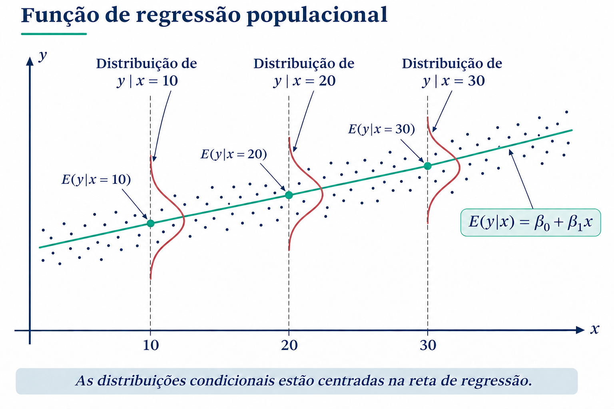
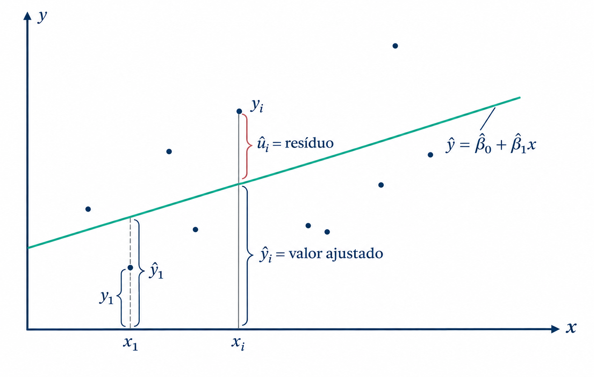
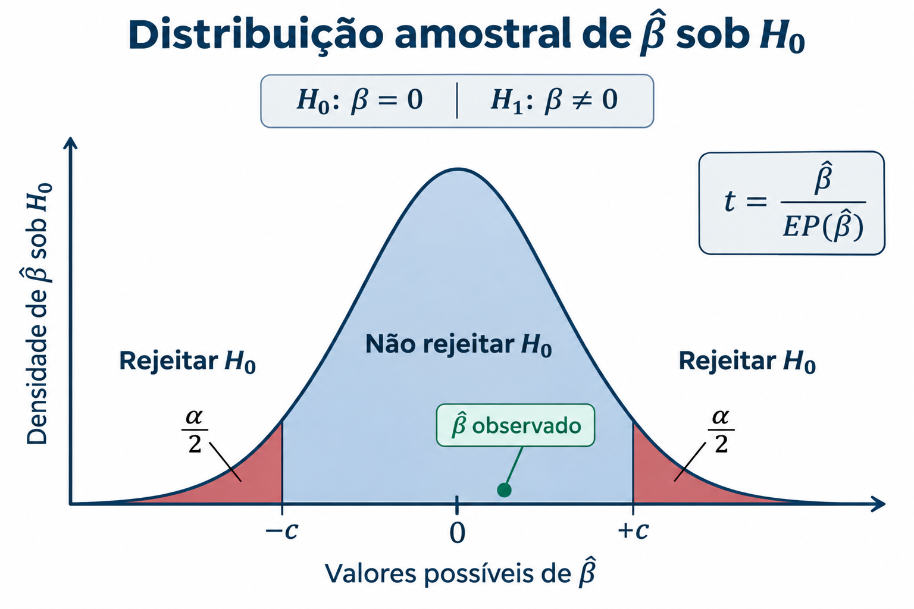

```{r}
#| include: false
#| eval: true
knitr::opts_knit$set(root.dir = normalizePath(".."))
knitr::opts_chunk$set(
  out.width = "78%",
  fig.align = "center"
)

library(dplyr)
library(ggplot2)
library(knitr)

cor_azul <- "#123B63"
cor_verde <- "#2A9D8F"
cor_marrom <- "#A68868"
cor_cinza <- "#697582"
```

A análise de regressão permite investigar como um fenômeno varia em função de características observadas. Em dados jurídicos, esse tipo de modelo pode ser utilizado, por exemplo, para examinar por que o valor de uma indenização é mais elevado em alguns processos do que em outros. O objetivo é representar estatisticamente essas variações e avaliar como elas se associam às informações disponíveis no banco de dados.

Neste capítulo, estudaremos os modelos lineares a partir de dados de corte transversal, nos quais diferentes processos são observados em determinado período. O percurso começa com a regressão linear simples (RLS), que relaciona uma variável dependente a uma única variável explicativa. Em seguida, apresentamos a estimação pelo método dos mínimos quadrados ordinários, a interpretação dos coeficientes, as formas funcionais e a regressão linear múltipla, que permite considerar simultaneamente diferentes características dos processos.

A exposição se baseia na quarta edição de *Introdução à Econometria: uma abordagem moderna*, de Jeffrey Wooldridge, publicada em 2013. Embora o livro esteja situado no campo da econometria, os modelos apresentados são utilizados em diferentes áreas das Ciências Sociais, entre elas o Direito, a Ciência Política, a Sociologia e a Psicologia.

A aplicação acompanhará o banco de violência de gênero digital construído e tratado nos capítulos anteriores. A pergunta que orienta o percurso será: **como o valor atualizado da indenização se associa às características observadas dos processos?** A partir dessa pergunta, mostraremos como especificar, estimar, interpretar e avaliar modelos lineares, começando por uma relação entre duas variáveis e avançando até modelos com diferentes variáveis explicativas.

::: callout-important
## Associação não é causalidade

Os modelos deste capítulo descrevem associações condicionais no banco analisado. Expressões como “efeito”, quando utilizadas na apresentação algébrica do modelo, não autorizam uma interpretação causal. Uma afirmação causal exige hipóteses adicionais e uma estratégia de identificação compatível com a pergunta de pesquisa.
:::

## Preparando o banco da aplicação

Para manter a mesma amostra ao longo do capítulo, todas as aplicações utilizarão os 349 casos que possuem valor atualizado de indenização maior que zero e nos quais vítima e agressor foram classificados como homem ou mulher. O valor zero não será incluído porque, como discutido anteriormente, ele pode representar tanto ausência de indenização quanto ausência de informação identificada. Os modelos, portanto, descrevem o valor da indenização **condicionalmente à existência de um valor positivo registrado e aos perfis selecionados**.

```{r}
#| label: preparar-bancos-modelos

base_tratada <- read.csv(
  "dados/violencia_digital_didatica_tratada.csv",
  check.names = FALSE,
  encoding = "UTF-8"
)

colunas_prova <- grep("^prova_", names(base_tratada), value = TRUE)

dados_modelos <- base_tratada |>
  filter(
    !is.na(valor_indenizacao_jul2026),
    valor_indenizacao_jul2026 > 0,
    !is.na(plataforma_parte),
    perfil_agressor %in% c("Homem", "Mulher"),
    perfil_vitima %in% c("Homem", "Mulher")
  ) |>
  mutate(
    numero_provas = rowSums(across(all_of(colunas_prova)), na.rm = TRUE),
    agressor_homem = if_else(perfil_agressor == "Homem", 1, 0),
    vitima_homem = if_else(perfil_vitima == "Homem", 1, 0),
    plataforma_sim = if_else(plataforma_parte == "Sim", 1, 0),
    tribunal_grupo = case_when(
      tribunal == "TJPR" ~ "TJPR",
      tribunal == "TJSP" ~ "TJSP",
      TRUE ~ "Outros_TJs"
    ),
    tribunal_grupo = factor(
      tribunal_grupo,
      levels = c("TJPR", "TJSP", "Outros_TJs")
    ),
    combinacao_genero = factor(
      paste(perfil_vitima, perfil_agressor, sep = " / "),
      levels = c(
        "Mulher / Mulher",
        "Mulher / Homem",
        "Homem / Mulher",
        "Homem / Homem"
      )
    ),
    perfil_agressor = factor(perfil_agressor, levels = c("Mulher", "Homem")),
    perfil_vitima = factor(perfil_vitima, levels = c("Mulher", "Homem"))
  )

nrow(dados_modelos)
```

O objeto `dados_modelos` será utilizado em todas as regressões. Essa decisão evita que diferenças entre resultados decorram apenas de mudanças na composição da amostra.

## Introdução

Começamos com o modelo mais geral da população:

$$y = \beta_0 + \beta_1x + u $$

Nesta equação, $y$ é a variavel dependente ou também denominada de variável explicada; $x$ é a variável explicativa e $u$ é o termo de erro. Essa equação é uma equação de **regressão linear simples**.

**Vejamos um exemplo**

Gostaríamos de explicar a taxa de crimes nos bairros de uma cidade e consideramos que os níveis de desemprego nas localidades são importantes. Nosso modelo de regressão poderia ser especificado da seguinte maneira:

$$Crime_i = \beta_0 + \beta_1Desemprego_i + u$$

O subscrito $i$ se refere a um bairro hipotético da cidade. Note que nesse caso, $i$ é o subscrito que relaciona nossas unidades de observação (bairros). Nossas unidades de observação podem variar a depender do contexto em estudo: países, cidades, bairros, estados, pessoas, processos, varas, tribunais....

Note que, novamente o termo de erro, $u$, está presente na equação. O termo de erro, não observado, capta tudo aquilo que afeta $Crime$, mas que não estamos controlando, ou seja, que não é explicado pelo $Desemprego$.

Voltemos a equação básica:

$$y = \beta_0 + \beta_1x + u $$

Na análise de RLS estamos interessados nos parâmetros $\beta_0$ e sobretudo $\beta_1$. A razão primordial para isso é que, tudo o mais constante, a relação acima aponta que

$$\Delta y = \beta_1 \Delta x $$ , se $$\Delta u = 0$$

Isto é, se tudo o mais que afeta $y$ permanecer inalterado, uma variação em $x$, $\Delta x$, estará associada a $\beta_1 \Delta x$ em $y$. No exemplo da criminalidade, teremos que:

$$\Delta crime = \beta_1 \Delta desemprego $$

Assim, o aumento de 1 ponto no desemprego estará associado a $\beta_1$ unidades de crimes, em média. Por isso, quando estimamos os parâmetros $\beta$, podemos descrever as relações entre $x$ e $y$ em nossas aplicações.

Cabe destacar algo bastante importante.As relações acima não encerram a questão da causalidade. Como podemos inferir um impacto causal do desemprego na criminalidade se estamos ignorando todos os demais fatores que ficaram de fora do modelo - fatores que são captados em $u$ não observados.

### Alguns exemplos de regressão aplicados ao contexto jurídico

Considere os seguintes exemplos de RLS aplicadas ao contexto do Direito

[**Previsão de Sentenças com Base na Gravidade do Crime:**]{.underline}
 
  * **Variável dependente $(Y)$**: Tamanho da pena, 
  * **Variável independente$(X)$**:  Gravidade do Crime, 
  * **Objetivo**: Identificar se a gravidade do crime tem influência sobre tamanho da pena.
  
  Nesse exemplo $\beta_0$ é o intercepto da regressão e $\beta_1$ o coeficiente de regressão que representa como a gravidade do crime influência o tamanho da pena, $u$ é o termo de erro.

$$Dpena = \beta_0 + \beta_1{\text{Gravidade}} + u$$

[**Análise de Fatores que Influenciam o Tempo de Julgamento:**]{.underline} 
 
  * **Variável Dependente ($Y$)**: Tempo de Duração do Processo 
  * **Variável Independente ($x$)**, Tipo de Processo (por exemplo, criminal, civil, administrativo).
  * **Objetivo**: Identificar se o tipo de processo tem impacto no tempo que um caso leva para ser concluído.

$$Tempo = \beta_0 + \beta_1  Processo  + u$$

[**Previsão de Probabilidade de Recurso com Base em Decisões Anteriores:**]{.underline} 

  * **Variável Dependente ($Y$)**: Probabilidade de Entrada com Recurso
  * **Variável Independente ($X$)**: Resultado da Decisão Anterior (por exemplo, deferimento ou negação do recurso). 
  * **Objetivo**: Determinar a probabilidade de um recurso ser apresentado com base no resultado de decisões passadas.

$$Recurso = \beta_0 + \beta_1 Resultado_{-1} + u $$

[**Análise de Relação entre Número de Testemunhas e Veredito:**]{.underline} 

  * **Variável Dependente ($Y$)**: Veredito (por exemplo, culpado ou inocente)
  * **Variável Independente ($X$)**: Número de Testemunhas. 
  * **Objetivo**: Investigar se o número de testemunhas influencia a decisão.

$$ Veredito = \beta_0 + \beta_1 Testemunhas + u $$

## Hipóteses sobre o comportamento do termo de erro

Se especificamos o modelo com $\beta_0$, podemos assumir que $u$, tem média igual a zero. Em notação de esperança matemática essa hipótese equivale a:

$$E(u) = 0$$

Podemos definir uma segunda hipótese sobre $u$. Uma hipótese forte é a de que $u$ e $x$ são independentes. Essa hipótese é crucial no modelo de RLS:

$$E(u|x) = 0$$

Em conjunto, as hipóteses de $E(u) = 0$ e $E(u|x) = 0$ são denominadas hipótese de média condicional zero.

Dessa forma, no nosso modelo inicial:

$$y = \beta_0 + \beta_1x + u$$

Aplicando o operador $E( \cdot |x )$, obtemos

$$ E( y |x ) = \beta_0 + \beta_1x $$

Assim, na equação acima, temos um aumento de uma unidade em $x$, implica em um aumento no valor esperado (ou em média) de $y$ na magnitude de $\beta_1$.

A equação acima, é caracterizada como **função de regressão populacional**. Essa função nos fornece a relação entre os diferentes níveis de $x$ é o nível médio de $y$, isto é $E( y |x )$.

{width="55%" fig-align="center"}

Agora, podemos voltar a nossa equação base e verificarmos o progresso feito no entendimento do modelo:

$$y = \beta_0 + \beta_1x + u $$

$$y = E( y |x ) + u $$

Na equação acima, $E( y |x )$ é chamada de parte sistemática de $y$. Isto é, a parte sistematicamente explicada por $x$. Já o termo de erro não observado, $u$ é a parte não sistemática de $y$, não explicada por $x$.


## Estimação dos parâmetros da RLS

Não conhecemos $\beta_0$ e $\beta_1$ e queremos estimadores desses parâmetros: $\hat{\beta}_0$ e $\hat{\beta}_1$.

Suponha que tenhamos uma amostra aleatória da população: $\{(x_i, y_i): i = 1, ..., n\}$. Poderia ser uma amostra de crimes e taxa de desemprego por bairros.

Em nosso modelo base:

$$y_i = \beta_0 + \beta_1x_i + u_i $$

onde $u_i$ é o erro aleatório da $i$-ésima observação.

[**Como estimamos** $\beta_0$ e $\beta_1$?]{.underline}

Após algum esforço algébrico, tem-se:

$$\hat{\beta}_0 = \bar{y} - \hat{\beta}_1 \bar{x}$$

e

$$\hat{\beta}_1 = \frac{\sum_{i=1}^{n} (x_i - \bar{x})(y_i - \bar{y})}{\sum_{i=1}^{n} (x_i - \bar{x})^2}$$

Onde, $\bar{x}$ e $\bar{y}$ são as médias amostrais de $X_i$ e $Y_i$, respectivamente.

Os estimadores $\hat{\beta}_0$ e $\hat{\beta}_1$ são chamados de estimadores de Mínimos Quadrados Ordinários (MQO).

A ideia é que os parâmetros que estimamos, $\hat{\beta}_0$ e $\hat{\beta}_1$, são os parâmetros que minimizam a soma dos quadrados das diferenças entre nossos $y_i$ observados e seus **valores preditos** definidos como

$$y_i- \hat{y}_i = y_i - (\hat{\beta}_0 + \hat{\beta}_1x_i)=\hat{u}_i$$ 

Queremos minimizar o quadrado dessa diferença. Vejamos graficamente:

{width="55%" fig-align="center"}

Antes de passarmos para o próximo tópico de RLS, cabe mencionar uma nota sobre terminologia: quando estimamos equações de RLS do tipo $y = \beta_0 + \beta_1 x + u$, dizemos que rodamos a regressão de $y$ sobre $x$.


### Teste de hipótese sobre um único parâmetro
 
Agora precisamos testar se nossa estimativa é estatisticamente igual a zero ou se ela é diferente de zero. 

*Há evidências que a nossa variável $X$ afeta a nossa variável $Y$ na população?*

Na maior parte do tempo testamos hipóteses do tipo 

$$H_0: {\beta_j}=0$$
Na hipótese principal testamos a situação que $X$ não afeta $Y$ na população sob análise. Na hipótese alternativa: 

$$H_1: \beta_j \neq 0$$

Testamos a hipótese que $X$ afeta $Y$ nessa população. Graficamente temos a figura abaixo onde a média populacional é igual a 0: 


{width="55%" fig-align="center"}

**Estatística de Teste**: 

Este é um valor calculado a partir dos dados da amostra que é usado para avaliar a probabilidade de observar tal valor se a hipótese nula fosse verdadeira ($H_0: {\beta_j}=0$). Ele que vai dizer se estamos na área amarela ou azul da figura acima. 


#### Valor-p

**O valor-p** é a probabilidade de observar uma estatística de teste tão extrema quanto, ou mais extrema do que, aquela calculada a partir dos dados da amostra, sob a suposição de que a hipótese nula seja verdadeira. Em outras palavras, mede quão provável é obter os resultados observados se a hipótese nula for correta.

**Interpretação**: Um valor-p pequeno (tipicamente menor que um nível de significância predefinido, comumente 0,05) sugere que os dados observados são improváveis de ter ocorrido se a hipótese nula fosse verdadeira. Portanto, fornece evidências contra a hipótese nula. Por outro lado, um valor-p grande indica que as evidências são insuficientes para rejeitá-la.


### Aplicação: estimando uma regressão linear simples

Começaremos pela diferença observada entre o valor médio da indenização nos casos com agressor homem e agressora mulher. A variável dependente será o valor atualizado da indenização, expresso em reais. A variável explicativa `agressor_homem` assume 1 para homem e 0 para mulher:

$$IndenizaçãoMil_i = \beta_0 + \beta_1 AgressorHomem_i + u_i$$

Nesse modelo, $\beta_0$ representa a indenização média quando a agressora é mulher. O coeficiente $\beta_1$ representa a diferença média entre os casos com agressor homem e agressora mulher.

```{r}
#| label: modelo-linear-simples

modelo_nivel <- lm(
  valor_indenizacao_jul2026 ~ agressor_homem,
  data = dados_modelos
)

summary(modelo_nivel)
```

#### Entendendo os resultados

**1. Resíduos** (*residuals*): representam as diferenças entre os valores observados e os valores ajustados pelo modelo.

**2. Coeficientes**: a seção *Coefficients* apresenta o nome de cada termo e quatro colunas numéricas.

*Coluna 1*: Nome da variável

*Coluna 2*: Coeficiente estimado $\hat{\beta}_0$, o intercepto, e $\hat{\beta}_1$, associado ao perfil do agressor.

*Coluna 3*: É o desvio padrão da estimativas de $\beta$

*Coluna 4*: É a estatistica `t` utilizada para fazer o teste de hipótese e neste caso, tem-se: $$H_0:\beta_0=0$$ 
$$H_1:\beta_0 \neq 0$$ 
e 
$$H_0:\beta_1=0$$
$$H_1:\beta_1 \neq 0$$ 

*Coluna 5*: É o p-valor, a probabilidade de encontrarmos valores mais extremos da estatística t. Os asteriscos indicam \*\*\* signicante a 0,1%; \*\* a 1%; \* a 5%; e $.$ a 10%.

**[Interpretando o coeficiente]{.underline}**

O intercepto estimado corresponde à indenização média, em reais, nos casos com agressora mulher. A soma do intercepto com o coeficiente de `agressor_homem` corresponde à média nos casos com agressor homem. O coeficiente da variável binária é, portanto, a diferença entre as duas médias.

::: callout-note
## Teste de médias e regressão com uma variável binária

Quando o modelo possui apenas uma variável explicativa binária, o teste sobre seu coeficiente reproduz a comparação entre as médias dos dois grupos. A regressão oferece uma forma de representar a mesma comparação e prepara a inclusão posterior de outras variáveis.
:::

**3. $R^2$**: indica a proporção da variabilidade observada na indenização que é representada pelo modelo. Um valor baixo não invalida a associação estimada, mas mostra que grande parte da variação permanece fora do modelo.

**4. Estatística F**: testa conjuntamente se os coeficientes das variáveis explicativas são iguais a zero. Em uma regressão simples, esse teste produz a mesma conclusão do teste $t$ aplicado ao único coeficiente angular.

$$H_0:\beta_1=...=\beta_k=0$$
contra 

$$H_1: H_0\text{ é falsa}$$


#### Visualizando os dados dos dois grupos

A regressão com uma variável binária compara dois grupos. Antes de representar o modelo por uma reta, é mais informativo observar a distribuição dos valores individuais em cada grupo. O boxplot resume mediana, quartis e valores mais afastados; os pontos mostram as observações que deram origem a esse resumo. Para tornar visível a região em que se concentra a maior parte dos casos, o eixo vertical será apresentado somente até R$ 100 mil. Essa ampliação não exclui as observações superiores do banco nem dos cálculos do modelo.

```{r}
#| label: grafico-modelo-simples
#| fig-cap: "Valor da indenização segundo o perfil do agressor, com visualização limitada a R$ 100 mil"
#| fig-width: 8
#| fig-height: 5

ggplot(
  dados_modelos,
  aes(x = perfil_agressor, y = valor_indenizacao_jul2026, color = perfil_agressor)
) +
  geom_boxplot(width = 0.42, outlier.shape = NA, alpha = 0.12) +
  geom_jitter(
    width = 0.12,
    alpha = 0.35,
    size = 1.5
  ) +
  scale_color_manual(values = c("Mulher" = cor_verde, "Homem" = cor_azul)) +
  coord_cartesian(ylim = c(0, 100000)) +
  labs(
    x = "Perfil do agressor",
    y = "Indenização atualizada (R$)"
  ) +
  theme_minimal(base_size = 10) +
  theme(panel.grid.minor = element_blank(), legend.position = "none")

```

## Características do método dos mínimos quadrados ordinários na amostra

### Valores estimados e resíduos

Uma vez estimados $\hat{\beta}_0$ e $\hat{\beta}_1$ temos os valores ajustados ou também denominados de valores preditos ou *fitted values*.

Para uma observação qualquer $i$, seu valor estimado é:

$$\hat{y}_i= \hat{\beta}_0 + \hat{\beta}_1x_i$$

Todos os valores $\hat{y}$ estarão sobre a reta de regressão.

O resíduo, tal qual definido anteriormente, será a diferença entre o valor ajustado $\hat{y}$ e o verdadeiro $y$ em nosso banco de dados:

$$\hat{u}_i = y_i - \hat{y}_i$$

Se $\hat{u_i} > 0$ a regressão subestima $y_i$. Se $\hat{u_i} < 0$ a reta superestima $y_i$. O cenário ideal é quando $\hat{u}_i= 0$, algo que quase nunca acontece.

```{r}
#| label: densidade-residuos-modelo-simples
#| fig-cap: "Distribuição dos resíduos do modelo em nível"

resid_nivel <- residuals(modelo_nivel)

ggplot(data.frame(residuo = resid_nivel), aes(x = residuo)) +
  geom_density(fill = cor_azul, color = cor_azul, alpha = 0.25, linewidth = 1) +
  geom_vline(xintercept = 0, color = cor_marrom, linetype = "dashed") +
  labs(x = "Resíduo (R$)", y = "Densidade") +
  theme_minimal(base_size = 10) +
  theme(panel.grid.minor = element_blank())
```

A distribuição está centrada próxima de zero, mas apresenta uma cauda direita longa. Isso ocorre porque os valores monetários positivos são assimétricos: poucos casos possuem indenizações muito superiores às demais. Uma transformação logarítmica de $Y$ pode tornar essa distribuição menos assimétrica.

### Transformando a indenização: o modelo log–nível

No modelo log–nível, a variável dependente passa a ser o logaritmo da indenização, enquanto a variável explicativa permanece em nível:

$$\log(Indenização_i)=\beta_0+\beta_1 AgressorHomem_i+u_i.$$

```{r}
#| label: modelo-log-nivel-agressor

modelo_log <- lm(
  log(valor_indenizacao_jul2026) ~ agressor_homem,
  data = dados_modelos
)

summary(modelo_log)
```

Como `agressor_homem` é binária, a variação percentual exata associada ao grupo dos agressores homens, em comparação com o grupo das agressoras mulheres, é calculada por $100(e^{\widehat\beta_1}-1)$:

```{r}
variacao_percentual_agressor <-
  100 * (exp(coef(modelo_log)["agressor_homem"]) - 1)

variacao_percentual_agressor
```

O resultado de aproximadamente 64,93% indica que o valor ajustado para os casos com agressor homem é cerca de 64,93% superior ao valor ajustado para os casos com agressora mulher. Para compreender essa comparação, podemos reconstruir os valores dos dois grupos.

Para a agressora mulher, `agressor_homem = 0`. O valor ajustado no logaritmo é, portanto, apenas o intercepto:

$$\widehat{\log(Indenização)}_{Mulher}=\widehat\beta_0.$$

Para o agressor homem, `agressor_homem = 1`. O valor ajustado é a soma do intercepto com o coeficiente da variável binária:

$$\widehat{\log(Indenização)}_{Homem}=\widehat\beta_0+\widehat\beta_1.$$

Aplicando a função exponencial e dividindo o resultado por mil, retornamos à escala monetária:

```{r}
beta_0_log <- coef(modelo_log)["(Intercept)"]
beta_1_log <- coef(modelo_log)["agressor_homem"]

valor_mulher_reais <- exp(beta_0_log)
valor_homem_reais <- exp(beta_0_log + beta_1_log)

estimativas_grupos <- data.frame(
  Grupo = c("Agressora mulher", "Agressor homem"),
  `Cálculo no log` = c("β₀", "β₀ + β₁"),
  `Valor retrans­formado (R$)` = c(valor_mulher_reais, valor_homem_reais),
  check.names = FALSE
)

estimativas_grupos

valor_homem_reais - valor_mulher_reais
valor_homem_reais / valor_mulher_reais
```

O modelo estima um valor retrans­formado de aproximadamente R$ 6.989,71 para os casos com agressora mulher e R$ 11.528,16 para os casos com agressor homem. A diferença é de aproximadamente R$ 4.538,45, e o segundo valor corresponde a cerca de 1,65 vez o primeiro. Essa razão é a mesma representada pelo aumento de 64,93%.

::: callout-note
## Retransformação e interpretação

Os valores de R$ 6.989,71 e R$ 11.528,16 resultam da exponencial dos valores ajustados no logaritmo. Eles representam valores típicos ajustados — equivalentes à média geométrica de cada grupo — e não as médias aritméticas das indenizações. A obtenção da média aritmética prevista na escala original exige uma correção adicional para a retrans­formação. Para a interpretação do coeficiente entre os grupos, contudo, a razão de aproximadamente 1,65 e a diferença percentual de 64,93% permanecem válidas.
:::

O coeficiente descreve uma associação no banco analisado, e não um efeito causal.

```{r}
#| label: comparar-residuos-nivel-log
#| fig-cap: "Distribuição dos resíduos: modelos em nível e log–nível"
#| fig-width: 9
#| fig-height: 4.5

residuos_comparacao <- bind_rows(
  data.frame(Modelo = "Nível", Residuo = residuals(modelo_nivel)),
  data.frame(Modelo = "Log–nível", Residuo = residuals(modelo_log))
)

ggplot(residuos_comparacao, aes(x = Residuo, fill = Modelo, color = Modelo)) +
  geom_density(alpha = 0.18, linewidth = 1) +
  geom_vline(xintercept = 0, color = cor_cinza, linetype = "dashed") +
  facet_wrap(~ Modelo, scales = "free") +
  scale_fill_manual(values = c("Nível" = cor_azul, "Log–nível" = cor_verde)) +
  scale_color_manual(values = c("Nível" = cor_azul, "Log–nível" = cor_verde)) +
  labs(x = "Resíduo", y = "Densidade") +
  theme_minimal(base_size = 10) +
  theme(panel.grid.minor = element_blank(), legend.position = "none")
```

Neste banco, a transformação reduz substancialmente a cauda longa observada no modelo em nível. Por isso, o modelo log–nível será a especificação principal nas aplicações seguintes. A escolha não decorre apenas do formato do gráfico: também deve considerar a pergunta, a interpretação pretendida e as demais hipóteses do modelo.

::: {.callout-note collapse="true"}
## Propriedades algébricas do MQO

(1) A Soma dos Resíduos é zero: 

$$\sum_{i=1}^{n} \hat{u}_i = 0$$

```{r}

sum(resid_nivel)


```

(2) A covariancia amostral entre a variavel explicativa e os resíduos é zero:

$$\sum_{i=1}^{n} x_i \hat{u}_i = 0$$

```{r}
#obtendo a variável x
x <- dados_modelos$agressor_homem

#somando com os residuos
sum(x * resid_nivel)


```

(3) O ponto $(\bar{x},\bar{y})$ sempre estará sob a reta de regressão.

(4) A média dos valores estimados, $\bar{\hat{y}}$ é igual a média dos valores observados $\bar{y}$.

```{r}

#y dos dados 
y <- dados_modelos$valor_indenizacao_jul2026
mean(y)

#y estimado
y_hat <- fitted.values(modelo_nivel)
mean(y_hat)

mean(y) - mean(y_hat)

isTRUE(all.equal(mean(y), mean(y_hat)))
```

(5) Note que as estimatvas de MQO decompõe $y$ em 2 partes: 1) os valores ajustados $\hat{y}$ e os resíduos $\hat{u}$.

(6) Os valores de $\hat{y}$ e $\hat{u}$ são não correlacionados na amostra!

:::


### Qualidade do ajuste

Depois de comparar os resíduos, adotamos o modelo log–nível como especificação principal. A qualidade do ajuste será, portanto, calculada para o modelo em que a variável dependente é $\log(Indenização)$. A pergunta passa a ser: **qual parcela da variação observada no logaritmo da indenização é representada pelo perfil do agressor?**

Para aplicar as definições, primeiro identificamos os valores observados, os valores ajustados e os resíduos desse modelo:

```{r}
y_log <- log(dados_modelos$valor_indenizacao_jul2026)
y_hat_log <- fitted(modelo_log)
residuos_log <- residuals(modelo_log)
```

Considere as seguintes definições.

Soma dos Quadrado Totais (SQT):

$$\text{SQT} = \sum_{i=1}^{n} (y_i - \bar{y})^2$$

```{r}
# Calcular a média do logaritmo da indenização
media_y_log <- mean(y_log)

# Calcular a Soma dos Quadrados Totais (SQT)
sqt_log <- sum((y_log - media_y_log)^2)
sqt_log
```

Soma dos Quadrados Explicados (SQE):

$$\text{SQE} = \sum_{i=1}^{n} (\hat{y}_i - \bar{y})^2$$

```{r}

# Calcular a Soma dos Quadrados Explicados (SQE)
sqe_log <- sum((y_hat_log - media_y_log)^2)
sqe_log
```

Soma dos Quadrados dos Resíduos (SQR):

$$\text{SQR} = \sum_{i=1}^{n} \hat{u}_i^2$$

```{r}
residuos_quadrados_log <- residuos_log^2
sqr_log <- sum(residuos_quadrados_log)
sqr_log
```


O resultado mais importante é o seguinte:

$$SQT =  SQE + SQR$$ 

É a partir dessa igualdade que podemos mostrar algo sobre o ajuste dos MQO.

Dividindo ambos os lados por $SQT$, teremos

$$1 = \frac{\text{SQE}}{\text{SQT}}  + \frac{\text{SQR}}{\text{SQT}}$$ 

Rearranjando os termos

$$R^2 = \frac{\text{SQE}}{\text{SQT}} = 1 - \frac{\text{SQR}}{\text{SQT}}$$

```{r}

# R-quadrado do modelo log–nível
r_quadrado_log <- 1 - (sqr_log / sqt_log)
r_quadrado_log

# Conferindo o valor informado por summary()
summary(modelo_log)$r.squared

```

Nesse modelo, o $R^2$ é a proporção da variação amostral do **logaritmo da indenização** representada pela variável `agressor_homem`. Ele não mede a proporção da variação da indenização em reais e tampouco demonstra uma relação causal. Na regressão linear simples com intercepto, seu valor estará entre 0 e 1.


## Unidade de medida e forma funcional

### Unidade de medida

Vejamos o efeito de mudanças na unidade de medida. O primeiro modelo expressa a indenização em reais; o segundo divide o valor por mil e o expressa em milhares de reais.

```{r}
#| label: comparacao-escala

modelo_reais <- lm(
  valor_indenizacao_jul2026 ~ agressor_homem,
  data = dados_modelos
)

modelo_mil <- lm(
  I(valor_indenizacao_jul2026 / 1000) ~ agressor_homem,
  data = dados_modelos
)

tabela_escala <- data.frame(
  Unidade = c("Reais", "Milhares de reais"),
  Intercepto = c(coef(modelo_reais)[1], coef(modelo_mil)[1]),
  `Coeficiente: agressor homem` = c(coef(modelo_reais)[2], coef(modelo_mil)[2]),
  `Estatística t` = c(
    summary(modelo_reais)$coefficients[2, 3],
    summary(modelo_mil)$coefficients[2, 3]
  ),
  `Valor-p` = c(
    summary(modelo_reais)$coefficients[2, 4],
    summary(modelo_mil)$coefficients[2, 4]
  ),
  `R²` = c(summary(modelo_reais)$r.squared, summary(modelo_mil)$r.squared),
  check.names = FALSE
)

kable(
  tabela_escala,
  digits = 4,
  caption = "O mesmo modelo com a indenização em reais e em milhares de reais"
)
```

Ao dividir $Y$ por mil, o intercepto, o coeficiente e os erros-padrão também são divididos por mil. A estatística $t$, o valor-p e o $R^2$ não se alteram. A relação estimada é a mesma; apenas mudou a unidade utilizada para comunicá-la.

::: callout-note
## Importante

O $R^2$ e os testes de hipótese não dependem das unidades de medida. Se a variável explicativa for multiplicada por uma constante, seu coeficiente será dividido pela mesma constante. Se for dividida por uma constante, seu coeficiente será multiplicado por ela.
:::

## Incorporando não linearidades nas variáveis

As transformações logarítmicas alteram a forma funcional e, consequentemente, a interpretação dos coeficientes. As quatro formas mais usuais distinguem variações absolutas e relativas em $X$ e em $Y$.


| Modelo | Dependente |  Explicativa | Interpretação de $\beta_1$     |
|--------------------|--------------|--------------|------------------|
| Nível–nível | $y$     | $x$      | Uma unidade em $x$ está associada a $\beta_1$ unidades em $y$ |
| Nível–log   | $y$     | $\ln(x)$ | 1% em $x$ está associado a aproximadamente $\beta_1/100$ unidade em $y$ |
| Log–nível   | $\ln(y)$ | $x$ | Uma unidade em $x$ está associada a aproximadamente $100\beta_1$% em $y$ |
| Log–log     | $\ln(y)$ | $\ln(x)$ | 1% em $x$ está associado a aproximadamente $\beta_1$% em $y$ |

#### Representação gráfica das quatro formas

Os gráficos abaixo representam as formas funcionais em uma escala comum, de 0 a 1. Eles são conceituais: servem para comparar o formato das relações, e não correspondem aos valores do banco da aplicação. Os parâmetros foram escolhidos para tornar visíveis as diferenças de curvatura. No modelo log–log, utilizamos uma elasticidade positiva inferior a 1, produzindo crescimento a taxas decrescentes.

```{r}
#| label: graficos-formas-funcionais
#| fig-cap: "Representação conceitual das formas funcionais. Elaboração própria, adaptada de Maia (2017)."
#| fig-width: 10
#| fig-height: 7

x_forma <- seq(1, 10, length.out = 200)

formas_grafico <- bind_rows(
  data.frame(Forma = "Nível–nível", X = x_forma, Y_original = x_forma),
  data.frame(Forma = "Log–nível", X = x_forma, Y_original = exp(0.38 * x_forma)),
  data.frame(Forma = "Nível–log", X = x_forma, Y_original = log(x_forma)),
  data.frame(Forma = "Log–log", X = x_forma, Y_original = x_forma^0.35)
) |>
  mutate(Forma = factor(
    Forma,
    levels = c("Nível–nível", "Log–nível", "Nível–log", "Log–log")
  )) |>
  group_by(Forma) |>
  mutate(Y = (Y_original - min(Y_original)) / (max(Y_original) - min(Y_original))) |>
  ungroup()

ggplot(formas_grafico, aes(x = X, y = Y)) +
  geom_line(color = cor_azul, linewidth = 1.25) +
  facet_wrap(~ Forma, ncol = 2) +
  scale_y_continuous(limits = c(0, 1), breaks = c(0, 0.5, 1)) +
  labs(x = "X", y = "Valor esperado de Y — escala normalizada") +
  theme_minimal(base_size = 10) +
  theme(
    panel.grid.minor = element_blank(),
    strip.text = element_text(face = "bold", color = cor_azul)
  )
```

Fonte conceitual: Maia, Alexandre Gori. *Econometria: conceitos e aplicações*. Capítulo 4, 2017. Ver também os [gráficos das formas funcionais apresentados pelo autor](https://www4.eco.unicamp.br/docentes/gori/images/arquivos/EconometriaI/Econometria_FormasFuncionais.pdf).

Para comparar empiricamente as quatro formas com a mesma amostra, utilizaremos apenas as observações de `dados_modelos` que possuem pelo menos um tipo de prova. Essa restrição é necessária porque $\log(0)$ não é definido. A variável explicativa será o número de tipos de prova, e a variável dependente será o valor positivo da indenização.


### Modelo Nível-Nível

Uma variação absoluta em $X$ está associada a uma variação absoluta em $Y$.


```{r}
modelo_nn <- lm(
  valor_indenizacao_jul2026 ~ numero_provas,
  data = subset(dados_modelos, numero_provas > 0)
)

summary(modelo_nn)

beta_nn <- coef(modelo_nn)["numero_provas"]
beta_nn
```

O coeficiente estimado é aproximadamente R$ 1.985,73. Portanto, cada tipo adicional de prova está associado, em média, a um acréscimo de R$ 1.985,73 no valor da indenização. Essa é uma interpretação absoluta: uma unidade adicional em $X$ corresponde a uma variação monetária em $Y$.


### Modelo Nível-log

O modelo nível–log mantém a indenização em reais e transforma o número de provas em logaritmo. Variações relativas em $X$ estão associadas a variações absolutas em $Y$.


```{r}
modelo_nl <- lm(
  valor_indenizacao_jul2026 ~ log(numero_provas),
  data = subset(dados_modelos, numero_provas > 0)
)

summary(modelo_nl)

beta_nl <- coef(modelo_nl)["log(numero_provas)"]

# Variação em reais associada a aumentos de 1% e 10% em X
beta_nl / 100
beta_nl / 10
```

O coeficiente estimado é aproximadamente 3.152,49. Como $X$ está em log e $Y$ permanece em reais, um aumento de 1% no número de provas está associado a aproximadamente $\beta_1/100$, ou R$ 31,52, no valor da indenização. Um aumento de 10% está associado a aproximadamente R$ 315,25.

Essa interpretação exige cautela. O número de provas é uma contagem discreta e assume poucos valores inteiros. Uma variação de 1% — por exemplo, passar de duas para 2,02 provas — não corresponde a uma mudança observável no banco. O modelo nível–log é útil para ensinar a forma funcional, mas sua interpretação substantiva é menos natural para essa variável.


### Modelo Log-Nível

Nesse modelo, $Y$ está em log e $X$ em nível. Uma unidade adicional em $X$ está associada a uma variação proporcional em $Y$.

```{r}

modelo_ln <- lm(
  log(valor_indenizacao_jul2026) ~ numero_provas,
  data = subset(dados_modelos, numero_provas > 0)
)

summary(modelo_ln)

beta_ln <- coef(modelo_ln)["numero_provas"]

# Variações percentual aproximada e exata em Y
100 * beta_ln
100 * (exp(beta_ln) - 1)

```

O coeficiente estimado é aproximadamente 0,0244. Para cada tipo adicional de prova, a indenização varia aproximadamente $100\beta_1=2,44$%. Pela transformação exata, $100(e^{\beta_1}-1)$, o aumento estimado é de aproximadamente 2,47%.

Nesse caso, a interpretação é mais direta: passar de um para dois tipos de prova, ou de dois para três, representa uma unidade adicional em $X$. O modelo supõe que cada unidade adicional esteja associada à mesma variação proporcional em $Y$.

### Modelo Log-Log

Nesse modelo, tanto $X$ quanto $Y$ estão em log. O coeficiente é uma elasticidade: uma variação de 1% em $X$ está associada a uma variação aproximada de $\beta_1$% em $Y$.


```{r}
modelo_ll <- lm(
  log(valor_indenizacao_jul2026) ~ log(numero_provas),
  data = subset(dados_modelos, numero_provas > 0)
)

summary(modelo_ll)

beta_ll <- coef(modelo_ll)["log(numero_provas)"]

# Variação percentual aproximada em Y para aumentos de 1% e 10% em X
beta_ll
10 * beta_ll

```

O coeficiente estimado é aproximadamente 0,0355. Ele é uma elasticidade: um aumento de 1% no número de provas está associado a um aumento aproximado de 0,0355% na indenização. Um aumento de 10% está associado, aproximadamente, a um aumento de 0,355% na indenização.

O modelo não afirma que um aumento de 3% em $X$ produz um aumento de 1% em $Y$. Com a elasticidade estimada neste banco, um aumento de 3% em $X$ corresponderia a apenas cerca de $3 \times 0{,}0355=0{,}107$% em $Y$. Novamente, como o número de provas é discreto, variações percentuais pequenas possuem interpretação limitada.

```{r}
#| label: tabela-formas-funcionais

resumo_forma <- function(modelo, nome) {
  c(
    Modelo = nome,
    Coeficiente = unname(coef(modelo)[2]),
    `Erro-padrão` = summary(modelo)$coefficients[2, 2],
    `Valor-p` = summary(modelo)$coefficients[2, 4],
    `R²` = summary(modelo)$r.squared
  )
}

tabela_formas <- rbind(
  resumo_forma(modelo_nn, "Nível–nível"),
  resumo_forma(modelo_nl, "Nível–log"),
  resumo_forma(modelo_ln, "Log–nível"),
  resumo_forma(modelo_ll, "Log–log")
) |>
  as.data.frame(stringsAsFactors = FALSE)

for (coluna in names(tabela_formas)[-1]) {
  tabela_formas[[coluna]] <- as.numeric(tabela_formas[[coluna]])
}

kable(
  tabela_formas,
  digits = 4,
  caption = "Comparação das quatro formas funcionais"
)
```

::: callout-tip
## Como escolher a forma funcional?

A escolha não deve ser feita apenas pelo valor-p. Ela depende da pergunta, da escala das variáveis, da interpretação pretendida e do comportamento dos resíduos. Neste exemplo, as quatro especificações servem principalmente para demonstrar como a transformação altera a leitura dos coeficientes. Os valores-p são superiores aos níveis usuais de significância e os valores de $R^2$ são baixos nas quatro formas. Portanto, essa aplicação não fornece evidência de uma associação precisa entre o número de tipos de prova e o valor da indenização.
:::


## Regressão linear múltipla (RLM)

A RLM é uma extensão natural da RLS. Em vez de termos apenas uma variável explicativa, podemos ter $k$ variáveis explicativas:

$$y = \beta_0 + \beta_1 x_1 + \beta_2 x_2 + \beta_3 x_3 + \ldots + \beta_k x_k + u$$

A hipótese fundamental é a de que:

$$E(u|x_1, . . . ,x_k) = 0$$

Se uma das variáveis explicativas estiver correlacionada com $u$, a hipótese acima será violada. Sob as hipóteses do modelo, os estimadores de MQO são não viesados.

### Exemplos de regressão múltipla no contexto jurídico

[**Determinação de Fatores que Afetam o Valor de Indenizações:**]{.underline}

 * **Variável Dependente ($Y$)**: Valor da Indenização.
 * **Variáveis Independentes ($X$)**: Idade da Vítima, Gravidade do Dano, Jurisdição. 
 * **Objetivo**: Analisar como a idade da vítima, a gravidade do dano e a jurisdição influenciam o valor das indenizações concedidas

$$Indenização = \beta_0 + \beta_1 idade + \beta_2 Gravidade + \beta_3 Jurisdição + u$$

[**Análise de Variáveis que Influenciam Taxas de Condenação em Casos Criminais:**]{.underline}

  * **Variável Dependente ($Y$)**: Taxa de Condenação.
  * **Variáveis Independentes($X$)**: Idade do Réu, Tipo de Crime, Local do Julgamento. 
  * **Objetivo**: Investigar como a idade do réu, o tipo de crime e o local do julgamento afetam a probabilidade de condenação.

$$Tx.Condenação = \beta_0 + \beta_1  idade  +  \beta_2 Local  + \beta_3  crime + u$$

[**Análise de Fatores que Influenciam a Taxa de Feminicídio:**]{.underline} 

  * **Variável Dependente ($Y$)**: Taxa de Feminicídio por 100.000 mulheres
  * **Variáveis Independentes ($X$)**: Taxa de Desemprego, Índice de Educação, Presença de Políticas de Proteção à Mulher.
  * **Objetivo**: Investigar como o desemprego, o nível de educação e a existência de políticas de proteção à mulher estão relacionados à taxa de feminicídio em diferentes regiões.

$$Tx.feminicidio = \beta_0 + \beta_1 desemprego + \beta_2 educ + \beta_3 política + u $$

### A interpretação da equação de regressão de MQO

Tal qual no modelo de RLS, temos que:

$$\Delta y = \beta_1 \Delta x_1 + \beta_2 \Delta x_2 + ...+\beta_k \Delta x_k$$

O coeficiente $\beta_j$, com $j=1,...,k$, mede a associação parcial entre o incremento de uma unidade de $x_j$ e $y$, mantidas constantes as demais variáveis. Nos modelos que utilizam logaritmos, a interpretação deve seguir a forma funcional apresentada anteriormente.

Suponha que estejamos interessados no efeito de $x_1$. Podemos fazer o seguinte exercício: Tudo o mais constante qual o efeito de $x_1$ em $y$:

$$\frac{\Delta y}{\Delta x} = \beta_1 $$

Manter outros fatores observados fixos permite interpretar cada coeficiente como uma associação parcial. Isso, isoladamente, não reproduz um experimento nem identifica causalidade. Uma interpretação causal exige, entre outras condições, que a hipótese $$E(u|x_1, . . . ,x_k) = 0$$ seja plausível no desenho da pesquisa.


## Estimação dos $k$ parâmetros na RLM

::: {.callout-note collapse="true"}
## Representação matricial dos estimadores de MQO

A mecânica para obter estimativas de $\beta_j$ é mais extensa. O `R` fornece essas estimativas diretamente. Ainda assim, convém apresentar a representação matricial utilizada no cálculo dos parâmetros.

Considere o modelo para a $i$-ésima observação

$$y_i = \beta_0 + \beta_1 x_{i1} + \beta_{2} x_{i2} + \beta_{3} x_{i3} + \ldots + \beta_k x_{ik} + u$$

como temos $n$ observações (tamanho de nossa amostra), podemos organizar esses valores em vetores e matrizes.


Assim, representamos o modelo de RLM da seguinte maneira:

$$\mathbf{Y} = \mathbf{X} \boldsymbol{\beta} + \mathbf{u}$$

Queremos encontrar um estimador de $\boldsymbol{\beta}$, que chamaremos de $\boldsymbol{\hat{\beta}}$. Esse estimador será dado por:

$$\hat{\boldsymbol{\beta}} = (\mathbf{X}^T \mathbf{X})^{-1} \mathbf{X}^T \mathbf{y}$$

Onde $\mathbf{X}^T$ é a matriz transposta de $\mathbf{X}$, e $(\mathbf{X}^T \mathbf{X})^{-1}$ é a matriz inversa da seguinte multiplicação de matrizes, $(\mathbf{X}^T \mathbf{X})$

Esse vetor de estimativas irá nos fornecer os valores para os $\beta_j$, com $j=1,...,k$. 

:::


### Estimativas de MQO

Vamos ampliar o modelo da indenização. Além do perfil do agressor, incluiremos o número de tipos de prova, o grupo do tribunal e a indicação de que a plataforma integra a ação. O TJPR e os processos nos quais a plataforma não faz parte serão as categorias de referência:

$$\log(Indenização_i) = \beta_0 + \beta_1 AgressorHomem_i + \beta_2 NúmeroProvas_i + \delta_1 TJSP_i + \delta_2 OutrosTJs_i + \gamma PlataformaParte_i + u_i$$

```{r}
#| label: regressao-linear-multipla

modelo_log_agressor <- lm(
  log(valor_indenizacao_jul2026) ~ agressor_homem,
  data = dados_modelos
)

rlm <- lm(
  log(valor_indenizacao_jul2026) ~
    agressor_homem + numero_provas + tribunal_grupo + plataforma_sim,
  data = dados_modelos
)

summary(rlm)
```

### Interpretando os resultados da regressão múltipla

Na regressão múltipla, cada coeficiente é interpretado mantendo constantes as demais variáveis incluídas. Como a variável dependente está em log, a interpretação percentual exata de um coeficiente $\widehat\beta$ é $100(e^{\widehat\beta}-1)$%.

```{r}
coeficientes_rlm <- coef(rlm)

tabela_interpretacao_rlm <- data.frame(
  Termo = c(
    "Intercepto",
    "Agressor homem",
    "Número de provas",
    "TJSP",
    "Outros tribunais",
    "Plataforma faz parte"
  ),
  Coeficiente = unname(coeficientes_rlm),
  Cálculo = c(
    sprintf("exp(%.4f)", coeficientes_rlm[1]),
    sprintf("100 × [exp(%.4f) − 1]", coeficientes_rlm[2]),
    sprintf("100 × [exp(%.4f) − 1]", coeficientes_rlm[3]),
    sprintf("100 × [exp(%.4f) − 1]", coeficientes_rlm[4]),
    sprintf("100 × [exp(%.4f) − 1]", coeficientes_rlm[5]),
    sprintf("100 × [exp(%.4f) − 1]", coeficientes_rlm[6])
  ),
  Resultado = c(
    exp(coeficientes_rlm[1]),
    100 * (exp(coeficientes_rlm[2]) - 1),
    100 * (exp(coeficientes_rlm[3]) - 1),
    100 * (exp(coeficientes_rlm[4]) - 1),
    100 * (exp(coeficientes_rlm[5]) - 1),
    100 * (exp(coeficientes_rlm[6]) - 1)
  ),
  Unidade = c("R$", "%", "%", "%", "%", "%"),
  Referência = c(
    "Mulher, zero provas e TJPR",
    "Agressora mulher",
    "Valor anterior do número de provas",
    "TJPR",
    "TJPR",
    "Plataforma não faz parte"
  ),
  check.names = FALSE
)

kable(
  tabela_interpretacao_rlm,
  digits = c(NA, 4, NA, 2, NA, NA),
  caption = "Transformação dos coeficientes do modelo log–nível"
)
```

#### Intercepto

O intercepto estimado é 8,3007. Ele representa o valor ajustado do logaritmo da indenização para a categoria de referência: agressora mulher, nenhuma prova contabilizada, processo do TJPR e plataforma fora da ação. Aplicando a exponencial, obtemos aproximadamente R$ 4.026,78.

Entretanto, o banco utilizado neste capítulo possui entre um e quatro tipos de prova por processo. Como não há observações com `numero_provas = 0`, o intercepto é necessário para definir a equação, mas não corresponde diretamente a um grupo observado. Sua interpretação substantiva deve, portanto, ser feita com cautela.

#### Perfil do agressor

O coeficiente de `agressor_homem` é 0,4887. Ele compara casos com agressor homem aos casos com agressora mulher, mantendo constantes o número de provas, o grupo do tribunal e a participação da plataforma. Pela transformação exata,

$$100(e^{0{,}4887}-1)=63{,}02\%.$$

Portanto, para processos equivalentes nas demais variáveis do modelo, o valor ajustado da indenização é aproximadamente 63,02% maior quando o agressor é homem do que quando a agressora é mulher. Trata-se de uma diferença condicional às variáveis incluídas no modelo, e não da simples diferença bruta entre os dois grupos.

#### Número de provas

`numero_provas` é uma variável numérica discreta e assume, neste banco, valores de 1 a 4. Seu coeficiente estimado é 0,0628. Pela transformação exata,

$$100(e^{0{,}0628}-1)=6{,}48\%.$$

Assim, um tipo adicional de prova está associado a uma indenização aproximadamente 6,48% maior, mantendo constantes as demais variáveis. Por exemplo, o coeficiente compara dois processos equivalentes nas demais características, mas com dois e três tipos de prova. A estimativa não indica, isoladamente, que acrescentar uma prova cause o aumento da indenização.

#### Tribunal

`tribunal_grupo` é uma variável qualitativa nominal, e o TJPR foi definido como referência.

O coeficiente do TJSP é 0,5422. Pela transformação exata,

$$100(e^{0{,}5422}-1)=71{,}98\%.$$

Isso significa que, mantidas constantes as demais variáveis, o valor ajustado da indenização no TJSP é aproximadamente 71,98% maior do que no TJPR.

O coeficiente de `Outros_TJs` é 0,7680. Sua transformação resulta em:

$$100(e^{0{,}7680}-1)=115{,}55\%.$$

Portanto, nas mesmas condições, o valor ajustado da indenização no grupo dos outros tribunais é aproximadamente 115,55% maior do que no TJPR.

Esses dois coeficientes não comparam diretamente TJSP e `Outros_TJs`, pois ambos utilizam o TJPR como referência. Para realizar essa comparação, calculamos a diferença entre os coeficientes: $0{,}7680-0{,}5422=0{,}2258$. A transformação exata indica que a indenização ajustada em `Outros_TJs` é aproximadamente 25,33% maior do que no TJSP, mantendo constantes as demais variáveis.

#### Participação da plataforma

O coeficiente de `plataforma_sim` é 0,6284. Ele compara processos nos quais a plataforma integra a ação com aqueles nos quais ela não faz parte, mantendo constantes o perfil do agressor, o número de provas e o grupo do tribunal. Pela transformação exata,

$$100(e^{0{,}6284}-1)=87{,}46\%.$$

Assim, no banco analisado, o valor ajustado da indenização é aproximadamente 87,46% maior quando a plataforma faz parte da ação. O intervalo de confiança dessa diferença é amplo, e somente 13 dos 349 casos pertencem a essa categoria. O resultado deve ser lido como uma associação condicional observada nessa amostra, e não como evidência de que a presença da plataforma cause o aumento da indenização.

::: callout-note
## Categoria de referência

Com três categorias de tribunal e um intercepto, o modelo inclui apenas duas variáveis indicadoras. O TJPR não desaparece: ele é a categoria de referência, representada quando `tribunal_grupoTJSP = 0` e `tribunal_grupoOutros_TJs = 0`.
:::


### Como o R codifica variáveis qualitativas

A saída anterior contém duas variáveis binárias — o perfil do agressor e a participação da plataforma — e uma variável nominal com três grupos de tribunal. Os valores dos coeficientes já foram interpretados na seção anterior. Agora examinaremos apenas como o R transforma essas categorias em variáveis numéricas para estimar o modelo.

Duas decisões são necessárias:

1. organizar as categorias no banco de dados de modo coerente;
2. definir a categoria utilizada como referência.

::: callout-note
## Variável binária ou *dummy*

Uma variável binária assume o valor 1 quando determinada condição ocorre e 0 quando ela não ocorre. O coeficiente compara o grupo identificado por 1 com o grupo identificado por 0, mantidas constantes as demais variáveis do modelo.
:::

#### Uma variável binária no modelo multivariado

No nosso exemplo, o R utiliza a coluna `agressor_homem`, que assume 1 para agressor homem e 0 para agressora mulher. A categoria codificada como 0 não aparece como um coeficiente separado na saída: ela está incorporada ao intercepto e funciona como referência para o termo `agressor_homem`. A mesma lógica se aplica a `plataforma_sim`: 1 indica que a plataforma faz parte da ação e 0 indica que não faz. Essas codificações integram o modelo multivariado já estimado, que também controla o número de provas e o grupo do tribunal.

Como esse primeiro modelo não contém interação, não é necessário atribuir valores ao número de provas ou às demais variáveis para interpretar a *dummy*. O coeficiente de `agressor_homem` representa diretamente a diferença entre os dois grupos, mantidas constantes as outras variáveis. No modelo log–nível, a razão entre os valores ajustados é $e^{\widehat\beta_1}$.

O intercepto, porém, não é a média da indenização quando a agressora é mulher. Para obter valores monetários representativos, calculamos médias previstas ajustadas. Mantemos, para cada processo, os valores efetivamente observados de número de provas, tribunal e participação da plataforma; alteramos apenas o perfil do agressor e calculamos novamente as previsões. A média dessas previsões mostra o valor estimado para cada grupo sob a mesma distribuição dos demais controles.

```{r}
#| label: grafico-coeficiente-binario
#| fig-cap: "Interpretação de uma variável binária no modelo log–nível"
#| fig-width: 8
#| fig-height: 4.8

fator_retransformacao_rlm <- mean(exp(residuals(rlm)))

dados_mulher_ajustado <- dados_modelos
dados_mulher_ajustado$agressor_homem <- 0

dados_homem_ajustado <- dados_modelos
dados_homem_ajustado$agressor_homem <- 1

media_ajustada_mulher <- mean(
  exp(predict(rlm, newdata = dados_mulher_ajustado)) * fator_retransformacao_rlm
)
media_ajustada_homem <- mean(
  exp(predict(rlm, newdata = dados_homem_ajustado)) * fator_retransformacao_rlm
)

resumo_agressor <- data.frame(
  Grupo = c("Agressora mulher", "Agressor homem"),
  `Média observada (R$)` = c(
    mean(dados_modelos$valor_indenizacao_jul2026[dados_modelos$agressor_homem == 0]),
    mean(dados_modelos$valor_indenizacao_jul2026[dados_modelos$agressor_homem == 1])
  ),
  `Média prevista ajustada (R$)` = c(
    media_ajustada_mulher,
    media_ajustada_homem
  ),
  check.names = FALSE
)

kable(
  resumo_agressor,
  digits = 2,
  caption = "Médias observadas e médias previstas ajustadas segundo o perfil do agressor"
)

grafico_binario <- resumo_agressor |>
  mutate(Grupo = factor(Grupo, levels = c("Agressora mulher", "Agressor homem")))

ggplot(grafico_binario, aes(x = Grupo, y = `Média prevista ajustada (R$)`, color = Grupo)) +
  geom_point(size = 4) +
  geom_text(
    aes(label = sprintf("R$ %.2f", `Média prevista ajustada (R$)`)),
    vjust = -1,
    show.legend = FALSE
  ) +
  scale_color_manual(values = c("Agressora mulher" = cor_verde, "Agressor homem" = cor_azul)) +
  labs(x = NULL, y = "Média prevista ajustada (R$)") +
  expand_limits(y = max(grafico_binario$`Média prevista ajustada (R$)`) * 1.18) +
  theme_minimal(base_size = 10) +
  theme(panel.grid.minor = element_blank(), legend.position = "none")
```

O fator de retrans­formação corrige a passagem da escala logarítmica para reais. Sem essa correção, a exponencial da previsão no log representa um valor típico retrans­formado, mas não a média aritmética condicional da indenização.

### Categorias múltiplas: os tribunais

Tribunal é uma variável categórica nominal, e não uma variável ordinal. As categorias foram agrupadas em TJPR, TJSP e `Outros_TJs`, reunindo TJDF, TJAM, TJCE e TJGO. O TJPR é a referência no mesmo modelo multivariado utilizado desde o início desta seção.

```{r}
#| label: tabela-tribunais-modelos

tabela_tribunais <- dados_modelos |>
  count(tribunal_grupo, name = "Casos") |>
  mutate(Percentual = 100 * Casos / sum(Casos))

kable(
  tabela_tribunais,
  digits = 1,
  col.names = c("Grupo do tribunal", "Casos", "Percentual"),
  caption = "Distribuição dos casos com indenização positiva por grupo de tribunal"
)
```

Embora existam três categorias, o modelo multivariado com intercepto inclui somente duas variáveis indicadoras para os tribunais:

$$\log(Indenização_i)=\beta_0+\beta_1 AgressorHomem_i+\beta_2 NúmeroProvas_i+\delta_1 TJSP_i+\delta_2 OutrosTJs_i+\gamma PlataformaParte_i+u_i.$$

Quando `TJSP = 0` e `OutrosTJs = 0`, a observação pertence ao TJPR. Incluir simultaneamente as três indicadoras e o intercepto produziria colinearidade perfeita. Os coeficientes dos tribunais são, portanto, interpretados mantendo constantes o perfil do agressor, o número de provas e a participação da plataforma.

### Qualidade do ajuste do primeiro modelo

Depois de interpretar os coeficientes e compreender como as categorias foram codificadas, examinamos a qualidade do ajuste do modelo multivariado que estamos utilizando. O $R^2$ informa a proporção da variação observada no logaritmo da indenização que é reproduzida pelo conjunto formado pelo perfil do agressor, pelo número de provas, pelos grupos de tribunal e pela participação da plataforma.

```{r}
#| label: comparacao-ajuste-modelos

tabela_ajuste <- data.frame(
  Modelo = "Agressor, provas, tribunais e plataforma",
  `R²` = summary(rlm)$r.squared,
  `R² ajustado` = summary(rlm)$adj.r.squared,
  Observações = nobs(rlm),
  check.names = FALSE
)

kable(
  tabela_ajuste,
  digits = 4,
  caption = "Qualidade do ajuste do modelo multivariado"
)
```

Por isso, os softwares geralmente reportam outra estatística de ajuste, o R-quadrado ajustado, $\bar{R}^2$:

$$\bar{R}^2 = 1 - \frac{(1 - R^2)(n - 1)}{n - k - 1}$$

O $\bar{R}^2$ impõe uma penalidade à inclusão de variáveis explicativas. Um $R^2$ baixo não constitui, isoladamente, evidência contra o modelo. Em Ciências Sociais, parte importante da variabilidade frequentemente permanece associada a fatores não observados. A avaliação deve considerar a pergunta, a especificação, os resíduos, a precisão das estimativas e os limites do banco.

## Segundo modelo: interação entre os perfis da vítima e do agressor

O primeiro modelo supõe que a diferença associada ao perfil do agressor seja a mesma para vítimas homens e mulheres. Agora estimaremos um segundo modelo para verificar se essa associação varia conforme o perfil da vítima. O número de provas, os grupos de tribunal e a participação da plataforma permanecerão como controles.

### Interação entre variáveis binárias

Uma interação permite que a associação de uma variável com o resultado dependa do valor de outra variável. Como `dados_modelos` já contém somente os casos nos quais vítima e agressor foram classificados como homem ou mulher, podemos representar as quatro combinações usando duas variáveis binárias.

O modelo será:

$$\log(Indenização_i) = \beta_0 + \beta_1 AgressorHomem_i + \beta_2 VitimaHomem_i + \beta_3(AgressorHomem_i \times VitimaHomem_i) + \beta_4 NúmeroProvas_i + \delta_1 TJSP_i + \delta_2 OutrosTJs_i + \gamma PlataformaParte_i + u_i.$$

```{r}
#| label: modelo-interacao-genero

modelo_interacao_genero <- lm(
  log(valor_indenizacao_jul2026) ~
    agressor_homem * vitima_homem + numero_provas + tribunal_grupo + plataforma_sim,
  data = dados_modelos
)

summary(modelo_interacao_genero)
```

A interpretação exige somar os coeficientes correspondentes a cada combinação. A tabela apresenta a parcela formada exclusivamente pelos perfis da vítima e do agressor:

| Perfil da vítima | Perfil do agressor | Expressão do modelo |
|---|---|---|
| Mulher | Mulher | $\beta_0$ |
| Mulher | Homem | $\beta_0 + \beta_1$ |
| Homem | Mulher | $\beta_0 + \beta_2$ |
| Homem | Homem | $\beta_0 + \beta_1 + \beta_2 + \beta_3$ |

Os coeficientes do número de provas, dos tribunais e da plataforma continuam fazendo parte do modelo, mas não alteram a composição algébrica da interação. Para calcular médias monetárias ajustadas, aplicaremos a mesma padronização utilizada anteriormente: em cada combinação, conservamos para os 349 processos os valores observados dos controles, alteramos apenas os perfis da vítima e do agressor e calculamos a média das previsões. Desse modo, não precisamos escolher arbitrariamente um número de provas ou uma categoria de tribunal.

```{r}
#| label: tabela-combinacoes-interacao

fator_retransformacao_interacao <- mean(exp(residuals(modelo_interacao_genero)))

combinacoes_genero <- expand.grid(
  agressor_homem = c(0, 1),
  vitima_homem = c(0, 1)
)

media_padronizada_genero <- function(agressor, vitima) {
  novos_dados <- dados_modelos
  novos_dados$agressor_homem <- agressor
  novos_dados$vitima_homem <- vitima

  mean(
    exp(predict(modelo_interacao_genero, newdata = novos_dados)) *
      fator_retransformacao_interacao
  )
}

contagens_genero <- dados_modelos |>
  count(agressor_homem, vitima_homem, name = "Casos")

tabela_combinacoes <- combinacoes_genero |>
  left_join(contagens_genero, by = c("agressor_homem", "vitima_homem")) |>
  mutate(
    `Perfil da vítima` = if_else(vitima_homem == 1, "Homem", "Mulher"),
    `Perfil do agressor` = if_else(agressor_homem == 1, "Homem", "Mulher"),
    Expressão = case_when(
      vitima_homem == 0 & agressor_homem == 0 ~ "β₀",
      vitima_homem == 0 & agressor_homem == 1 ~ "β₀ + β₁",
      vitima_homem == 1 & agressor_homem == 0 ~ "β₀ + β₂",
      TRUE ~ "β₀ + β₁ + β₂ + β₃"
    ),
    `Média prevista ajustada (R$)` = mapply(
      media_padronizada_genero,
      agressor_homem,
      vitima_homem
    )
  ) |>
  select(
    `Perfil da vítima`, `Perfil do agressor`, Casos, Expressão,
    `Média prevista ajustada (R$)`
  ) |>
  mutate(
    `Perfil da vítima` = factor(`Perfil da vítima`, levels = c("Mulher", "Homem")),
    `Perfil do agressor` = factor(`Perfil do agressor`, levels = c("Mulher", "Homem"))
  )

kable(
  tabela_combinacoes,
  digits = 2,
  caption = "Combinações dos coeficientes e médias previstas ajustadas para os quatro perfis"
)
```

```{r}
#| label: grafico-interacao-genero
#| fig-cap: "Médias previstas ajustadas segundo os perfis da vítima e do agressor"
#| fig-width: 8
#| fig-height: 5

ggplot(
  tabela_combinacoes,
  aes(
    x = `Perfil da vítima`,
    y = `Média prevista ajustada (R$)`,
    color = `Perfil do agressor`,
    group = `Perfil do agressor`
  )
) +
  geom_line(linewidth = 1) +
  geom_point(size = 3) +
  geom_text(
    aes(label = sprintf("R$ %.2f", `Média prevista ajustada (R$)`)),
    vjust = -0.8,
    show.legend = FALSE
  ) +
  scale_color_manual(values = c("Mulher" = cor_verde, "Homem" = cor_azul)) +
  labs(x = "Perfil da vítima", y = "Média prevista ajustada (R$)", color = "Agressor") +
  theme_minimal(base_size = 10) +
  theme(panel.grid.minor = element_blank(), legend.position = "top")
```

::: callout-warning
## Categorias com poucas observações

Há somente 16 casos com vítima homem e agressora mulher e sete casos com vítima homem e agressor homem. A interação é útil para ensinar a construção do modelo, mas as estimativas dessas combinações possuem incerteza elevada e não sustentam conclusões substantivas gerais.
:::

### Qualidade do ajuste do segundo modelo

Por fim, comparamos o modelo múltiplo sem interação ao segundo modelo, que acrescenta o perfil da vítima e o termo de interação. Como os dois utilizam a mesma amostra, podemos observar se a ampliação produz ganho de ajuste.

```{r}
tabela_ajuste_interacao <- data.frame(
  Modelo = c("Múltiplo sem interação", "Com interação vítima × agressor"),
  `R²` = c(
    summary(rlm)$r.squared,
    summary(modelo_interacao_genero)$r.squared
  ),
  `R² ajustado` = c(
    summary(rlm)$adj.r.squared,
    summary(modelo_interacao_genero)$adj.r.squared
  ),
  Observações = c(nobs(rlm), nobs(modelo_interacao_genero)),
  check.names = FALSE
)

kable(
  tabela_ajuste_interacao,
  digits = 4,
  caption = "Comparação do ajuste antes e depois da interação"
)
```

## Diagnóstico do modelo

Os coeficientes não devem ser analisados isoladamente. Os resíduos permitem examinar se o modelo deixa padrões sistemáticos sem representar e se algumas observações exercem influência desproporcional.

```{r}
#| label: diagnostico-residuos
#| fig-cap: "Resíduos e valores ajustados do modelo múltiplo"
#| fig-width: 8
#| fig-height: 5

diagnostico <- data.frame(
  ajustado = fitted(modelo_interacao_genero),
  residuo = residuals(modelo_interacao_genero)
)

ggplot(diagnostico, aes(x = ajustado, y = residuo)) +
  geom_point(alpha = 0.45, color = cor_azul) +
  geom_smooth(method = "loess", se = FALSE, color = cor_marrom, linewidth = 1) +
  geom_hline(yintercept = 0, linetype = "dashed", color = cor_cinza) +
  labs(x = "Valor ajustado no logaritmo", y = "Resíduo") +
  theme_minimal(base_size = 10) +
  theme(panel.grid.minor = element_blank())
```

```{r}
#| label: diagnostico-qq
#| fig-cap: "Gráfico quantil–quantil dos resíduos"
#| fig-width: 7
#| fig-height: 5

ggplot(diagnostico, aes(sample = residuo)) +
  stat_qq(color = cor_azul, alpha = 0.55) +
  stat_qq_line(color = cor_marrom, linewidth = 1) +
  labs(x = "Quantis teóricos", y = "Quantis observados") +
  theme_minimal(base_size = 10) +
  theme(panel.grid.minor = element_blank())
```

Os gráficos não constituem um teste automático de validade. Eles ajudam a identificar padrões que exigem revisão da especificação, transformação das variáveis ou investigação de observações particulares.

## Formatando resultados para apresentação

Durante a análise, a saída de `summary()` é importante porque mostra diretamente o que o R calcula. Em um artigo ou relatório, porém, é comum reunir diferentes modelos em uma única tabela. O pacote `stargazer` organiza coeficientes, erros-padrão e estatísticas de ajuste em um formato próximo ao utilizado em trabalhos acadêmicos.

```{r}
#| label: tabela-modelos-stargazer
#| results: asis

stargazer::stargazer(
  modelo_nivel,
  modelo_log,
  rlm,
  modelo_interacao_genero,
  type = "html",
  title = "Modelos para o valor da indenização",
  column.labels = c("Nível", "Log–nível", "Múltiplo", "Interação"),
  dep.var.caption = "",
  dep.var.labels.include = FALSE,
  order = c(
    "agressor_homem",
    "numero_provas",
    "vitima_homem",
    "tribunal_grupoTJSP",
    "tribunal_grupoOutros_TJs",
    "plataforma_sim",
    "agressor_homem:vitima_homem"
  ),
  covariate.labels = c(
    "Agressor homem",
    "Número de provas",
    "Vítima homem",
    "TJSP",
    "Outros tribunais",
    "Plataforma faz parte",
    "Agressor homem × vítima homem"
  ),
  digits = 3,
  single.row = FALSE,
  notes = "Erros-padrão entre parênteses.",
  notes.append = FALSE,
  header = FALSE
)
```

Essa tabela é uma forma de comunicação dos resultados. Ela não substitui a leitura da saída original nem a interpretação substantiva de cada coeficiente. A primeira coluna utiliza a indenização em reais, enquanto as três colunas seguintes utilizam seu logaritmo; essa diferença de escala deve ser informada ao leitor.

## Síntese

O capítulo partiu da regressão linear simples e mostrou como os mínimos quadrados relacionam valores observados, valores ajustados e resíduos. A aplicação evidenciou que mudanças de unidade alteram a escala dos coeficientes, mas não a evidência estatística; que as formas nível–nível, nível–log, log–nível e log–log exigem interpretações distintas; e que a regressão múltipla permite incluir variáveis categóricas e interações.

Todas as aplicações utilizaram os mesmos 349 casos com indenização positiva e perfis de vítima e agressor classificados como homem ou mulher. Apenas a comparação das formas funcionais restringiu temporariamente a amostra às observações com pelo menos um tipo de prova, pois o logaritmo de zero não é definido. Em todos os casos, as estimativas representam associações no banco analisado, e não efeitos causais.
