## Buscando um Bom Instrumento: Jurimetria

### O que é Jurimetria?

A jurimetria nasce da aplicação do método científico ao campo do Direito. Utiliza **ferramentas quantitativas e estatísticas para analisar fenômenos jurídicos**, buscando identificar padrões, prever comportamentos e fundamentar decisões em evidências empíricas. Mais do que contar processos ou descrever dados, a jurimetria procura **compreender os mecanismos** que orientam as decisões judiciais e **revelar as regularidades** que estruturam a prática jurídica.Assim como nas demais ciências, seu processo envolve observar, explicar e testar

::::: columns
::: {.column width="65%"}
Um dos grandes **desafios** dessa abordagem está na própria **natureza dos dados jurídicos**, que em sua maioria são não estruturados. Decisões, petições e sentenças são **textos longos e complexos**, redigidos em linguagem natural, o que torna sua análise sistemática mais difícil.

Por isso, a pesquisa jurimétrica requer três etapas complementares: **coletar e estruturar** os dados a partir de fontes dispersas; aplicar **métodos de tratamento**, como limpeza, padronização e categorização; e, por fim, empregar **métodos de análise estatística** e computacional capazes de extrair padrões e formular hipóteses sobre o funcionamento do sistema de justiça.
:::

::: {.column width="35%"}
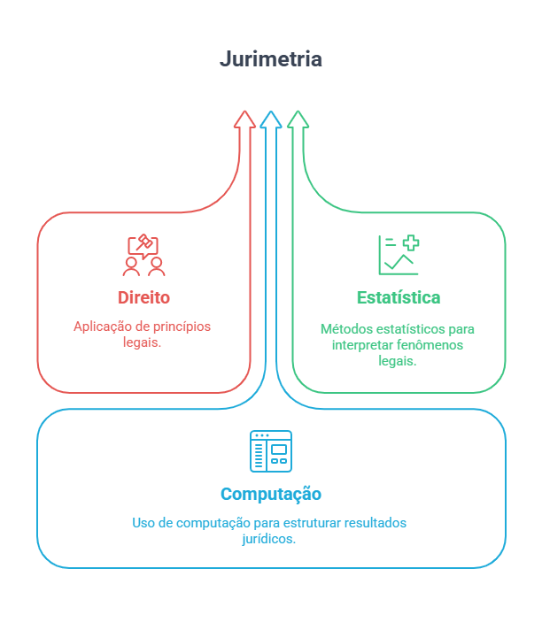{.lightbox fig-align="center" width="100%"}
:::
:::::

Essa capacidade de transformar grandes volumes de informações textuais não padronizadas em conhecimento empírico é o que confere à jurimetria seu caráter verdadeiramente **interdisciplinar**, unindo **Direito, Estatística e Ciência de Dados**.

### Porque estudar Jurimetria?

O uso de informações e pesquisas empíricas no Direito permite desenvolver práticas mais racionais, eficientes e transparentes. Entre as principais finalidades dessa abordagem, destacam-se:

-   **Aperfeiçoamento da gestão judiciária**, mediante o uso de dados para identificar gargalos, otimizar fluxos processuais e orientar decisões administrativas;
-   **Racionalização das decisões judiciais**, favorecendo maior consistência e previsibilidade nos julgamentos;
-   **Compreensão do funcionamento de leis e políticas públicas**, avaliando seus efeitos práticos sobre o sistema de justiça e a sociedade;
-   **Avaliação criteriosa da implementação de normas e políticas**, com base em indicadores objetivos e evidências empíricas.

Além de sua aplicação prática, a jurimetria também contribui para o **desenvolvimento do senso crítico** diante de argumentos causais frequentemente utilizados no cotidiano jurídico. A análise empírica possibilita questionar afirmações do tipo:\
- “A jurisprudência dominante informa que...”,\
- “O comportamento da vítima foi determinante para o desfecho do caso”,\
- “Não há discriminação contra mulheres na carreira da magistratura paulista”,\
- “Juízes seguem o entendimento do Ministério Público”.

Esses exemplos evidenciam a necessidade de examinar, com base em dados e métodos, até que ponto tais alegações se sustentam empiricamente.

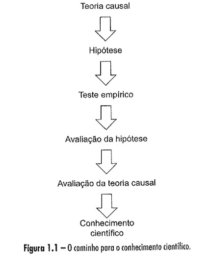{.lightbox fig-align="center" width="70%"}

### O que Jurimetria pode Responder?

A jurimetria pode oferecer evidências que **apoiem a tomada de decisão** e **o aperfeiçoamento institucional**, seja no Judiciário, no Legislativo ou no Executivo. Alguns exemplos ilustram o tipo de questão que a jurimetria pode responder:

{.lightbox fig-align="center" width="100%"}

A jurimetria busca quantificar e **compreender padrões e comportamentos** do sistema de justiça Com isso, oferece uma base empírica para aprimorar o Direito e orientar políticas públicas e reformas mais objetiva e transparente.

### O que IA Pode Fazer?

Na jurimetria, a função da **inteligência artificial** (IA) é automatizar a extração de informações de peças processuais, analisar rapidamente grandes volumes de texto e, até auxiliar na elaboração de documentos jurídicos. A perspectiva é que a IA **apoie a atividade do Direito**, oferecendo suporte e eficiência, mas **não substitua o papel do profissional jurídico**. Assim:

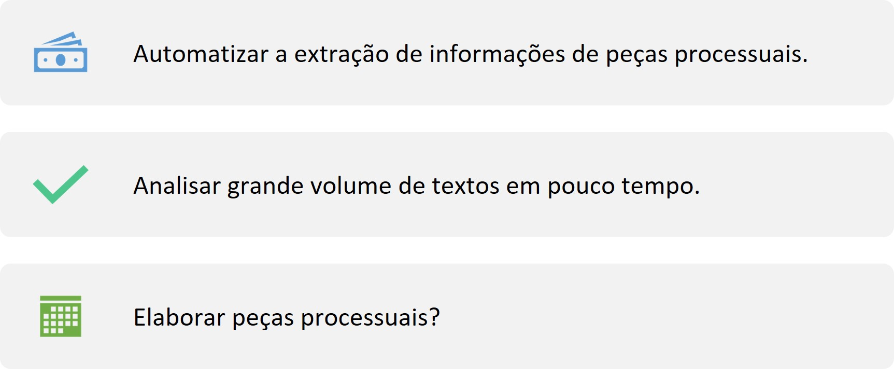{.lightbox fig-align="center" width="100%"}

## Fase 1: Boas Obervações: Coleta e Transformação

### Coleta e Transformação de Dados

A fase de **coleta e transformação** de dados é uma **etapa central** na pesquisa jurimétrica, funcionando como o **alicerce** do trabalho, já que todas as análises posteriores dependem da qualidade e da estruturação desses dados.

Geralmente, a coleta é realizada por meio de consultas aos sites dos tribunais, mas esses acervos não oferecem a totalidade das sentenças e acórdãos, e possivelmente não constituem uma amostra totalmente representativa. Por isso, é fundamental conduzir essa etapa com cautela, rigor e transparência, reconhecendo suas limitações e discutindo como essas incompletudes podem impactar os resultados das pesquisas.

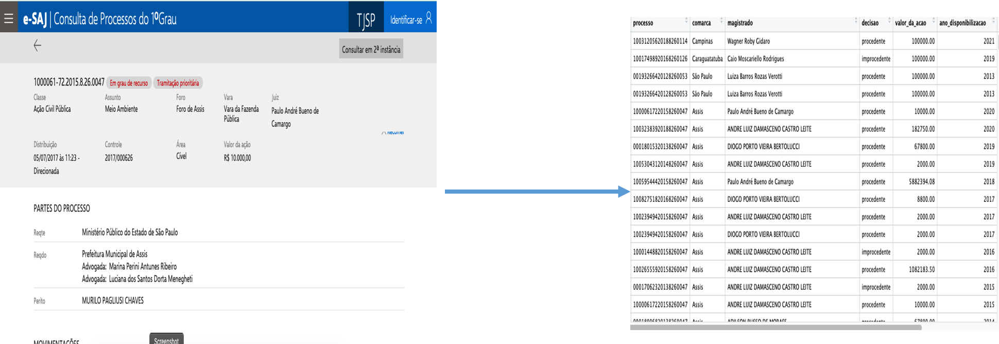{.lightbox fig-align="center" width="100%"}

### Extração com IA

Outra etapa essencial na construção do banco de dados é o uso de **inteligência artificial**. Embora a IA seja poderosa, ela não é totalmente precisa, dependendo da forma como os **textos processuais estão escritos e dos léxicos utilizados**. Pode deixar de identificar termos relevantes ou interpretá-los fora de contexto. Por isso, essa etapa deve ser conduzida com cuidado, incluindo testes em subamostras, para garantir que os prompts retornem as informações desejadas

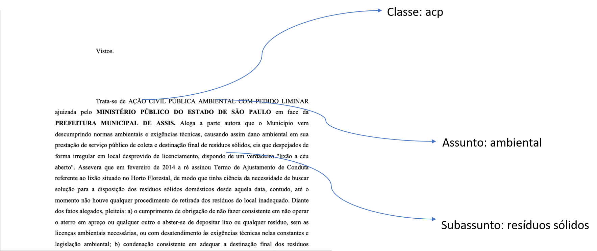{.lightbox fig-align="center" width="100%"}

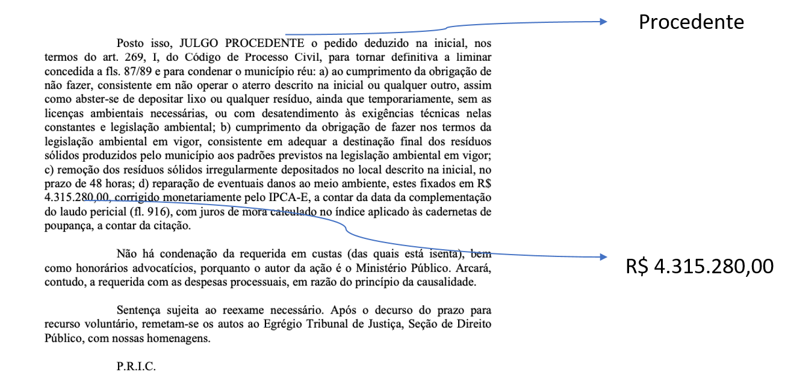{.lightbox fig-align="center" width="100%"}

### Bom conhecimento de programação

O conhecimento de linguagens de programação voltadas à ciência de dados, como `R` e `Python`, é fundamental para coletar, tratar e analisar dados jurídicos. Além disso, é desejável dominar sistemas de gerenciamento de bancos de dados, `SQL` p.ex., pois permite armazenar esses dados de forma eficiente. Por fim, é importante utilizar técnicas de extração e análise de texto, como `NLP` e **expressões regulares**, para explorar e organizar as informações de maneira adequada.

## Fase 2: Explicações

### Teoria do Direito

O **conhecimento** substantivo do **Direito** é fundamental para elaborar perguntas apropriadas, levantar hipóteses e delimitar o escopo de um projeto. Há muitos ramos no direito e dentro desses ramos muitos assuntos:

-   Direito civil
-   Direito penal
-   Direito tributário
-   Direito previdenciário
-   Direito do Trabalho
-   Direito administrativo
-   Direito constitucional

Ter pessoas que entendam bem sobre o tema é fundamental para o sucesso do projeto.

### Bom conhecimento do Direito

Conforme observa Ricardo Feliz, cada esfera do Poder possui seus próprios atos processuais. Os **atos processuais** são o registro formal das **ações dentro de um processo**. Compreender esses atos é fundamental para determinar quando e como coletar as informações dentro da estrutura processual. Algus exemplos de atos processuais no Judiciários são:

-   Sentença; Acórdão; Decisão liminar; Decisão monocrática
-   Petição inicial; Contestação
-   Parecer
-   Documentos probatórios

Ter clareza sobre esses atos permite organizar a coleta de dados de forma precisa e consistente, garantindo que cada informação seja extraída no momento adequado do processo.

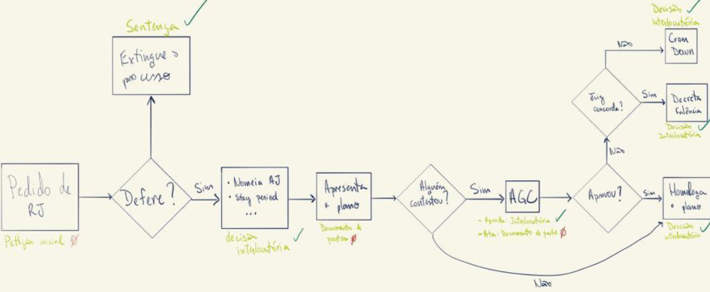{.lightbox fig-align="center" width="100%"}

### Bom Desenho de Projeto

Para elaborar um bom projeto, é essencial seguir uma lógica que conecte problema, hipótese e dados:

-   **Compreender o fenômeno:** identificar claramente o problema existente e entender bem o contexto em que ele ocorre.\
-   **Definir o objetivo da pesquisa:** estabelecer o que se pretende responder sobre o fenômeno.\
-   **Planejar como responder:** determinar quais informações precisam ser coletadas e como serão analisadas para testar a hipótese.

Um bom projeto articula essas etapas de forma coerente, garantindo que cada decisão metodológica esteja alinhada com o problema inicial e a pergunta de pesquisa.

::: callout-warning
### Exemplo

-   Qual o tempo estimado para a apreciação de uma liminar em pedido de despejo?
-   A quantidade e o tipo de droga influenciam o desfecho processual no sentido de condenar por tráfico ou por porte?
-   Decisões monocráticas são mais relevantes que decisões colegiadas no STF?
:::

### Importante!!!

A **avaliação de viabilidade** é uma etapa essencial no desenho de um projeto de pesquisa. Ela busca responder três perguntas básicas:

-   Os dados existem?\
-   Se existem, são acessíveis?\
-   Se são acessíveis, qual a qualidade desses dados?

## Fase 3: Análise das Explicações

### Usando Modelos e Estatística

**Análises descritivas**: resume e organiza os dados para mostrar padrões e distribuições. Abaixo pode-se observar o comportamento de 9.499 julgados com o assunto direito ambiental no TJSP.

Após organizar os dados em tabelas, manteve-se apenas ações civis públicas. Técnicas de processamento de linguagem natural classificaram os desfechos (como procedente, improcedente, acordo, extinção, etc.) e os casos foram agrupados por autor (MP, Defensoria, Executivo e Terceiro Setor) e por faixa de valor da causa. Essa análise permite observar a distribuição dos julgados por desfecho, autor e valor, fornecendo uma visão inicial do comportamento judicial.

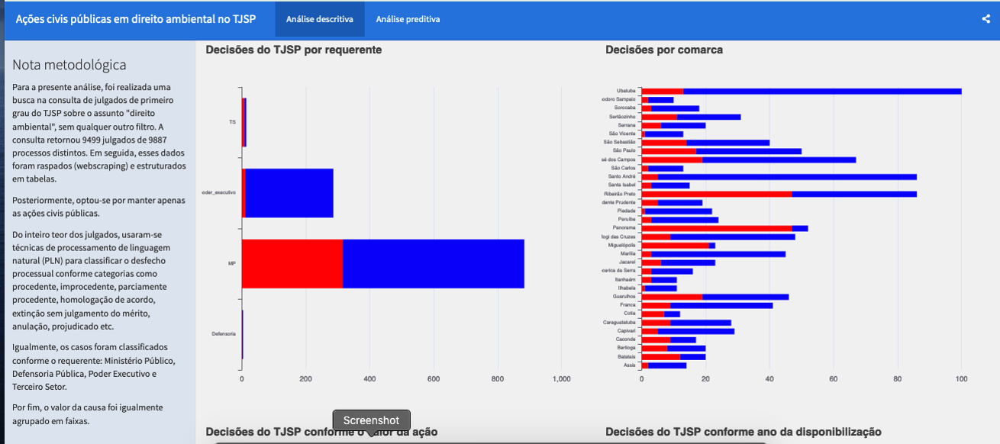{.lightbox fig-align="center" width="100%"}

------------------------------------------------------------------------

**Análises Preditivas**: usa dados e modelos para antecipar resultados futuros.

Na análise preditiva, é possível estimar a probabilidade de uma ação civil pública em Direito Ambiental no TJSP, por exemplo, na comarca de Assis, ser julgada procedente, considerando que o requerente é o Ministério Público.

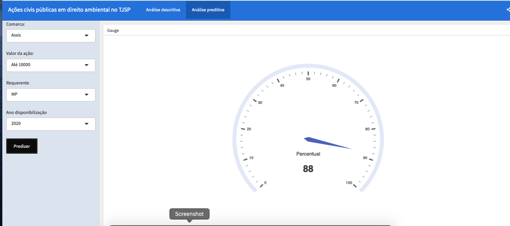{.lightbox fig-align="center" width="100%"}

------------------------------------------------------------------------

**Análises Explicartivas**: investiga relações e/ou causas entre variáveis para entender por que os fenômenos ocorrem.

Neste modelo, busca-se **explicar o diferencial de salário** entre magistrados homens e mulheres, **identificando os determinantes** que efetivamente causam essa diferença. Ou seja, o objetivo é entender por que o diferencial observado ocorre.

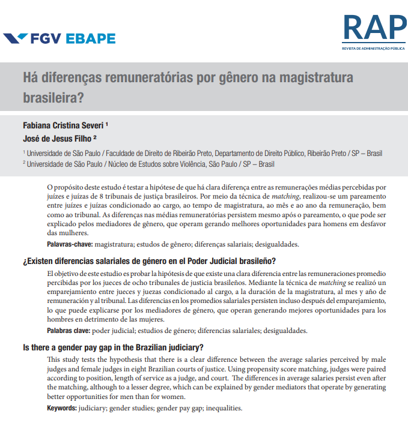{.lightbox fig-align="center" width="100%"}

### Ciclo da Pesquisa

O ciclo da pesquisa nem sempre segue um caminho linear ou fácil; frequentemente é tortuoso. Apesar disso, ele envolve etapas importantes que precisam ser bem fundamentadas e respeitadas, como as que segue:

-   Desenho do projeto;
-   Operacionalização em variáveis mensuráveis;
-   Análise de viabilidade;
-   Coleta;
-   Limpeza e organização dos dados;
-   Transformação dos dados;
-   Análise exploratória;
-   Análise inferencial e preditiva;
-   Métricas de desempenho;
-   Publicação dos resultados.

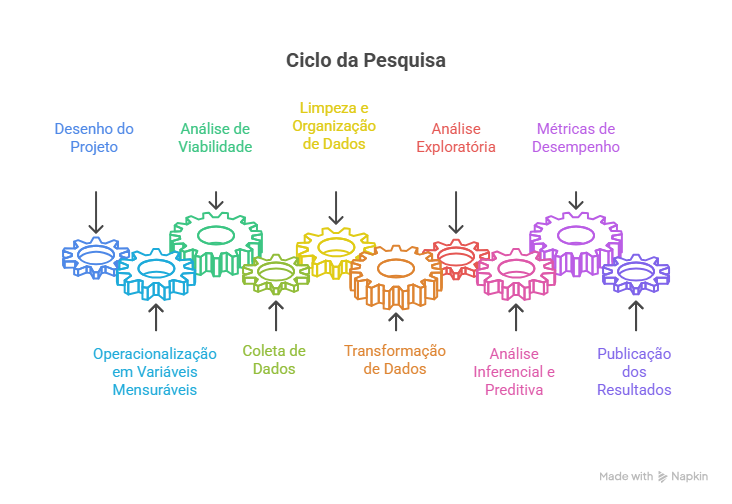{.lightbox fig-align="center" width="100%"}
