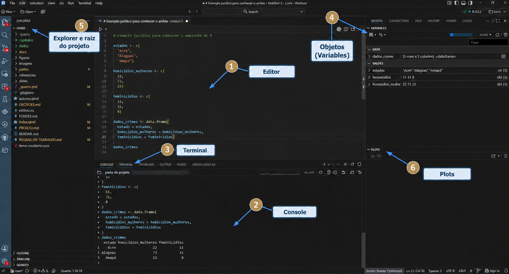

## Introdução

A pesquisa jurimétrica combina perguntas jurídicas, dados, métodos estatísticos e ferramentas computacionais. Para desenvolver esse trabalho de forma transparente e reproduzível, precisamos compreender não apenas alguns comandos, mas também o ambiente no qual os dados, os códigos e os resultados serão organizados.

Neste capítulo, apresentaremos o R e os principais ambientes utilizados para escrever e executar código. O objetivo não é memorizar a posição de cada botão, mas compreender **onde escrevemos, onde executamos e onde encontramos os arquivos, os resultados e a documentação**.

::: {.callout-note title="Objetivos do capítulo"}

Ao final deste capítulo, você deverá ser capaz de:

- explicar a diferença entre R e uma IDE;
- reconhecer as funções do RStudio e do Positron;
- localizar editor, console, terminal, arquivos, gráficos e ajuda;
- distinguir um comando temporário de um código registrado em script;
- criar e executar um primeiro script com um exemplo jurídico;
- consultar a documentação de uma função;
- utilizar a inteligência artificial como apoio, sem substituir a verificação humana.

:::

## Por que utilizar R na jurimetria?

O R é uma linguagem e um ambiente para computação estatística, análise de dados e produção de gráficos. É um software livre, disponível para diferentes sistemas operacionais, cuja funcionalidade pode ser ampliada por meio de pacotes.

Na jurimetria, o R pode ser utilizado para:

- organizar informações extraídas de processos, decisões e outros documentos jurídicos;
- verificar e transformar bases de dados;
- produzir tabelas, gráficos e mapas;
- descrever fenômenos jurídicos e sociais;
- estimar modelos estatísticos;
- registrar procedimentos que possam ser examinados e reproduzidos.

Além dessas aplicações, algumas características ajudam a explicar a ampla utilização do R:

- **Software livre e gratuito:** o R pode ser utilizado em diferentes sistemas operacionais. Como possui código aberto, seu funcionamento e o de seus pacotes podem ser examinados pela comunidade.
- **Linguagem de programação:** o trabalho é registrado em comandos, e não apenas em operações realizadas por meio de menus. Embora isso exija aprendizagem inicial, favorece a exploração, a organização, a memória das atividades e a integração entre diferentes etapas da pesquisa.
- **Gráficos e visualizações:** o R oferece recursos amplos e flexíveis para a construção de gráficos e outras formas de visualização dos dados.
- **Pacotes estatísticos:** diferentes pacotes disponibilizam rotinas para regressão, séries temporais, dados em painel, métodos causais e outras formas de análise.
- **Proximidade com novos métodos:** desenvolvimentos recentes em estatística, econometria e ciência de dados frequentemente recebem implementações em R, o que facilita sua aplicação e avaliação.
- **Documentação e comunidade:** o R possui documentação extensa e uma comunidade numerosa, que produz livros, cursos, fóruns, exemplos e respostas para problemas recorrentes.
- **Integração com outras ferramentas:** o R pode trabalhar de forma integrada com Python, Java, SQL, LaTeX e diferentes formatos de bancos de dados.

::: {.callout-important title="R não é apenas um programa de clicar"}

No R, registramos instruções em código. No início, isso exige aprender uma nova linguagem. Em compensação, o código preserva a sequência da análise, facilita correções e permite repetir o trabalho quando os dados são atualizados.

:::

## R e IDE não são a mesma coisa

O **R** é a linguagem que interpreta e executa os comandos. Uma **IDE**, ou ambiente integrado de desenvolvimento, reúne ferramentas para escrever, executar, inspecionar e organizar esses comandos.

Neste livro, consideraremos principalmente duas IDEs:

- **RStudio**, ambiente consolidado e amplamente utilizado pela comunidade de R;
- **Positron**, ambiente mais recente, com suporte a R e Python e integração com diferentes ferramentas de ciência de dados.

```{mermaid}
%%| fig-align: center
%%| fig-alt: "Relação entre o pesquisador, a IDE, a linguagem R e os produtos de uma pesquisa jurimétrica"

flowchart LR
    A["Pesquisador"] --> B["IDE<br/>RStudio ou Positron"]
    B --> C["Linguagem R"]
    C --> D["Dados jurídicos"]
    C --> E["Tabelas e gráficos"]
    C --> F["Análises"]
    B --> G["Scripts e documentos Quarto"]

    classDef etapa fill:#E8EEF5,stroke:#415A77,stroke-width:2px,color:#233F56;
    classDef resultado fill:#F4E9D7,stroke:#B49A68,stroke-width:2px,color:#233F56;
    class A,B,C,G etapa;
    class D,E,F resultado;
```

É possível ter o R instalado sem possuir uma IDE. Também é possível instalar uma IDE que ainda não consegue localizar uma instalação válida do R. A interface ajuda a trabalhar, mas não substitui a linguagem responsável pela execução dos comandos.

::: {.callout-tip title="Escolha um ambiente para começar"}

Não é necessário aprender RStudio e Positron ao mesmo tempo. Escolha um deles para iniciar. Depois de compreender a relação entre editor, console e arquivos, a transição entre as interfaces se torna mais simples.

:::

## Componentes do ambiente de trabalho

Apesar das diferenças visuais, RStudio e Positron possuem componentes com funções semelhantes.

{#fig-positron-ambiente .lightbox fig-align="center" width="100%" fig-alt="Captura da interface do Positron com seis marcações: 1, Editor, na região central superior; 2, Console, na região central inferior; 3, Terminal, na aba ao lado do Console; 4, Objetos ou Variables, no painel superior direito; 5, Explorer e raiz do projeto, na barra lateral esquerda; e 6, Plots, no painel inferior direito."}

A [Figura @fig-positron-ambiente] apresenta uma possível organização da interface. O **Explorer** mostra a raiz e os arquivos do projeto; o **Editor** contém o código; o **Console** apresenta sua execução; a aba **Terminal** dá acesso aos comandos do sistema; o painel **Variables** reúne os objetos da sessão; e o painel **Plots** recebe os gráficos produzidos.

### Editor

O **editor** é o local em que escrevemos e salvamos scripts, documentos Quarto e outros arquivos de texto. O código permanece registrado no arquivo e pode ser revisado, compartilhado e executado novamente.

### Console

O **console** mantém uma sessão ativa do R. Nele executamos comandos e observamos resultados, mensagens, avisos e erros. Quando está pronto para receber uma instrução, normalmente apresenta o símbolo `>`.

Um cálculo simples pode ser executado diretamente no console:

```{r}
2 + 2
```

O console é útil para testes rápidos, mas não deve ser o único registro da análise.

### Terminal

O **terminal** envia comandos ao sistema operacional. Ele pode ser utilizado para navegar entre pastas, executar programas e trabalhar com Git.

| Local | Interpreta principalmente | Exemplo de uso |
|---|---|---|
| Console do R | linguagem R | calcular uma média ou inspecionar um objeto |
| Terminal | comandos do sistema | consultar o estado de um repositório Git |

::: {.callout-warning title="Observe onde o comando será executado"}

Um comando do R inserido no terminal pode produzir erro, assim como um comando do sistema inserido no console do R. Antes de executar, verifique qual painel está ativo.

:::

### Arquivos, objetos, gráficos e ajuda

As IDEs também permitem:

- navegar pelos arquivos do projeto;
- observar objetos existentes na sessão;
- visualizar bases, tabelas e gráficos;
- instalar e carregar pacotes;
- consultar a documentação;
- acompanhar mensagens e problemas do código.

A posição desses componentes pode variar. O importante é compreender a função de cada um, e não memorizar uma disposição específica da tela.

No arranjo tradicional do RStudio, esses recursos aparecem distribuídos em quatro áreas principais:

1. o editor de scripts, normalmente localizado na parte superior esquerda;
2. o console, geralmente apresentado na parte inferior esquerda;
3. o ambiente e o histórico de comandos, localizados na parte superior direita;
4. os arquivos, gráficos, pacotes e a ajuda, reunidos na parte inferior direita.

Essa distribuição ajuda a compreender as funções do ambiente, mas não constitui uma regra geral. A posição dos componentes pode ser modificada no próprio RStudio e é diferente em outras IDEs, como o Positron. O mais importante é reconhecer a função de cada componente.

## Console ou script?

O console é adequado para uma verificação rápida. O **script** é o arquivo em que registramos o código que deverá ser compreendido e executado novamente.

```{mermaid}
%%| fig-align: center
%%| fig-alt: "Fluxo entre escrever no script, executar no console, observar o resultado e corrigir o script"

flowchart LR
    A["Escrever no script"] --> B["Executar no console"]
    B --> C["Observar resultado ou erro"]
    C --> D["Corrigir no script"]
    D --> B
    C --> E["Salvar a versão compreendida"]

    classDef etapa fill:#E8EEF5,stroke:#415A77,stroke-width:2px,color:#233F56;
    class A,B,C,D,E etapa;
```

::: {.callout-important title="O histórico do console não substitui o script"}

O histórico pode conter tentativas incompletas, comandos incorretos e operações que não fazem parte da análise final. O script deve registrar a sequência revisada do trabalho.

:::

## Primeiro contato com um exemplo jurídico

Utilizaremos ao longo dos próximos capítulos dados sobre homicídios de mulheres e feminicídios nos estados brasileiros. Neste primeiro contato, trabalharemos apenas com três estados para observar o percurso entre editor e console.

Crie um arquivo chamado `primeiros_passos.R` e registre:

```{r}
# Dados ilustrativos de três estados brasileiros

estados <- c("Acre", "Alagoas", "Amapá")
homic_abs <- c(22, 73, 22)
feminic_abs <- c(11, 31, 8)

dados_crimes <- data.frame(
  estado = estados,
  homicidios_mulheres = homic_abs,
  feminicidios = feminic_abs
)

dados_crimes
```

Esse exemplo já apresenta alguns elementos que serão estudados posteriormente:

- `<-` atribui um valor a um objeto;
- `c()` reúne valores em um vetor;
- textos são delimitados por aspas;
- `data.frame()` reúne vetores em uma estrutura tabular;
- nomes claros ajudam a compreender o conteúdo de cada objeto;
- linhas iniciadas por `#` são comentários e não são executadas.

Neste momento, não é necessário dominar todos esses elementos. O objetivo é salvar o código no editor, executar uma linha de cada vez e observar o que aparece no console e no ambiente de objetos.

## Mensagens, avisos e erros

Ao executar um código, o R pode apresentar:

- **resultado:** resposta produzida pelo comando;
- **mensagem:** informação fornecida por uma função ou pacote;
- **aviso:** indicação de que o comando terminou, mas algo merece atenção;
- **erro:** indicação de que a operação não pôde ser concluída.

::: {.callout-warning title="Leia a mensagem antes de tentar novamente"}

Procure identificar a linha em que ocorreu o problema, o objeto ou a função mencionada e possíveis erros de digitação. Verifique também se faltam aspas, vírgulas ou parênteses e se o comando está sendo executado no local correto.

Mensagens de erro fazem parte da programação e podem orientar a correção do código.

:::

## Ajuda e documentação

Não é necessário memorizar todas as funções. É necessário aprender a consultar a documentação.

Para abrir a ajuda de uma função, podemos utilizar:

```r
help.start()
```

`help.start()` abre a página inicial da documentação do R. Quando conhecemos o nome da função, podemos consultar sua página com `help()` ou com o operador `?`:

```r
help(summary)
```

ou:

```r
?summary
```

Para executar exemplos fornecidos pela documentação:

```r
example(summary)
```

A função `example()` executa os exemplos incluídos na documentação.

Uma página de ajuda normalmente informa o objetivo da função, sua forma de uso, os argumentos aceitos, o tipo de resultado produzido e exemplos.

::: {.callout-tip title="Leia primeiro Usage e Arguments"}

Ao encontrar uma função desconhecida, observe como ela é chamada, identifique seus argumentos, verifique o que retorna e execute um exemplo pequeno antes de adaptá-la ao seu trabalho.

:::

## Inteligência artificial como apoio

Ferramentas de inteligência artificial podem ajudar a explicar uma mensagem de erro, comentar um trecho de código, sugerir uma função ou tornar uma explicação mais clara. Elas também podem apoiar a organização dos arquivos e a documentação das decisões tomadas durante a pesquisa.

Esse apoio não elimina a responsabilidade do pesquisador. Uma sugestão pode utilizar uma função inexistente, confundir versões de um pacote, interpretar incorretamente a estrutura dos dados ou produzir um código que executa sem responder adequadamente à pergunta jurídica.

Antes de incorporar uma sugestão de IA:

1. identifique claramente o problema que deseja resolver;
2. leia e compreenda o código proposto;
3. consulte a documentação da função;
4. teste o código com um exemplo pequeno;
5. confira o resultado à luz dos dados e da pergunta de pesquisa;
6. registre no script a versão que foi efetivamente validada.

::: {.callout-important title="A validação continua sendo humana"}

A inteligência artificial pode contribuir para a pesquisa, mas não deve decidir sozinha quais dados utilizar, como interpretar uma variável ou quais conclusões jurídicas podem ser extraídas dos resultados.

:::

## Síntese

Neste capítulo, diferenciamos a linguagem R das interfaces utilizadas para trabalhar com ela. Identificamos as funções do editor, do console e do terminal, criamos um primeiro script com dados jurídicos e discutimos o papel da documentação e da inteligência artificial.

Nos capítulos seguintes, organizaremos esse trabalho dentro de um projeto reproduzível e aprofundaremos a representação e a manipulação dos dados no R.

::: {.callout-tip title="Antes de avançar"}

- [ ] Consigo explicar a diferença entre R e IDE?
- [ ] Sei onde escrever e salvar o código?
- [ ] Distingo console do R e terminal?
- [ ] Consigo executar uma linha de um script?
- [ ] Sei localizar a documentação de uma função?
- [ ] Sei por que uma sugestão de IA precisa ser verificada?

:::
