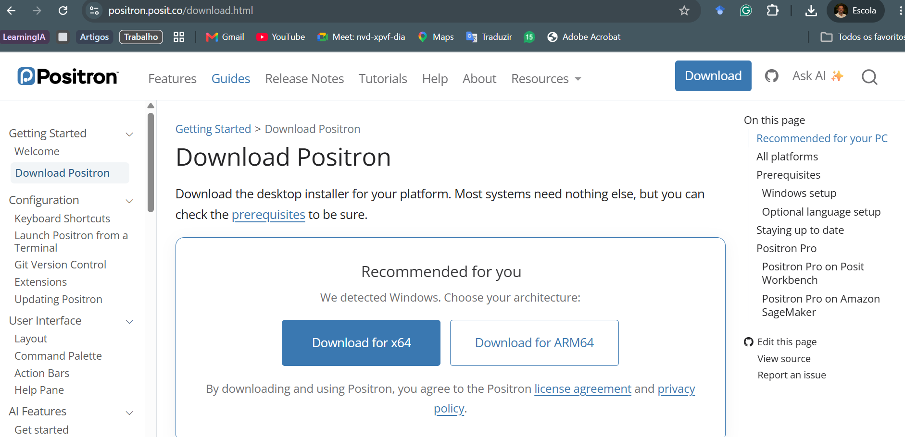
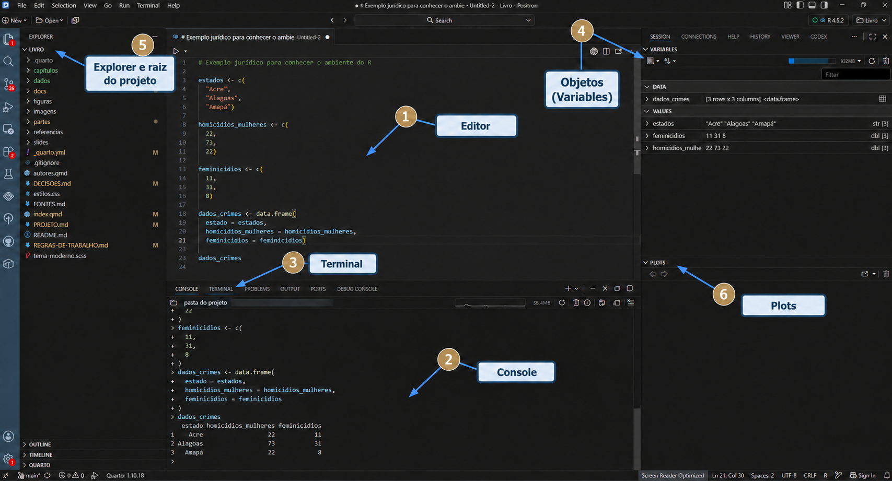
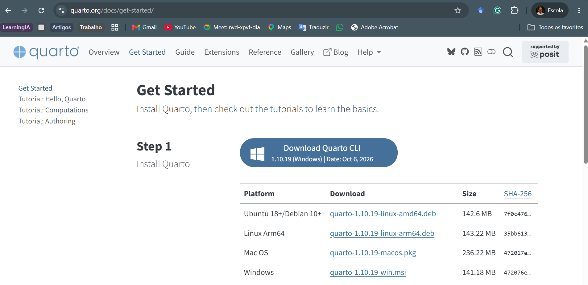

## Objetivos da aula

- distinguir linguagem, IDE e sistema de publicação;
- reconhecer os componentes do Positron;
- selecionar R ou Python;
- criar um ambiente virtual de Python;
- instalar e verificar o Quarto;
- renderizar um documento `.qmd` mínimo.

## Três funções diferentes

| Componente | Função |
|---|---|
| R ou Python | interpretar e executar o código |
| Positron | organizar arquivos, sessões e execução |
| Quarto | transformar a fonte em documento de leitura |

Uma IDE não substitui as linguagens. O Quarto não substitui o editor nem o interpretador.

## Instalação do Positron {.secao background-color="#071739"}

## Download no Windows

{fig-align="center" width="92%"}

Em computadores usuais com processador Intel ou AMD, utilize **Windows x64**. ARM64 deve ser escolhida apenas para essa arquitetura.

## Procedimento de instalação

1. Baixe o instalador na [página oficial](https://positron.posit.co/download.html).
2. Execute o arquivo.
3. Mantenha a opção de incluir `positron` no `PATH`.
4. Conclua a instalação.
5. Abra o Positron.

No terminal, a versão pode ser verificada com:

```powershell
positron --version
```

## Abrindo a pasta de trabalho

Use **File > Open Folder** e selecione a pasta principal do projeto.

A pasta aberta aparece no topo do Explorer e passa a funcionar como referência para:

- caminhos relativos;
- terminal integrado;
- controle de versões;
- agentes que examinam o projeto.

Abrir a pasta principal é diferente de abrir apenas um arquivo isolado.

## Componentes do Positron

{fig-align="center" width="96%"}

## Explorer e editor

**Explorer**

- mostra pastas e arquivos;
- identifica a raiz do projeto;
- altera arquivos reais do computador.

**Editor**

- contém scripts e documentos salvos;
- preserva a sequência do trabalho;
- permite revisar antes de executar.

## Console e terminal

| Local | Recebe | Exemplo |
|---|---|---|
| Console R | código R | `mean(c(1, 2, 3))` |
| Console Python | código Python | `sum([1, 2, 3])` |
| Terminal | comandos do sistema | `python --version` |

O console mantém uma sessão da linguagem. O terminal executa programas e comandos do sistema operacional.

## Objetos e gráficos

O painel **Variables** permite inspecionar objetos existentes na sessão.

O painel **Plots** recebe gráficos produzidos pelo código.

Esses painéis facilitam a inspeção, mas não substituem o registro das operações nos scripts.

## Seleção de R e Python {.secao background-color="#071739"}

## Qual interpretador está ativo?

No console de R:

```r
R.version.string
```

No console de Python:

```python
import sys
print(sys.executable)
print(sys.version)
```

Se houver mais de uma instalação, selecione explicitamente aquela que pertence ao projeto.

## Gerenciamento do Python com `uv`

O `uv` administra para cada projeto:

- a versão do Python;
- os pacotes necessários;
- a resolução exata das dependências;
- o ambiente local reconstruível.

O aluno não precisa criar ou ativar manualmente um ambiente com `venv`.

::: {.callout-note title="`uv` e `.venv`"}
`uv` é o gerenciador utilizado pelo projeto. `.venv` é somente a pasta local criada e administrada por ele. Sua presença não representa o uso do procedimento manual com `python -m venv`.

O Jupyter também será instalado pelo `uv` para permitir a execução futura de blocos Python em documentos Quarto.
:::

## Instalação do `uv`

No terminal integrado:

```powershell
winget install --id=astral-sh.uv -e
```

Reinicie completamente o Positron e verifique:

```powershell
uv --version
```

O `uv` é instalado uma vez no Windows e pode ser utilizado em todos os projetos.

## Antes de configurar o projeto

Abra **Terminal > New Terminal** e confirme:

```powershell
Get-Location
```

O resultado deve ser a raiz do projeto, não `C:\Windows\System32` ou outra pasta do sistema.

## Configuração do projeto

```powershell
uv init --bare
uv python pin 3.14
uv sync
```

- `init` cria a configuração mínima;
- `pin` registra Python 3.14;
- `sync` cria ou atualiza o ambiente.

## Arquivos do `uv`

| Elemento | Função |
|---|---|
| `pyproject.toml` | dependências do projeto |
| `.python-version` | versão de Python |
| `uv.lock` | versões exatas resolvidas |
| `.venv/` | ambiente local reconstruível |

Os três primeiros acompanham o projeto. `.venv/` permanece no `.gitignore`.

## Execução sem ativação manual

```powershell
uv run python --version
uv run python -c "import sys; print(sys.executable)"
```

`uv run` utiliza automaticamente o ambiente correto. Não é necessário executar `Activate.ps1`.

{fig-align="center" width="66%"}

## Sessão Python no Positron

1. Abra a Paleta de Comandos com `Ctrl + Shift + P`.
2. Execute **Interpreter: Discover All Interpreters**.
3. Execute **Interpreter: Start New Console Session**.
4. Selecione a `.venv` do projeto.

{fig-align="center" width="92%"}

## O que entra no Git?

O arquivo `.gitignore` deve conter:

```gitignore
.venv/
```

A `.venv` é reconstruível e permanece no computador. `pyproject.toml`, `.python-version` e `uv.lock` devem ser preservados para que outra pessoa execute `uv sync`.

## Quarto {.secao background-color="#071739"}

## O que é o Quarto?

O Quarto combina:

- prosa e referências;
- equações, tabelas e figuras;
- código executável e seus resultados.

O arquivo-fonte possui extensão `.qmd`. A renderização produz HTML, PDF, Word, slides ou livros.

## Instalação do Quarto

{fig-align="center" width="92%"}

Baixe o instalador `.msi`, conclua o assistente e reabra o terminal.

## Verificação do Quarto

```powershell
quarto --version
quarto check
```

O primeiro comando informa a versão. O segundo examina o Quarto e as integrações disponíveis.

{fig-align="center" width="92%"}

## Quando o Jupyter é necessário?

A sessão Python do Positron não exige uma instalação separada do Jupyter.

O Jupyter é necessário quando o **Quarto executa blocos Python durante a renderização**. Se o documento utiliza somente R, essa instalação não é necessária.

## Jupyter administrado pelo `uv`

```powershell
uv add --dev jupyter
uv run python -m jupyter --version
```

{fig-align="center" width="92%"}

## Verificação pelo Quarto

```powershell
uv run quarto check jupyter
```

O resultado deve mostrar:

- o interpretador dentro de `.venv`;
- a instalação do Python localizada;
- o Jupyter disponível.

## Primeiro documento Quarto {.secao background-color="#071739"}

## Cabeçalho e texto

Crie `exemplo.qmd`:

````markdown
---
title: "Exemplo jurídico"
format: html
---

## Uma tabela simples

O documento combina texto, código e resultado.
````

O bloco inicial é o YAML e deve começar na primeira linha.

## Bloco de código

````markdown
```r
estados <- c("Acre", "Alagoas", "Amapá")
feminicidios <- c(11, 31, 8)

data.frame(
  estado = estados,
  feminicidios = feminicidios
)
```
````

## Renderização

No terminal, na pasta do arquivo:

```powershell
quarto render exemplo.qmd
```

Em um arquivo isolado, o HTML tende a aparecer ao lado da fonte. Em um projeto, `_quarto.yml` pode definir outro destino, como `docs/`.

## Fonte e produto

| Arquivo | Natureza | Conduta |
|---|---|---|
| `exemplo.qmd` | fonte | escrever, revisar e preservar |
| `exemplo.html` | resultado | abrir para leitura e verificação |
| `exemplo_files/` | dependências geradas | manter quando o HTML depender dela |

Não edite diretamente o HTML. A próxima renderização pode substituir a alteração.

## Erros frequentes

**YAML inválido:** existe conteúdo antes do primeiro `---`.

**Arquivo não encontrado:** o caminho relativo não corresponde à raiz da renderização.

**Linguagem ou pacote ausente:** o Quarto utiliza outro R ou outro ambiente Python.

Leia primeiro a mensagem que identifica o arquivo, a linha ou o bloco responsável.

## Verificação final {.exemplo background-color="#A1C2BB"}

- [ ] A raiz correta está aberta no Explorer?
- [ ] Distingo editor, console e terminal?
- [ ] Sei qual R ou Python está ativo?
- [ ] `uv --version` funciona no terminal do Positron?
- [ ] `uv run python --version` informa Python 3.14?
- [ ] `.venv/` está no `.gitignore`?
- [ ] `pyproject.toml`, `.python-version` e `uv.lock` estão preservados?
- [ ] `quarto --version` e `quarto check` funcionam?
- [ ] Sei distinguir `.qmd` de `.html`?

