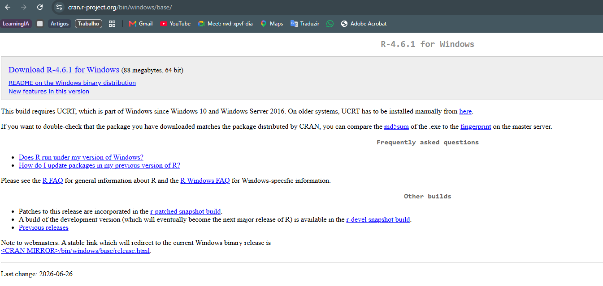
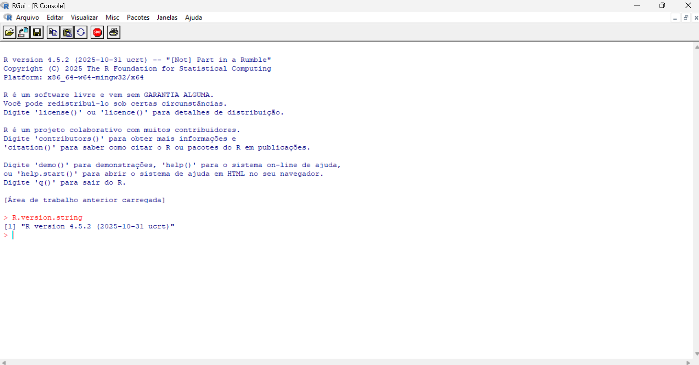
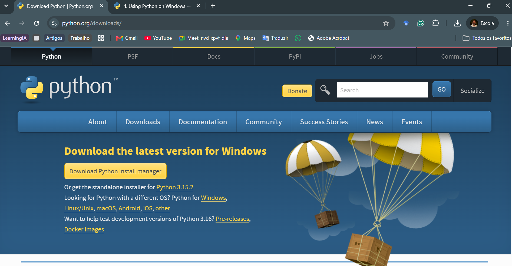
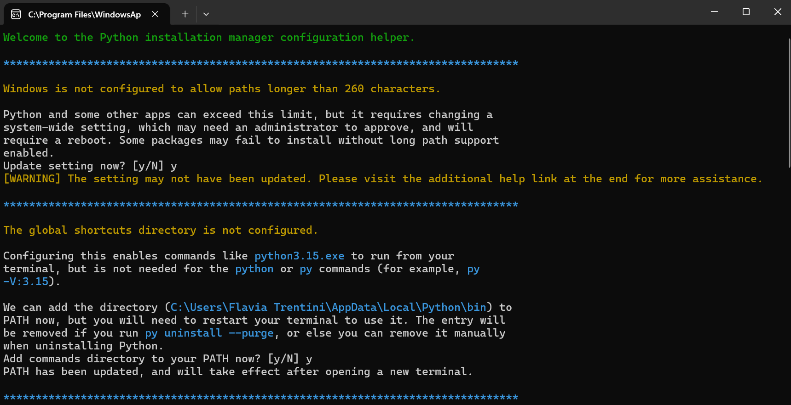
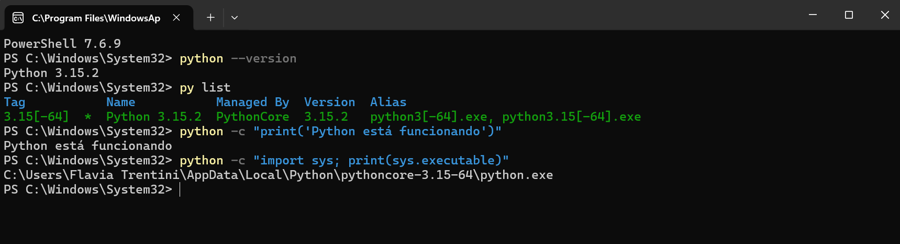

## O percurso da Parte II

Nesta parte, construiremos um ambiente no qual os dados, os códigos, os documentos e o histórico da pesquisa permanecem relacionados.

1. R e Python: linguagens
2. Positron e Quarto: trabalho e documentos
3. Git e GitHub: versões e colaboração
4. Codex e Claude Code: apoio supervisionado
5. Exemplo integrado: criação de um projeto jurídico

## Uma pesquisa é um projeto

A pesquisa jurimétrica articula:

- uma pergunta jurídica;
- documentos e dados;
- procedimentos de coleta e tratamento;
- códigos e resultados;
- interpretações e decisões metodológicas.

As ferramentas registram e executam esse percurso. Elas não formulam a pergunta nem validam os resultados.

## O ecossistema de trabalho

{fig-align="center" width="92%"}

## Funções dos componentes

| Componente | Função |
|---|---|
| R | organizar, transformar, analisar e representar dados |
| Python | apoiar coleta, extração, automação e análise |
| Positron | reunir edição, execução, terminal, arquivos e resultados |
| Quarto | combinar texto, código e resultados |
| Git e GitHub | registrar versões e apoiar a colaboração |
| Agentes | auxiliar em tarefas delimitadas pelos pesquisadores |

## O livro como exemplo

O Livro de Jurimetria integra capítulos, imagens, dados, códigos e referências em uma estrutura comum.

- O Quarto converte os arquivos-fonte em páginas.
- R e Python executam procedimentos.
- O Positron reúne os componentes do projeto.
- Git e GitHub registram versões e colaboração.
- Os agentes auxiliam sob supervisão dos autores.

## Objetivos desta aula

Ao final, você deverá ser capaz de:

- explicar as funções gerais de R e Python;
- compreender por que as duas linguagens podem coexistir;
- instalar as duas linguagens no Windows;
- identificar as versões instaladas;
- executar um teste mínimo em cada linguagem.

## Linguagens registram procedimentos

Uma linguagem permite expressar instruções que o computador executará.

O código pode importar dados, transformar variáveis, extrair informações, produzir tabelas ou estimar modelos. Como as instruções ficam registradas, outras pessoas podem examiná-las e executá-las novamente.

## Duas linguagens no mesmo projeto

| Linguagem | Ênfase | Exemplos |
|---|---|---|
| R | estatística e dados | transformar bases, produzir gráficos e estimar modelos |
| Python | automação e uso geral | coletar documentos, processar textos e automatizar tarefas |

A divisão depende do problema, das bibliotecas disponíveis, do conhecimento da equipe e da manutenção do projeto.

## R: linguagem para dados e estatística {.secao background-color="#071739"}

## O que é o R?

R é uma linguagem e um ambiente para:

- computação estatística;
- análise de dados;
- produção de gráficos;
- construção de procedimentos reproduzíveis.

É um software livre e pode ser ampliado por pacotes.

## R na pesquisa jurimétrica

R pode ser utilizado para:

- organizar informações extraídas de documentos jurídicos;
- verificar e transformar bases de dados;
- produzir tabelas, gráficos e mapas;
- descrever fenômenos jurídicos e sociais;
- estimar modelos estatísticos.

## R básico e pacotes

A instalação contém funções básicas. Os pacotes acrescentam funções e documentação para tarefas específicas.

```r
# Executado normalmente uma vez
install.packages("dplyr")

# Executado em cada nova sessão
library(dplyr)
```

Instalar transfere o pacote para o computador. Carregar disponibiliza suas funções na sessão atual.

## Instalação do R no Windows

1. Acesse [R for Windows](https://cran.r-project.org/bin/windows/base/).
2. Baixe a versão estável.
3. Execute o instalador.
4. Mantenha as opções sugeridas, salvo orientação institucional.
5. Conclua a instalação.
6. Reabra programas e terminais que já estavam em execução.

## Página oficial do R

{fig-align="center" width="92%"}

## Quem já possui R

Verifique primeiro a versão ativa:

```r
R.version.string
```

Compare o resultado com a versão estável indicada pelo CRAN. Mantenha temporariamente a versão anterior até confirmar o funcionamento dos pacotes necessários.

## A biblioteca ativa

```r
.libPaths()
```

O comando mostra as pastas nas quais R procura os pacotes.

```r
"dplyr" %in% rownames(installed.packages())
```

O resultado `TRUE` indica que o pacote está disponível em alguma biblioteca ativa.

## Biblioteca pessoal no Windows

O Windows protege a biblioteca localizada em `Program Files`. Se R perguntar se deve utilizar uma biblioteca pessoal, responda **Sim**.

Os pacotes serão instalados na pasta do usuário, sem necessidade de executar R como administrador.

## Pacotes de uma versão anterior

Na versão anterior, registre os pacotes adicionais:

```r
pacotes <- as.data.frame(installed.packages())
meus_pacotes <- pacotes$Package[is.na(pacotes$Priority)]
writeLines(sort(unique(meus_pacotes)),
           file.path(path.expand("~"),
                     "pacotes-versao-anterior.txt"))
```

## Reinstalação na versão nova

```r
arquivo <- file.path(path.expand("~"),
                     "pacotes-versao-anterior.txt")

meus_pacotes <- readLines(arquivo)
pacotes_faltantes <- setdiff(
  meus_pacotes,
  rownames(installed.packages())
)

if (length(pacotes_faltantes) > 0) {
  install.packages(pacotes_faltantes)
}
```

O procedimento instala versões atuais dos pacotes. Pacotes provenientes de outras fontes exigem seus procedimentos próprios.

## Verificação do R

```r
R.version.string

mensagem <- "R está funcionando"
print(mensagem)
```

{fig-align="center" width="72%"}

## Quando R não é localizado

A instalação oficial não adiciona R ao `PATH` por padrão.

R pode abrir normalmente pelo menu Iniciar e ainda não ser localizado por outra ferramenta. Nesse caso:

```r
R.home()
```

O comando informa a pasta da instalação ativa. A seleção dessa instalação no Positron será apresentada na próxima aula.

## Python: linguagem de uso geral {.secao background-color="#071739"}

## O que é Python?

Python pode apoiar:

- coleta de arquivos;
- comunicação com serviços;
- extração de informações;
- processamento de textos;
- automação de tarefas;
- análise de dados.

As dependências de cada projeto serão isoladas em um ambiente virtual na aula sobre Positron.

## Instalação do Python no Windows

1. Acesse [python.org/downloads](https://www.python.org/downloads/).
2. Abra o instalador com dois cliques.
3. Autorize a execução no Windows.
4. Mantenha as opções recomendadas.
5. Aceite a inclusão dos comandos no `PATH`.
6. Aguarde a confirmação da instalação.

O terminal será utilizado somente depois, para verificar o resultado.

## Página oficial do Python

{fig-align="center" width="92%"}

## Python Install Manager

{fig-align="center" width="92%"}

Depois de qualquer alteração no `PATH`, feche e abra novamente o terminal.

## Verificação do Python

```powershell
python --version
py list
python -c "print('Python está funcionando')"
python -c "import sys; print(sys.executable)"
```

O último comando identifica o executável que respondeu ao comando `python`.

## Resultado esperado

{fig-align="center" width="92%"}

## Quando Python não é localizado

1. Feche e reabra o terminal.
2. Confirme a conclusão do Python Install Manager.
3. Execute `py list` para identificar as versões conhecidas.
4. Consulte a documentação oficial antes de alterar manualmente variáveis do sistema.

Instalações antigas podem fazer com que `python` e `py` apontem para versões diferentes.

## Como distribuir as tarefas

Uma organização possível utiliza Python para obter ou extrair informações e R para estruturar a base, realizar análises estatísticas e produzir resultados.

A divisão deve considerar:

- a natureza da tarefa;
- as bibliotecas disponíveis;
- a experiência da equipe;
- a manutenção e a reprodução do código.

## Antes da próxima aula {.exemplo background-color="#A1C2BB"}

- [ ] Consigo explicar as funções gerais de R e Python?
- [ ] Instalei R a partir da página oficial?
- [ ] `R.version.string` informa a versão esperada?
- [ ] `python --version` identifica uma versão instalada?
- [ ] `py list` mostra os interpretadores conhecidos?
- [ ] Os testes mínimos funcionam?

